# Awesome Claude Fable Games

[](https://awesome.re)    [](LICENSE)

### ▶ [Play all of these in your browser → vibegamer.io](https://vibegamer.io?utm_source=github&utm_medium=readme&utm_campaign=awesome-claude-fable-games)

<a href="https://vibegamer.io?utm_source=github&utm_medium=readme&utm_campaign=awesome-claude-fable-games">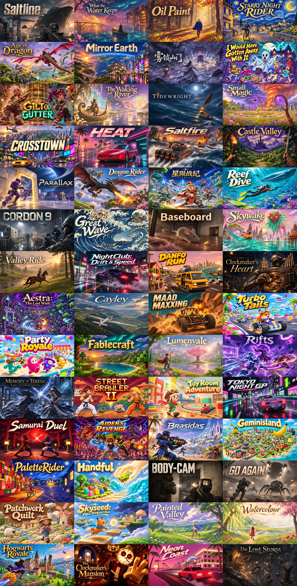</a>

A curated list of **games made with AI coding models**, most of them with Claude Fable 5.2, Anthropic's model released on November 9, 2026: browser games you can play right now, Unreal and Roblox projects, and one-prompt experiments. Each game names the model its maker says they used. Every game is credited to its maker and linked to the post where they shared it. Where the maker published the prompt, it's copied here word for word.

**144 games · 133 playable in the browser · 5 with prompts** · Updated 2026-11-23

Most games also have a page on **[vibegamer.io](https://vibegamer.io?utm_source=github&utm_medium=readme&utm_campaign=awesome-claude-fable-games)** with its trailer, screenshots and a play button. Games made with other AI models (GPT, Gemini, Grok…) are in **[awesome-ai-games](https://github.com/ummydev/awesome-ai-games)**.

More from Claude: **[awesome-claude-fable-videos](https://github.com/ummydev/awesome-claude-fable-videos)** (films and 3D worlds) and **[awesome-claude-motion-video](https://github.com/ummydev/awesome-claude-motion-video)** (launch films and motion graphics made with Opus 5.5).

## Contents

- [All games](#all-games)
- [Games](#games)
- [How we pick and score](#how-we-pick-and-score)
- [Add a game](#add-a-game)
- [Credits and removal](#credits-and-removal)

## All games

Sorted by our score, then by likes on the original post.

| | Game | Maker | Model | Play | VibeGamer | Post | Likes | Prompt | Score |
|---|---|---|---|---|---|---|---|---|---|
| <a href="#saltline">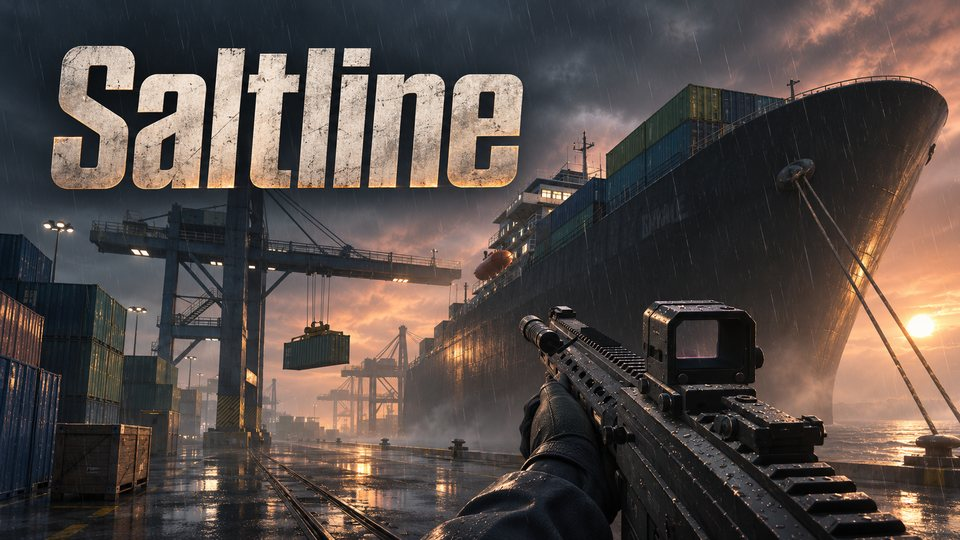</a> | **[Saltline](#saltline)** | [Felix Rieseberg](https://x.com/felixrieseberg) | Claude Fable 5.2 | [▶ Play URL](https://claude.ai/artifact/BGY1SztrAYcJQHSsnHHGmp) | [page](https://vibegamer.io/game/saltline?utm_source=github&utm_medium=readme&utm_campaign=awesome-claude-fable-games) | [X](https://x.com/felixrieseberg/status/2119925633564463609) | 13.6K | ✓ | 10/10 |
| <a href="#what-the-water-keeps">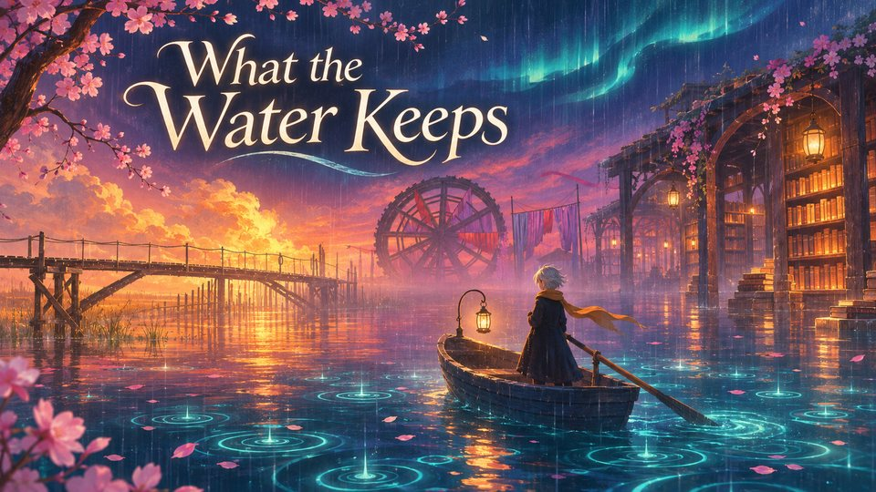</a> | **[What the Water Keeps](#what-the-water-keeps)** | [Kevin Ngo](https://x.com/kevin_t_ngo) | Claude Fable 5.2 | [▶ Play URL](https://what-the-water-keeps.vercel.app/) | [page](https://vibegamer.io/game/what-the-water-keeps?utm_source=github&utm_medium=readme&utm_campaign=awesome-claude-fable-games) | [X](https://x.com/kevin_t_ngo/status/2119868968307695818) | 4.1K |  | 9/10 |
| <a href="#oil-paint">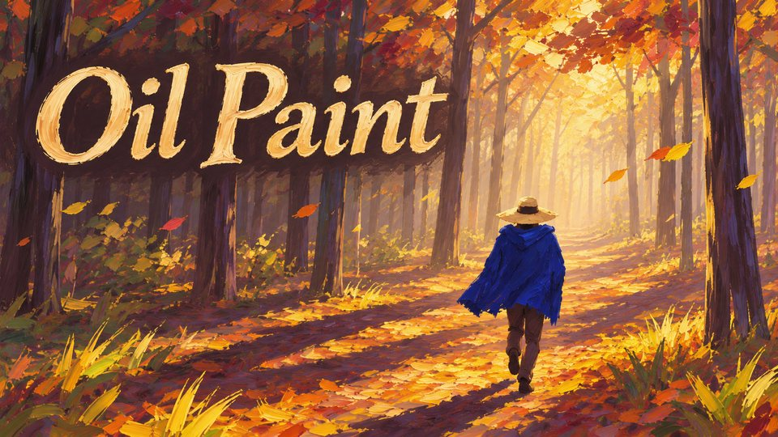</a> | **[Oil Paint](#oil-paint)** | [Blendi](https://x.com/BlendiByl) | Claude Fable 5.2 | [▶ Play URL](https://patch.gg/blendi/oil-paint) | [page](https://vibegamer.io/game/oil-paint?utm_source=github&utm_medium=readme&utm_campaign=awesome-claude-fable-games) | [X](https://x.com/BlendiByl/status/2120341251178594532) | 4K |  | 9/10 |
| <a href="#starry-night-rider"></a> | **[Starry Night Rider](#starry-night-rider)** | [Ebby Amir](https://x.com/ebbyamir) | Claude Fable 5.2 | [▶ Play URL](https://starrynightrider.com) | [page](https://vibegamer.io/game/starry-night-rider?utm_source=github&utm_medium=readme&utm_campaign=awesome-claude-fable-games) | [X](https://x.com/ebbyamir/status/2120284261089673376) | 3K |  | 9/10 |
| <a href="#age-of-dragon">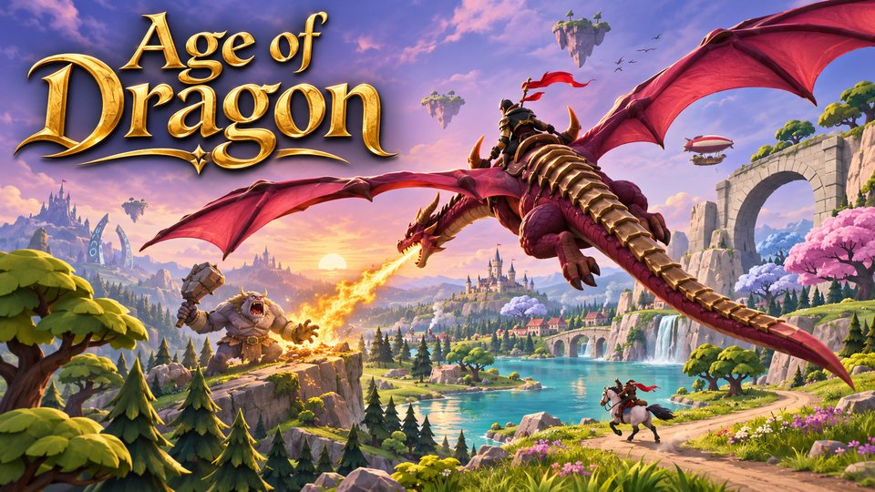</a> | **[Age of Dragon](#age-of-dragon)** | [Mike Houser](https://x.com/M__Houser) | Claude Fable 5.2 and Claude Opus 5.5 | video only |  | [X](https://x.com/M__Houser/status/2120253236309569696) | 2.5K |  | 9/10 |
| <a href="#mirror-earth">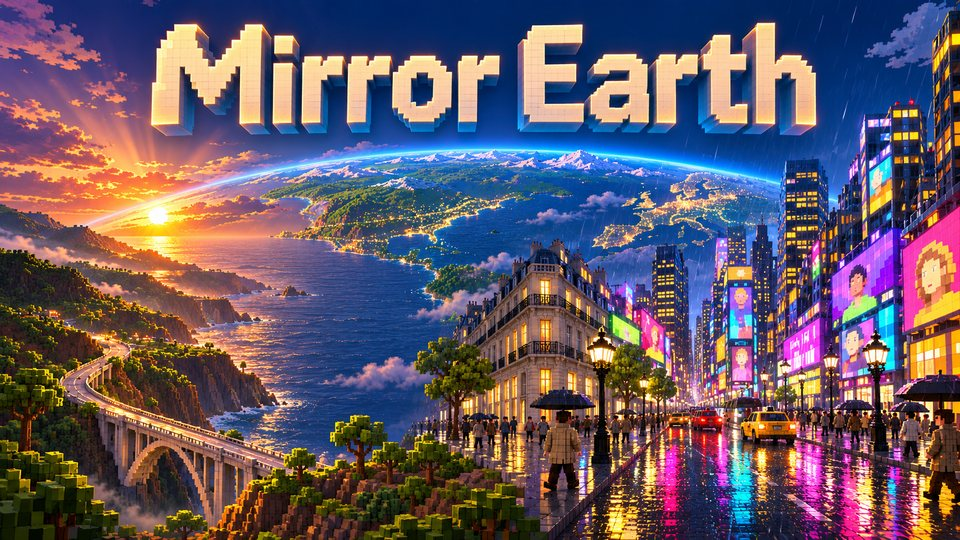</a> | **[Mirror Earth](#mirror-earth)** | [Matt Shumer](https://x.com/mattshumer_) | Claude Fable 5.2 | [▶ Play URL](https://www.spawn.co/@mattshumer/earth?room=local) | [page](https://vibegamer.io/game/mirror-earth?utm_source=github&utm_medium=readme&utm_campaign=awesome-claude-fable-games) | [X](https://x.com/mattshumer_/status/2119877065701036047) | 2.4K |  | 9/10 |
| <a href="#mist-locked-gate"></a> | **[Mist-Locked Gate (雾锁山门)](#mist-locked-gate)** | [歸藏 (Guizang)](https://x.com/op7418) | Claude Fable 5.2 | [▶ Play URL](https://op7418.github.io/guizang-game-skill/) | [page](https://vibegamer.io/game/mist-locked-gate?utm_source=github&utm_medium=readme&utm_campaign=awesome-claude-fable-games) | [X](https://x.com/op7418/status/2120694045299327187) | 769 |  | 9/10 |
| <a href="#i-would-have-gotten-away-with-it">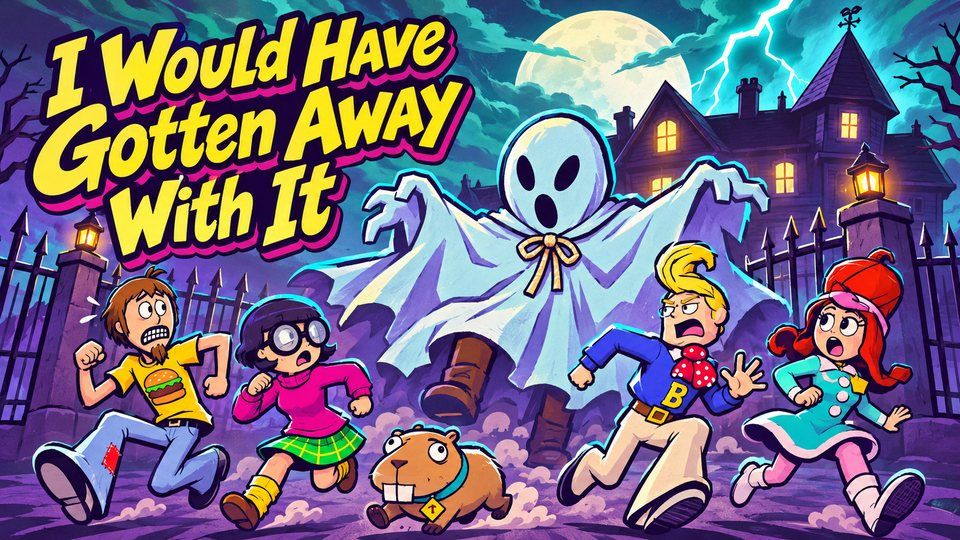</a> | **[I Would Have Gotten Away With It](#i-would-have-gotten-away-with-it)** | [Ethan Mollick](https://x.com/emollick) | Claude Fable 5.2 | [▶ Play URL](https://i-would-have-gotten-away-with-it.netlify.app) | [page](https://vibegamer.io/game/i-would-have-gotten-away-with-it?utm_source=github&utm_medium=readme&utm_campaign=awesome-claude-fable-games) | [X](https://x.com/emollick/status/2119876449494540554) | 503 |  | 9/10 |
| <a href="#gilt-and-gutter">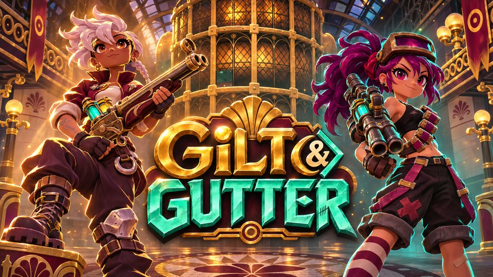</a> | **[Gilt & Gutter](#gilt-and-gutter)** | [Kevin Ngo](https://x.com/kevin_t_ngo) | Claude Fable 5.2 | [▶ Play URL](https://gilt-and-gutter.vercel.app) | [page](https://vibegamer.io/game/gilt-and-gutter?utm_source=github&utm_medium=readme&utm_campaign=awesome-claude-fable-games) | [X](https://x.com/kevin_t_ngo/status/2119900487688622171) | 318 |  | 9/10 |
| <a href="#the-waking-river">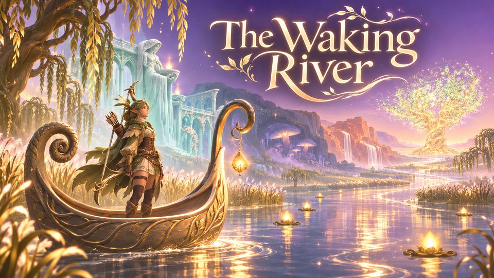</a> | **[The Waking River](#the-waking-river)** | [Florence](https://x.com/flxrnc) | Claude Fable 5.2 | [▶ Play URL](https://rivergame-kappa.vercel.app) | [page](https://vibegamer.io/game/the-waking-river?utm_source=github&utm_medium=readme&utm_campaign=awesome-claude-fable-games) | [X](https://x.com/flxrnc/status/2120494277528580110) | 86 |  | 9/10 |
| <a href="#tidewright">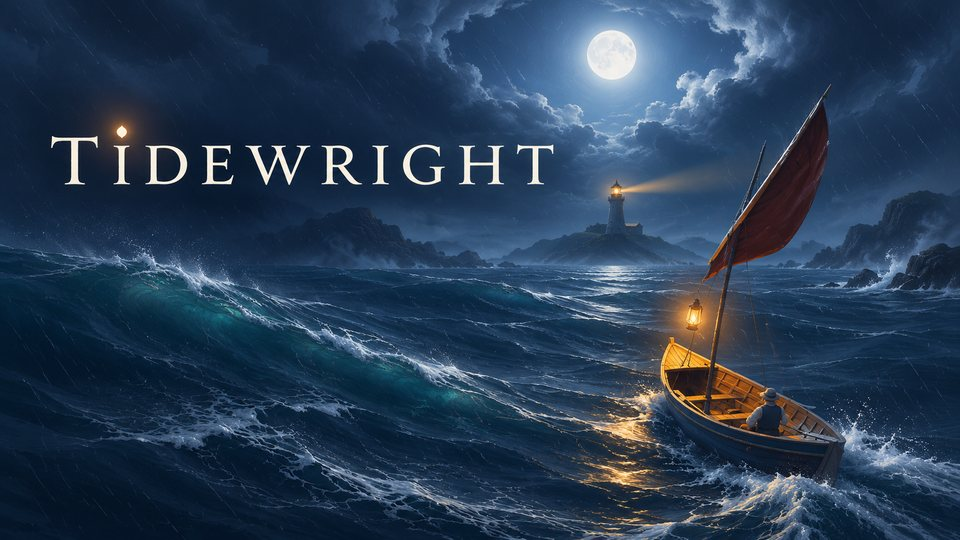</a> | **[Tidewright](#tidewright)** | [Felix Rieseberg](https://x.com/felixrieseberg) | Claude Fable 5.2 | [▶ Play URL](https://claude.ai/artifact/JTgyEMn7sn1q2riWrMb7D4) | [page](https://vibegamer.io/game/tidewright?utm_source=github&utm_medium=readme&utm_campaign=awesome-claude-fable-games) | [X](https://x.com/felixrieseberg/status/2119867839033352596) |  |  | 9/10 |
| <a href="#small-magic">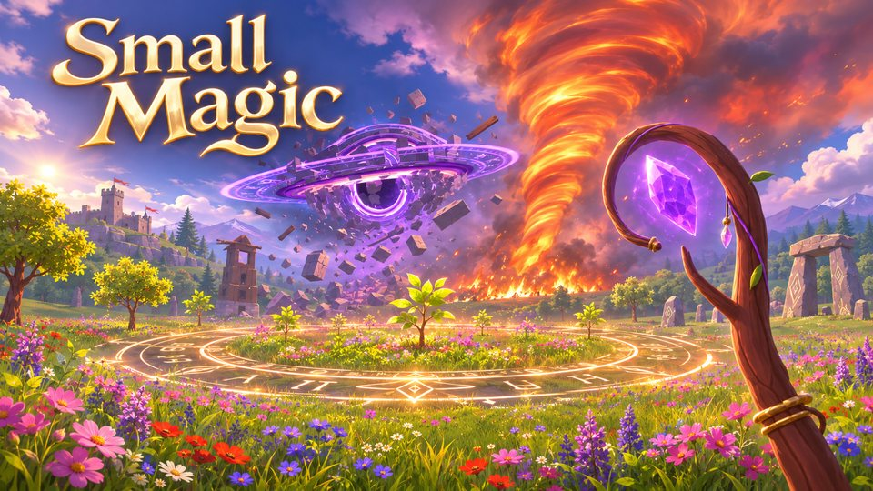</a> | **[Small Magic](#small-magic)** | [Blendi](https://x.com/BlendiByl) | Claude Fable 5.2 | [▶ Play URL](https://patch.gg/play/blendi/small-magic) | [page](https://vibegamer.io/game/small-magic?utm_source=github&utm_medium=readme&utm_campaign=awesome-claude-fable-games) | [X](https://x.com/BlendiByl/status/2121594536153718972) | 1.5K |  | 8.8/10 |
| <a href="#crosstown">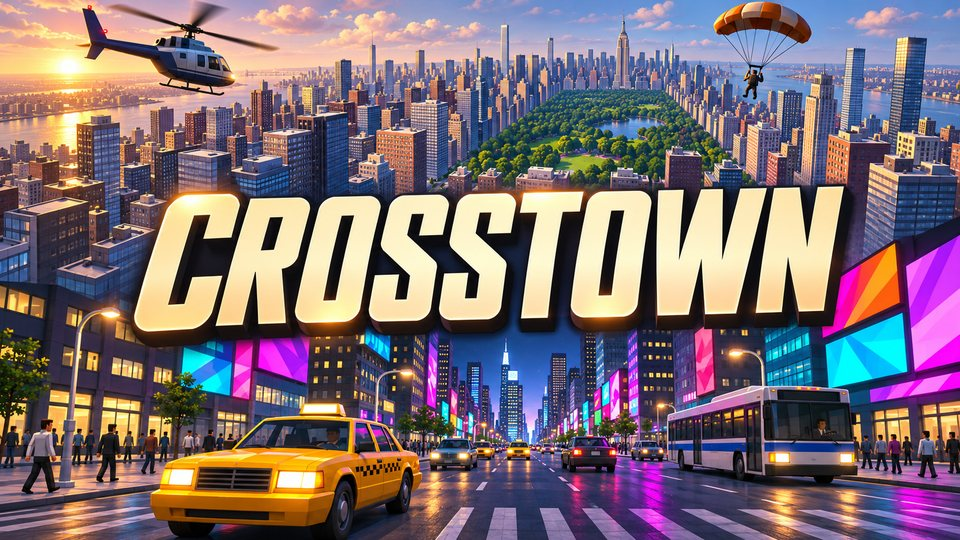</a> | **[CROSSTOWN](#crosstown)** | [Matt Shumer](https://x.com/mattshumer_) | Claude Fable 5.2 | [▶ Play URL](https://nyc.somethingbig.ai/) | [page](https://vibegamer.io/game/crosstown?utm_source=github&utm_medium=readme&utm_campaign=awesome-claude-fable-games) | [X](https://x.com/mattshumer_/status/2123134336891318350) | 234 |  | 8.8/10 |
| <a href="#heat">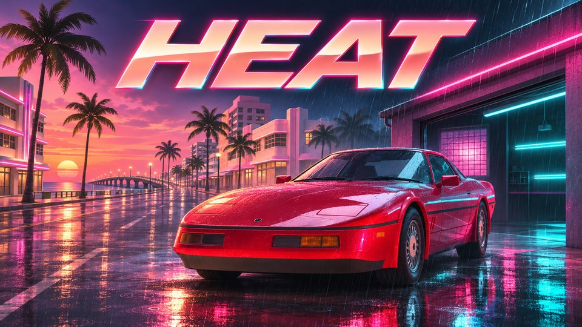</a> | **[HEAT](#heat)** | [Aravind Srinivas](https://x.com/AravSrinivas) | Claude Fable 5.2 | [▶ Play URL](https://heat.pplx.app/) | [page](https://vibegamer.io/game/heat?utm_source=github&utm_medium=readme&utm_campaign=awesome-claude-fable-games) | [X](https://x.com/AravSrinivas/status/2122338465648103676) | 765 |  | 8.7/10 |
| <a href="#uno-com-escada">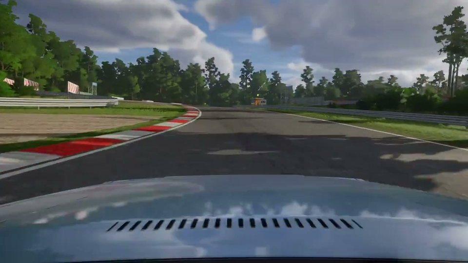</a> | **[Uno com Escada](#uno-com-escada)** | [ViktorKav](https://x.com/ViktorKav) | Claude Fable 5.2 | [▶ Play URL](https://viktorkav.com.br/apoio/uno-com-escada/fable/) | [page](https://vibegamer.io/game/uno-com-escada?utm_source=github&utm_medium=readme&utm_campaign=awesome-claude-fable-games) | [X](https://x.com/ViktorKav/status/2122647483281015155) | 9.2K |  | 8.6/10 |
| <a href="#papertrails">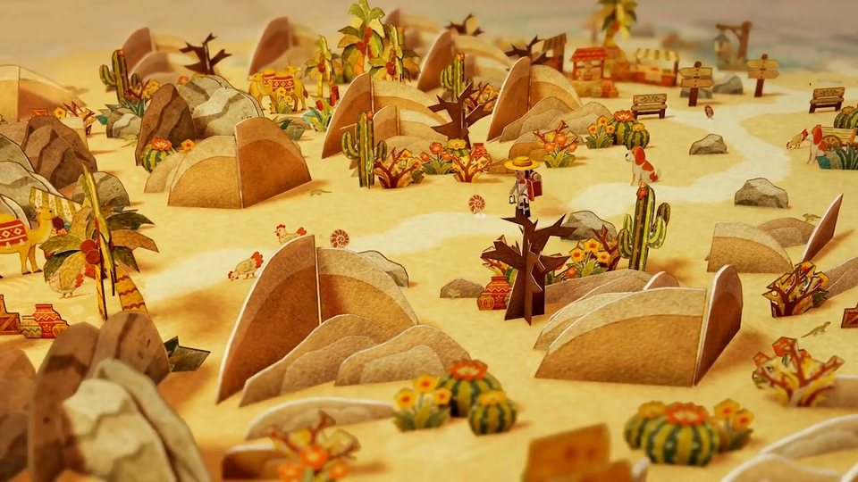</a> | **[Papertrails](#papertrails)** | [xikhar](https://x.com/xikhar) | Claude Fable 5.2 | [▶ Play URL](https://xikhar.github.io/papertrails/) | [page](https://vibegamer.io/game/papertrails?utm_source=github&utm_medium=readme&utm_campaign=awesome-claude-fable-games) | [X](https://x.com/xikhar/status/2122682962647122403) | 2.2K |  | 8.6/10 |
| <a href="#portals-endless-worlds">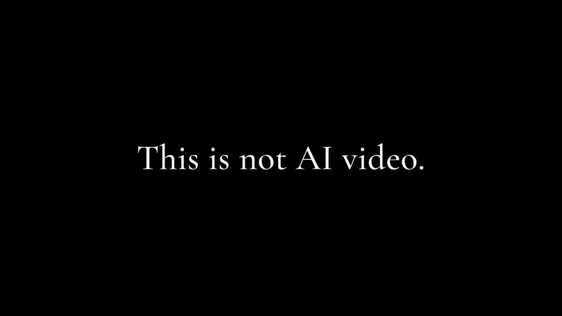</a> | **[Portals: Endless Worlds](#portals-endless-worlds)** | [emollick](https://x.com/emollick) | Claude Fable 5.2 | [▶ Play URL](https://portals-endless-worlds.netlify.app/) | [page](https://vibegamer.io/game/portals-endless-worlds?utm_source=github&utm_medium=readme&utm_campaign=awesome-claude-fable-games) | [X](https://x.com/emollick/status/2119918307457577163) | 1.9K |  | 8.6/10 |
| <a href="#evensong">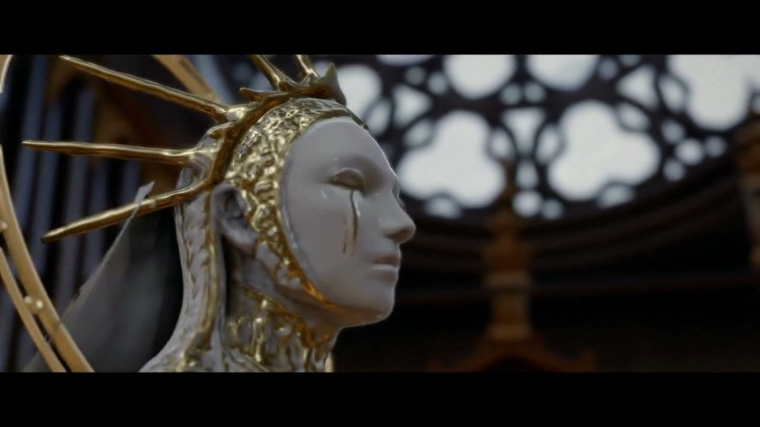</a> | **[Evensong](#evensong)** | [kevin_t_ngo](https://x.com/kevin_t_ngo) | Claude Fable 5.2 | [▶ Play URL](https://evensong-phi.vercel.app/) | [page](https://vibegamer.io/game/evensong?utm_source=github&utm_medium=readme&utm_campaign=awesome-claude-fable-games) | [X](https://x.com/kevin_t_ngo/status/2120238844754923874) | 1.8K |  | 8.6/10 |
| <a href="#lanternfall">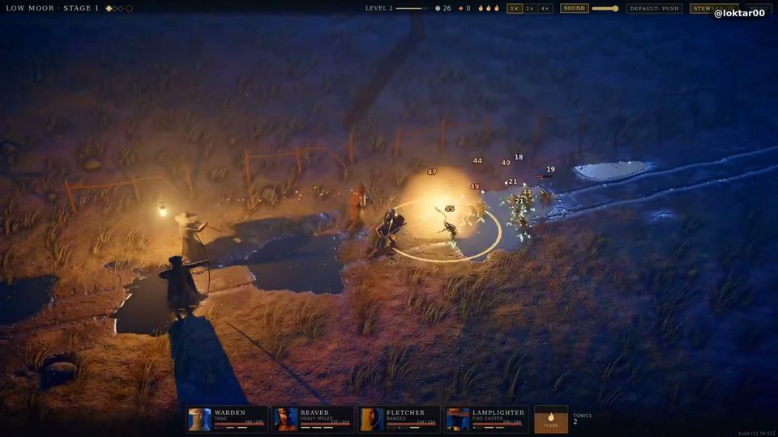</a> | **[LANTERNFALL](#lanternfall)** | [loktar00](https://x.com/loktar00) | Claude Fable 5.2 | [▶ Play URL](https://loktar00.github.io/lanternfall/) | [page](https://vibegamer.io/game/lanternfall?utm_source=github&utm_medium=readme&utm_campaign=awesome-claude-fable-games) | [X](https://x.com/loktar00/status/2120192761542615271) | 1.4K |  | 8.6/10 |
| <a href="#ancient-babylon-600-bc">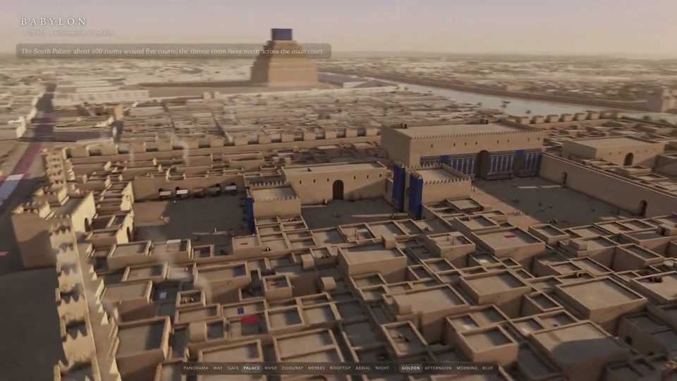</a> | **[Ancient Babylon, 600 BC](#ancient-babylon-600-bc)** | [literallydenis](https://x.com/literallydenis) | Claude Fable 5.2 | [▶ Play URL](https://claude.ai/artifact/CTjrZXVdUgKJ6qJXrvvr28) | [page](https://vibegamer.io/game/ancient-babylon-600-bc?utm_source=github&utm_medium=readme&utm_campaign=awesome-claude-fable-games) | [X](https://x.com/literallydenis/status/2120866958790848953) | 1.2K |  | 8.6/10 |
| <a href="#1-km-of-indiranagar">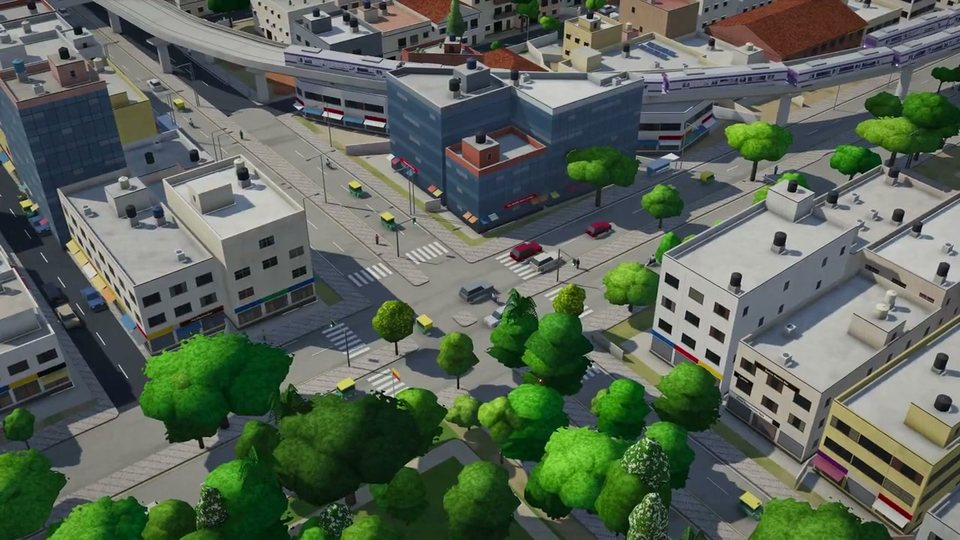</a> | **[1 km² of Indiranagar](#1-km-of-indiranagar)** | [anshu4321](https://x.com/anshu4321) | Claude Fable 5.2 | [▶ Play URL](https://indiranagar-live.vercel.app) | [page](https://vibegamer.io/game/1-km-of-indiranagar?utm_source=github&utm_medium=readme&utm_campaign=awesome-claude-fable-games) | [X](https://x.com/anshu4321/status/2119938067758772403) | 1.2K |  | 8.6/10 |
| <a href="#rome-ad-320">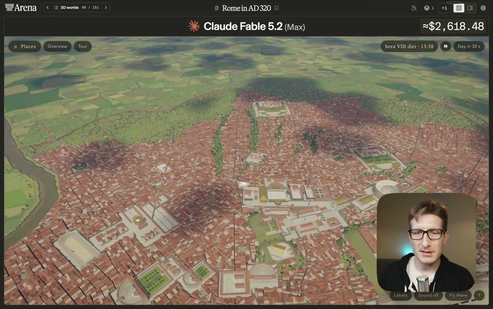</a> | **[Rome, AD 320](#rome-ad-320)** | [petergostev](https://x.com/petergostev) | Claude Fable 5.2 | [▶ Play URL](https://fable-rome.surge.sh/) | [page](https://vibegamer.io/game/rome-ad-320?utm_source=github&utm_medium=readme&utm_campaign=awesome-claude-fable-games) | [X](https://x.com/petergostev/status/2120167560700383572) | 973 |  | 8.6/10 |
| <a href="#er-6-terrain-explorer">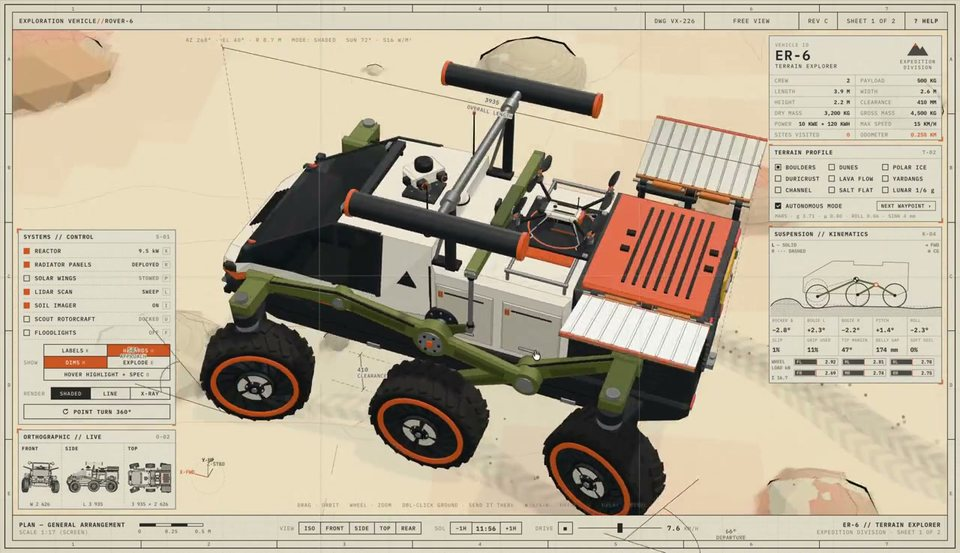</a> | **[ER-6 Terrain Explorer](#er-6-terrain-explorer)** | [DilumSanjaya](https://x.com/DilumSanjaya) | Claude Fable 5.2 | [▶ Play URL](https://fable-rover.vercel.app) | [page](https://vibegamer.io/game/er-6-terrain-explorer?utm_source=github&utm_medium=readme&utm_campaign=awesome-claude-fable-games) | [X](https://x.com/DilumSanjaya/status/2120561077385867663) | 794 |  | 8.6/10 |
| <a href="#solar">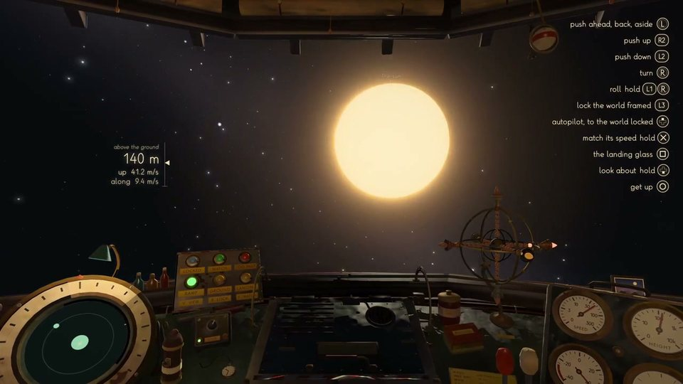</a> | **[Solar](#solar)** | [BlendiByl](https://x.com/BlendiByl) | Claude Fable 5.2 | [▶ Play URL](https://patch.gg/play/blendi/solar) | [page](https://vibegamer.io/game/solar?utm_source=github&utm_medium=readme&utm_campaign=awesome-claude-fable-games) | [X](https://x.com/BlendiByl/status/2122673770607591855) | 793 |  | 8.6/10 |
| <a href="#coloured-pencil">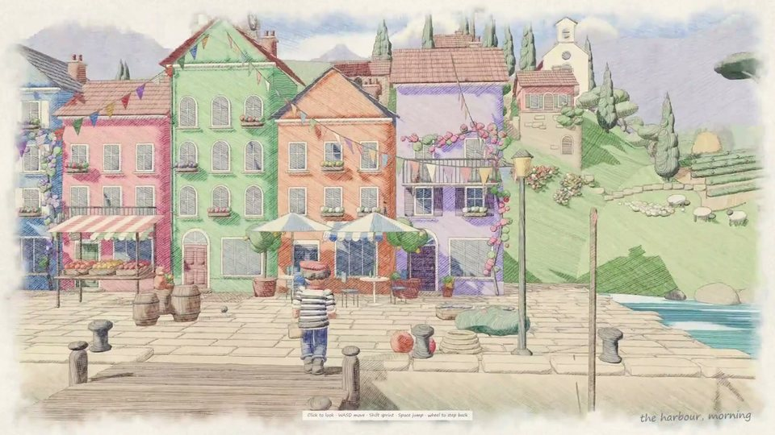</a> | **[Coloured Pencil](#coloured-pencil)** | [BlendiByl](https://x.com/BlendiByl) | Claude Fable 5.2 | [▶ Play URL](https://patch.gg/blendi/coloured-pencil) | [page](https://vibegamer.io/game/coloured-pencil?utm_source=github&utm_medium=readme&utm_campaign=awesome-claude-fable-games) | [X](https://x.com/BlendiByl/status/2121130385723789637) | 763 |  | 8.6/10 |
| <a href="#voxel-engine">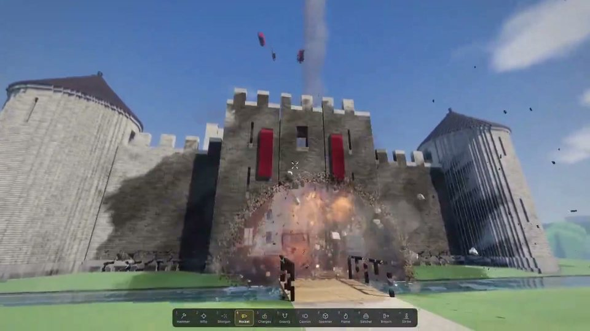</a> | **[Voxel Engine](#voxel-engine)** | [mattshumer_](https://x.com/mattshumer_) | Claude Fable 5.2 | [▶ Play URL](https://www.spawn.co/@mattshumer/voxel-engine) | [page](https://vibegamer.io/game/voxel-engine?utm_source=github&utm_medium=readme&utm_campaign=awesome-claude-fable-games) | [X](https://x.com/mattshumer_/status/2119870965106483384) | 744 |  | 8.6/10 |
| <a href="#saltfire">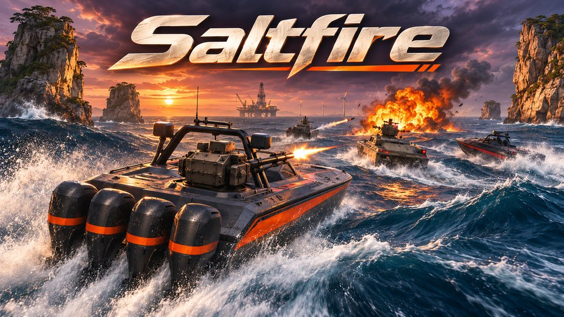</a> | **[Saltfire](#saltfire)** | [Higgsfield AI](https://x.com/higgsfield_ai) | Claude Fable 5.2 | [▶ Play URL](https://saltfire.higgsfield.app/) | [page](https://vibegamer.io/game/saltfire?utm_source=github&utm_medium=readme&utm_campaign=awesome-claude-fable-games) | [X](https://x.com/higgsfield_ai/status/2119928918035910668) |  |  | 8.6/10 |
| <a href="#castle-valley">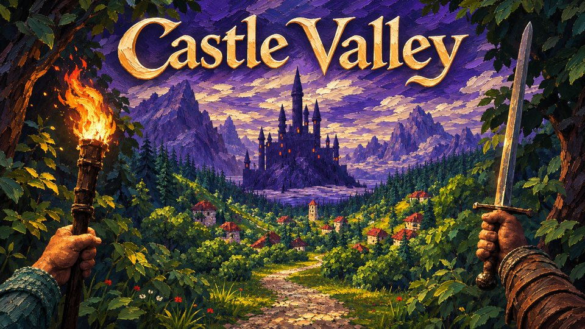</a> | **[Castle Valley](#castle-valley)** | [Tommy D. Rossi](https://x.com/__morse) | Claude Fable 5.2 | [▶ Play URL](https://omw-game.kimaki.dev/) | [page](https://vibegamer.io/game/castle-valley?utm_source=github&utm_medium=readme&utm_campaign=awesome-claude-fable-games) | [X](https://x.com/__morse/status/2122013410309153042) |  |  | 8.6/10 |
| <a href="#parallax">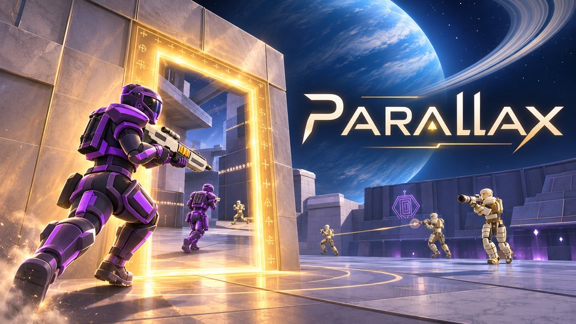</a> | **[Parallax](#parallax)** | [Sholto Douglas](https://x.com/_sholtodouglas) | Claude Fable 5.2 | video only |  | [X](https://x.com/_sholtodouglas/status/2119935331499925557) | 1.9K |  | 8.5/10 |
| <a href="#valsera-side-scrolling-rpg">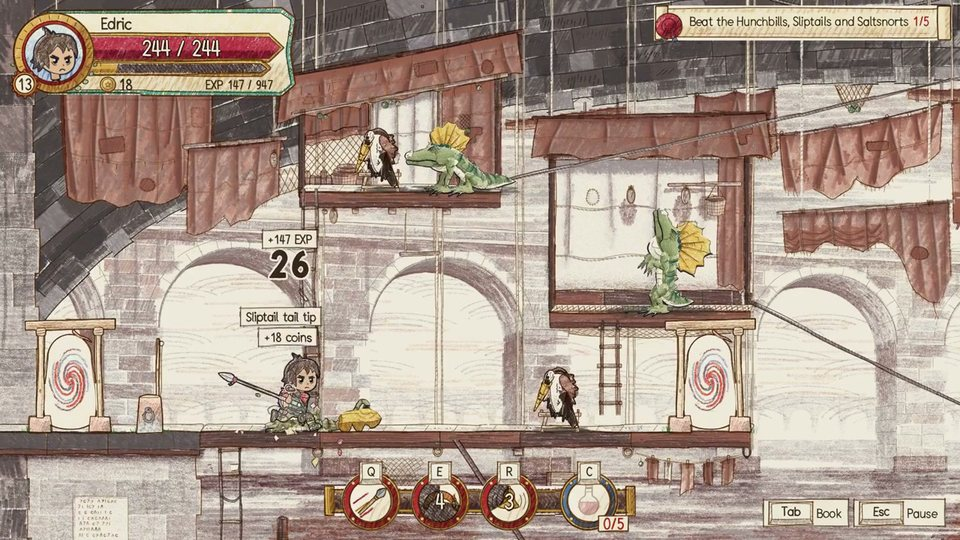</a> | **[Valsera — side-scrolling RPG](#valsera-side-scrolling-rpg)** | [kevin_t_ngo](https://x.com/kevin_t_ngo) | Claude Fable 5.2 | [▶ Play URL](https://valsera-game.vercel.app/) | [page](https://vibegamer.io/game/valsera-side-scrolling-rpg?utm_source=github&utm_medium=readme&utm_campaign=awesome-claude-fable-games) | [X](https://x.com/kevin_t_ngo/status/2121701020598415465) | 511 |  | 8.5/10 |
| <a href="#dragon-rider">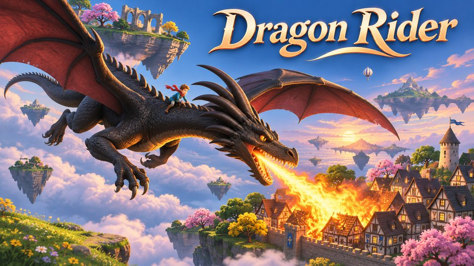</a> | **[Dragon Rider](#dragon-rider)** | [Future Brian](https://x.com/ForwardEditor) | Claude Fable 5.2 | video only |  | [X](https://x.com/ForwardEditor/status/2119867743965163994) | 461 |  | 8.5/10 |
| <a href="#the-world-of-hoodcraft">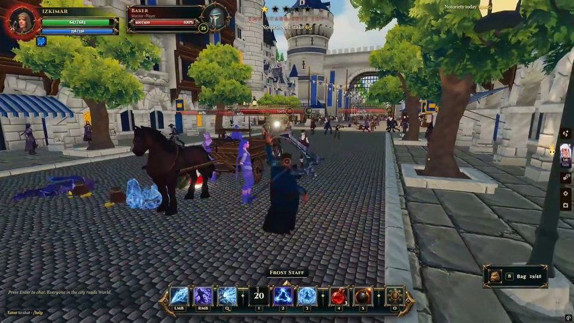</a> | **[The World of Hoodcraft](#the-world-of-hoodcraft)** | [Izkimar](https://x.com/Izkimar) | Claude Fable 5.2 | [▶ Play URL](https://www.spawn.co/@izkimar/the-world-of-hoodcraft) | [page](https://vibegamer.io/game/the-world-of-hoodcraft?utm_source=github&utm_medium=readme&utm_campaign=awesome-claude-fable-games) | [X](https://x.com/Izkimar/status/2123188582836031910) | 454 |  | 8.5/10 |
| <a href="#starfall-moba"></a> | **[Starfall (星陨战纪)](#starfall-moba)** | [Fu Sheng](https://x.com/FuSheng_0306) | Claude Fable 5.2 | [▶ Play URL](https://sanwan.ai/games/xingyun-moba/) | [page](https://vibegamer.io/game/starfall-moba?utm_source=github&utm_medium=readme&utm_campaign=awesome-claude-fable-games) | [X](https://x.com/FuSheng_0306/status/2121237878097207583) |  |  | 8.5/10 |
| <a href="#reef-dive">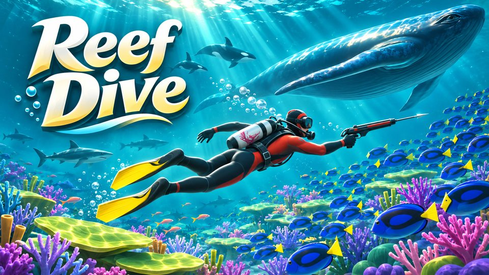</a> | **[Reef Dive](#reef-dive)** | [Ibrahim Boona](https://x.com/boona11) | Claude Fable 5.2 | [▶ Play URL](https://wavedash.com/games/reef-dive) | [page](https://vibegamer.io/game/reef-dive?utm_source=github&utm_medium=readme&utm_campaign=awesome-claude-fable-games) | [X](https://x.com/boona11/status/2120482516733702472) |  |  | 8.5/10 |
| <a href="#childhood-rug-racer">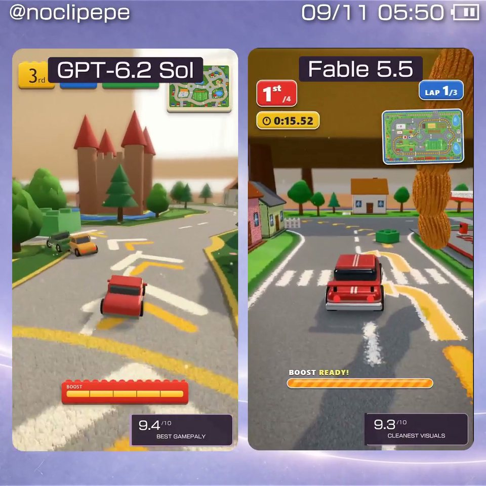</a> | **[Childhood Rug Racer](#childhood-rug-racer)** | [noclipepe](https://x.com/noclipepe) | Claude Fable 5.2 | [▶ Play URL](https://noclipepe.pages.dev/rug/) | [page](https://vibegamer.io/game/childhood-rug-racer?utm_source=github&utm_medium=readme&utm_campaign=awesome-claude-fable-games) | [X](https://x.com/noclipepe/status/2119728047754547326) | 428 |  | 8.4/10 |
| <a href="#bay-area-through-time">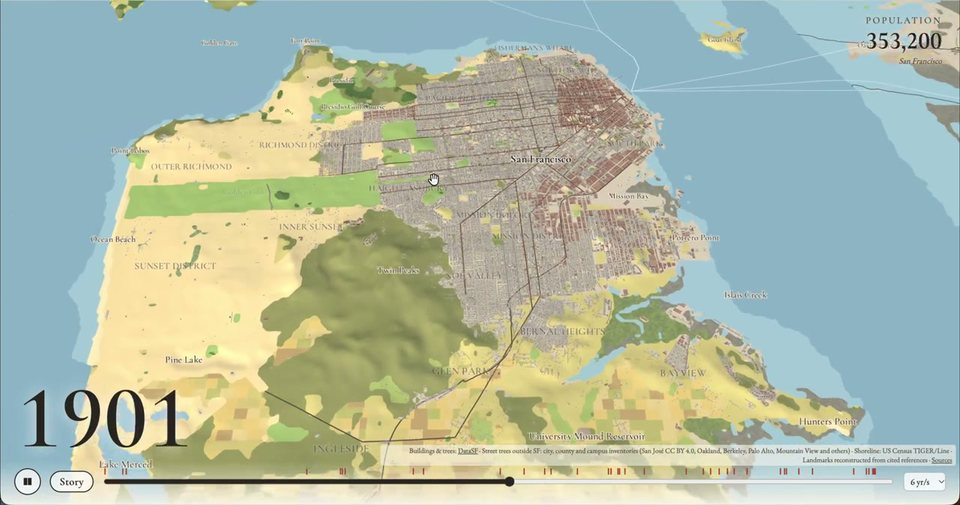</a> | **[Bay Area Through Time](#bay-area-through-time)** | [theojaffee](https://x.com/theojaffee) | Claude Fable 5.2 | [▶ Play URL](https://bay.theojaffee.net) | [page](https://vibegamer.io/game/bay-area-through-time?utm_source=github&utm_medium=readme&utm_campaign=awesome-claude-fable-games) | [X](https://x.com/theojaffee/status/2120312766544437738) | 388 |  | 8.4/10 |
| <a href="#hadal">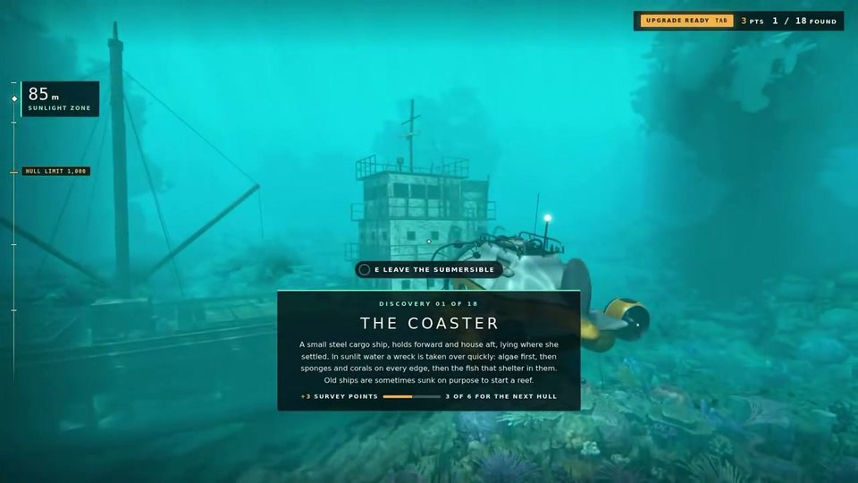</a> | **[HADAL](#hadal)** | [AravSrinivas](https://x.com/AravSrinivas) | Claude Fable 5.2 | [▶ Play URL](https://mariana.pplx.app) | [page](https://vibegamer.io/game/hadal?utm_source=github&utm_medium=readme&utm_campaign=awesome-claude-fable-games) | [X](https://x.com/AravSrinivas/status/2122713692324384793) | 364 |  | 8.4/10 |
| <a href="#cloud-stunt-3d"></a> | **[Cloud Stunt 3D](#cloud-stunt-3d)** | [jev_chat](https://x.com/jev_chat) | Claude Fable 5.2 | [▶ Play URL](https://finderchangchang.github.io/cloud-stunt-3d/) | [page](https://vibegamer.io/game/cloud-stunt-3d?utm_source=github&utm_medium=readme&utm_campaign=awesome-claude-fable-games) | [X](https://x.com/jev_chat/status/2120015641151426838) | 328 |  | 8.4/10 |
| <a href="#valle-morta">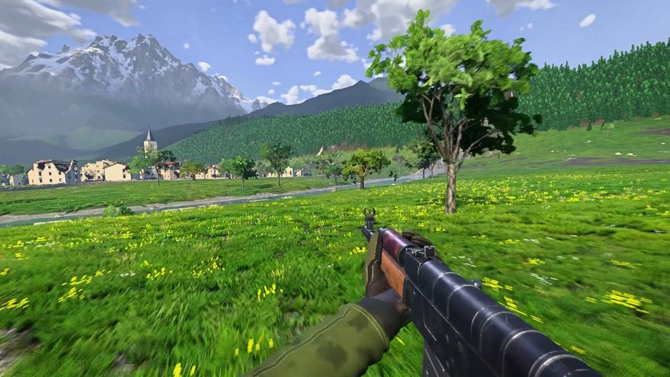</a> | **[Valle Morta](#valle-morta)** | [LexnLin](https://x.com/LexnLin) | Claude Fable 5.2 | [▶ Play URL](https://valle-morta.vercel.app/) | [page](https://vibegamer.io/game/valle-morta?utm_source=github&utm_medium=readme&utm_campaign=awesome-claude-fable-games) | [X](https://x.com/LexnLin/status/2121934071429468543) | 323 |  | 8.4/10 |
| <a href="#cordon-9">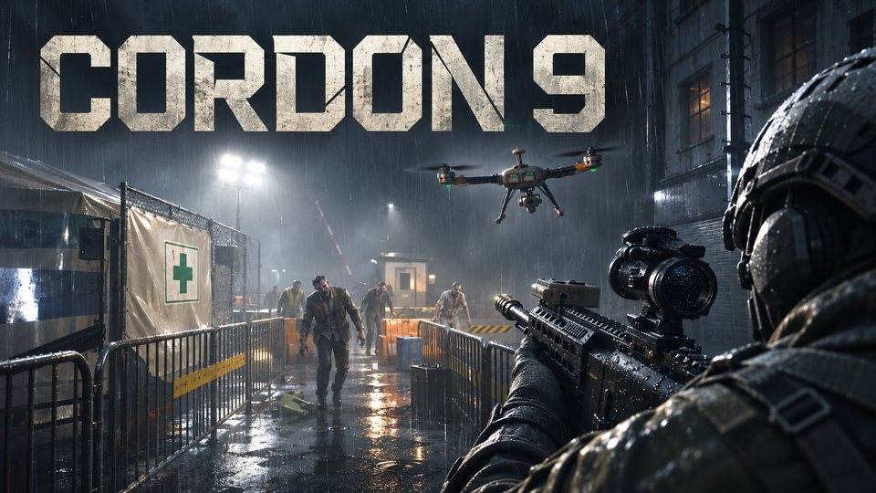</a> | **[CORDON 9](#cordon-9)** | [Aravind Srinivas](https://x.com/AravSrinivas) | Claude Fable 5.2 | [▶ Play URL](https://cordon9.pplx.app) | [page](https://vibegamer.io/game/cordon-9?utm_source=github&utm_medium=readme&utm_campaign=awesome-claude-fable-games) | [X](https://x.com/AravSrinivas/status/2120506245131977026) |  |  | 8.4/10 |
| <a href="#dread-district">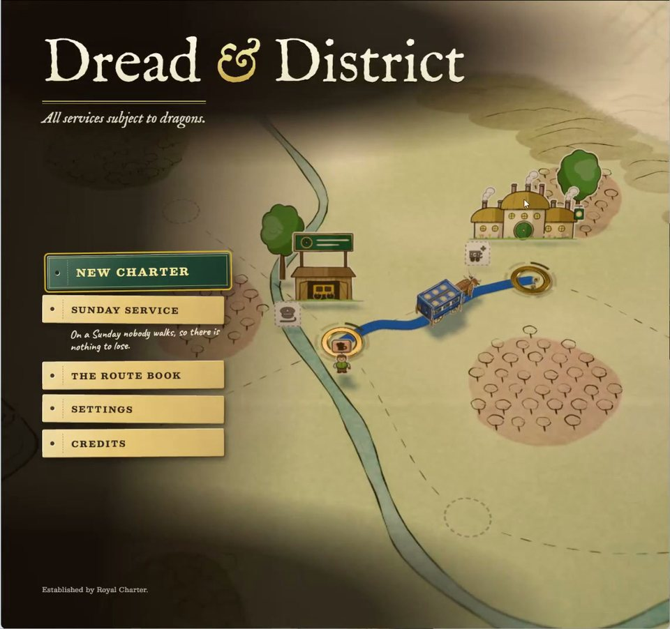</a> | **[Dread & District](#dread-district)** | [emollick](https://x.com/emollick) | Claude Fable 5.2 | [▶ Play URL](https://dread-and-district.netlify.app) | [page](https://vibegamer.io/game/dread-district?utm_source=github&utm_medium=readme&utm_campaign=awesome-claude-fable-games) | [X](https://x.com/emollick/status/2120248525254742318) | 303 |  | 8.3/10 |
| <a href="#unsung-vale-open-world-rpg">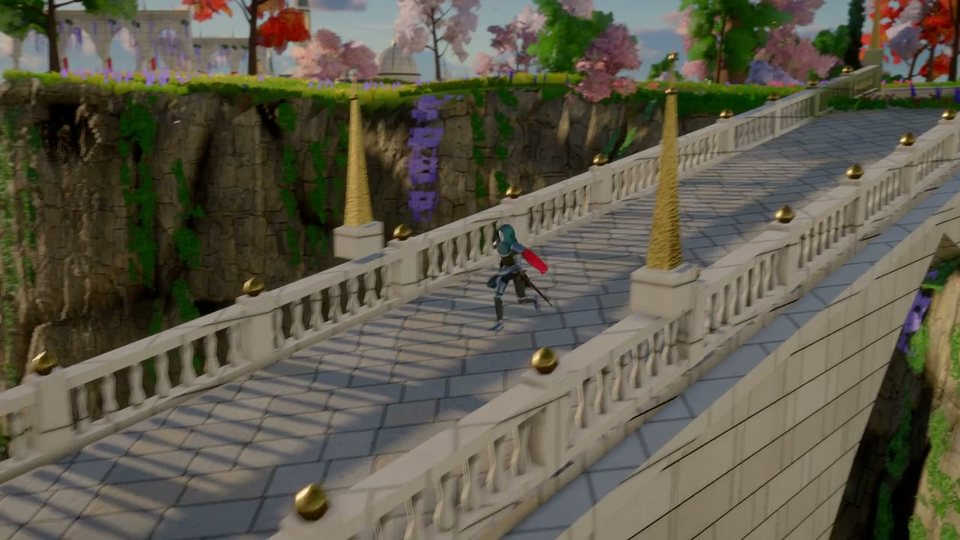</a> | **[Unsung Vale — open-world RPG](#unsung-vale-open-world-rpg)** | [LexnLin](https://x.com/LexnLin) | Claude Fable 5.2 | [▶ Play URL](https://unsung-vale.vercel.app/) | [page](https://vibegamer.io/game/unsung-vale-open-world-rpg?utm_source=github&utm_medium=readme&utm_campaign=awesome-claude-fable-games) | [X](https://x.com/LexnLin/status/2121253191748669705) | 302 |  | 8.3/10 |
| <a href="#fall-line-downhill-mtb">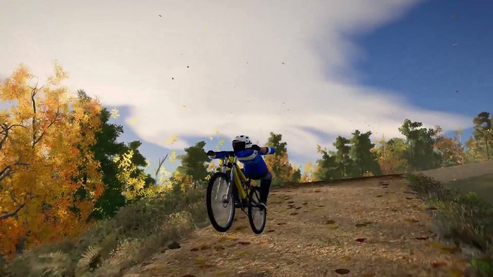</a> | **[Fall Line: downhill MTB](#fall-line-downhill-mtb)** | [BananaOfMercy](https://x.com/BananaOfMercy) | Claude Fable 5.2 | [▶ Play URL](https://fallline-9zo.pages.dev) | [page](https://vibegamer.io/game/fall-line-downhill-mtb?utm_source=github&utm_medium=readme&utm_campaign=awesome-claude-fable-games) | [X](https://x.com/BananaOfMercy/status/2123037856398733438) | 279 |  | 8.3/10 |
| <a href="#chill-taoist-vibe">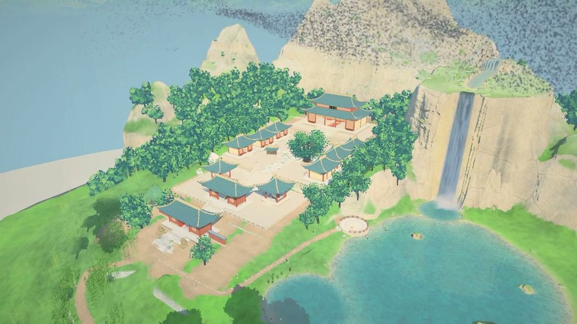</a> | **[Chill Taoist Vibe](#chill-taoist-vibe)** | [qiqileyuan](https://x.com/qiqileyuan) | Claude Fable 5.2 | [▶ Play URL](http://taoistvibe.com) | [page](https://vibegamer.io/game/chill-taoist-vibe?utm_source=github&utm_medium=readme&utm_campaign=awesome-claude-fable-games) | [X](https://x.com/qiqileyuan/status/2122006851298693277) | 253 |  | 8.3/10 |
| <a href="#first-crush">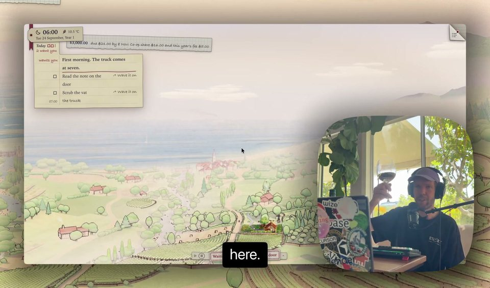</a> | **[First Crush](#first-crush)** | [kieranklaassen](https://x.com/kieranklaassen) | Claude Fable 5.2 | [▶ Play URL](https://frontier.every.to/experiments/first-crush) | [page](https://vibegamer.io/game/first-crush?utm_source=github&utm_medium=readme&utm_campaign=awesome-claude-fable-games) | [X](https://x.com/kieranklaassen/status/2119871673294037280) | 230 |  | 8.3/10 |
| <a href="#hidden-layers">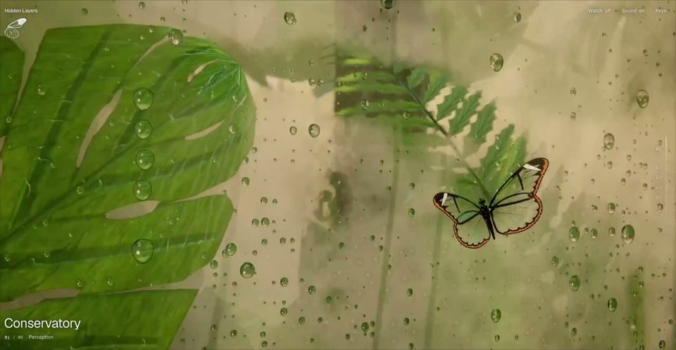</a> | **[Hidden Layers](#hidden-layers)** | [ky__zo](https://x.com/ky__zo) | Claude Fable 5.2 | [▶ Play URL](https://butterfly.kyzo.io) | [page](https://vibegamer.io/game/hidden-layers?utm_source=github&utm_medium=readme&utm_campaign=awesome-claude-fable-games) | [X](https://x.com/ky__zo/status/2122274109795054036) | 229 |  | 8.3/10 |
| <a href="#great-wave">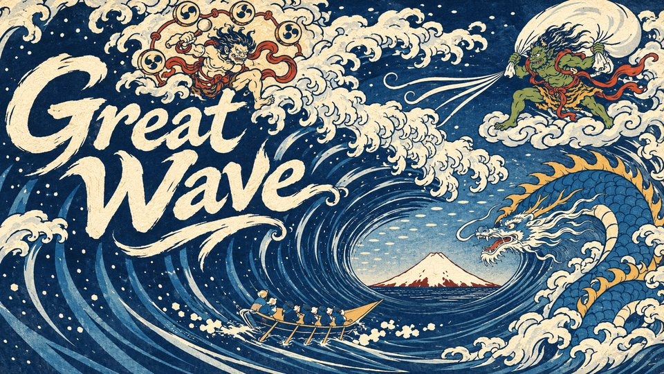</a> | **[Great Wave](#great-wave)** | [Nil Ni](https://x.com/_nilni) | Claude Fable 5.2 | [▶ Play URL](https://www.aigameshare.com/games/great-wave-off-kanagawa) | [page](https://vibegamer.io/game/great-wave?utm_source=github&utm_medium=readme&utm_campaign=awesome-claude-fable-games) | [X](https://x.com/_nilni/status/2120797996610994355) | 7 |  | 8.3/10 |
| <a href="#baseboard">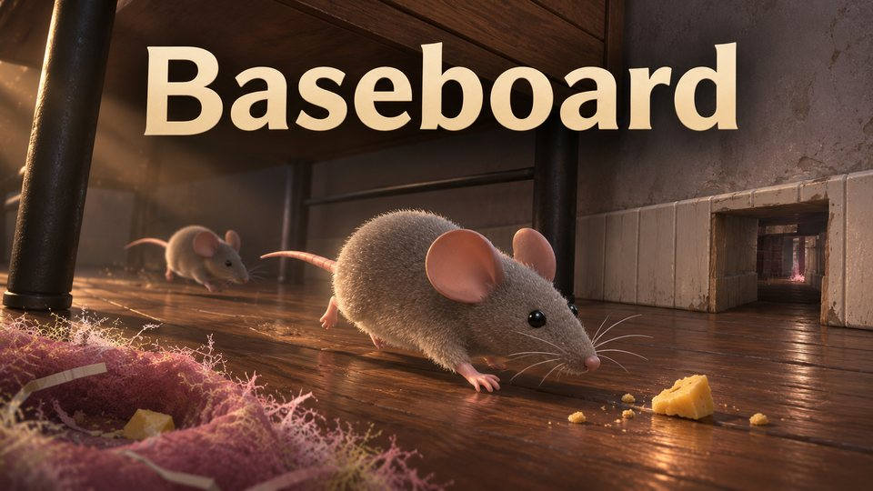</a> | **[Baseboard](#baseboard)** | [Chris DiMarco](https://x.com/chrisjdimarco) | Claude Fable 5.2 | [▶ Play URL](https://app.thinklet.io/t/baseboard-393600) | [page](https://vibegamer.io/game/baseboard?utm_source=github&utm_medium=readme&utm_campaign=awesome-claude-fable-games) | [X](https://x.com/chrisjdimarco/status/2122455657034985828) |  |  | 8.3/10 |
| <a href="#atlantis">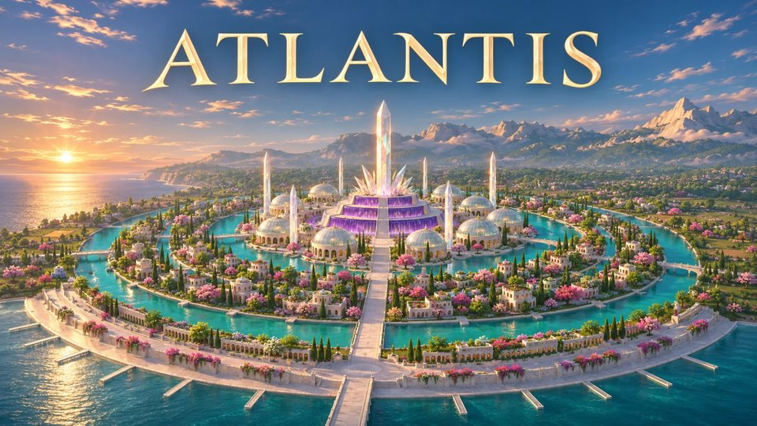</a> | **[Atlantis](#atlantis)** | Noniv | Claude Fable 5.2, Claude Opus 5.5, Claude Code | [▶ Play URL](https://noniv.github.io/atlantis/) | [page](https://vibegamer.io/game/atlantis?utm_source=github&utm_medium=readme&utm_campaign=awesome-claude-fable-games) | [blog post](https://www.reddit.com/r/singularity/comments/1y1z1cu/fable_52_built_a_flyable_atlantis_in_a_single_96/) |  |  | 8.3/10 |
| <a href="#a-claude-demo-you-can-walk-into">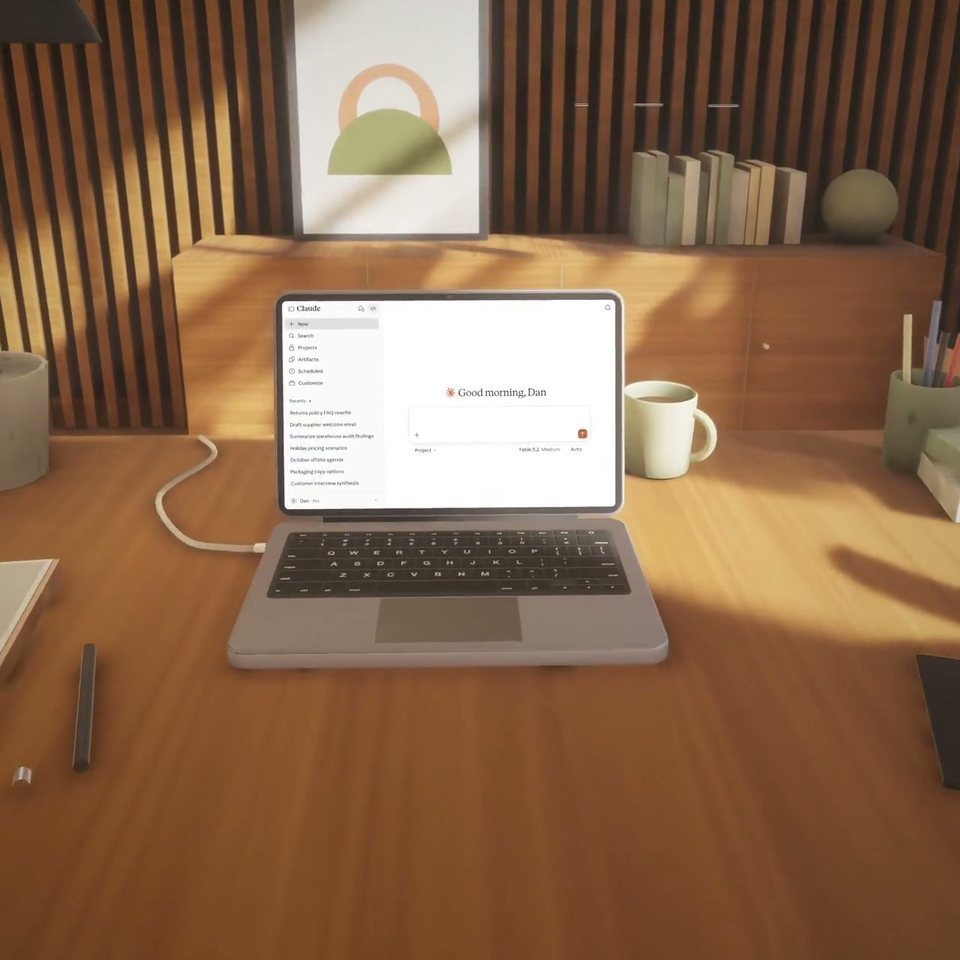</a> | **[A Claude demo you can walk into](#a-claude-demo-you-can-walk-into)** | [dfeinition](https://x.com/dfeinition) | Claude Fable 5.2 | [▶ Play URL](https://claude.ai/artifact/R6YBDkAm2GjAC5A65D9djx) | [page](https://vibegamer.io/game/a-claude-demo-you-can-walk-into?utm_source=github&utm_medium=readme&utm_campaign=awesome-claude-fable-games) | [X](https://x.com/dfeinition/status/2120330644261589051) | 214 |  | 8.2/10 |
| <a href="#skywake">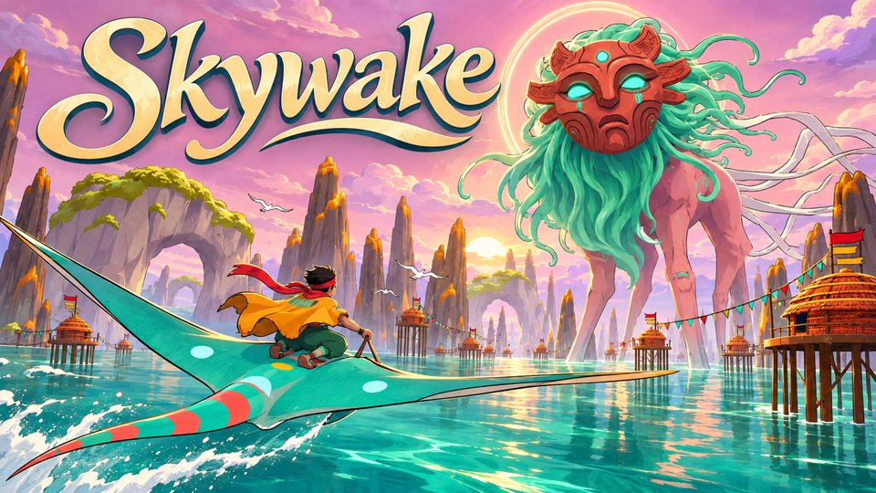</a> | **[Skywake: Kite & Mo's Big Flight](#skywake)** | [Aniket J](https://x.com/aniketjart) | Gemini 4 Argon and Claude Opus 5.5 | [▶ Play URL](https://app.usecrayon.ai/play/992c2130-43da-416b-a577-aed9514d3057) | [page](https://vibegamer.io/game/skywake?utm_source=github&utm_medium=readme&utm_campaign=awesome-claude-fable-games) | [X](https://x.com/aniketjart/status/2117508141076378029) | 203 |  | 8.2/10 |
| <a href="#code-planet">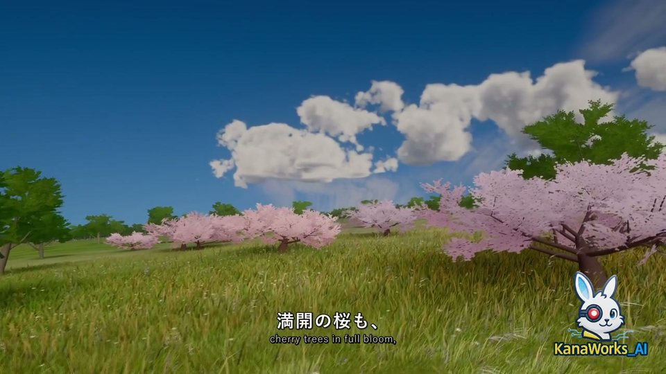</a> | **[Code Planet](#code-planet)** | [KanaWorks_AI](https://x.com/KanaWorks_AI) | Claude Fable 5.2 | [▶ Play URL](https://planet.tokyoaivisuals.club/) | [page](https://vibegamer.io/game/code-planet?utm_source=github&utm_medium=readme&utm_campaign=awesome-claude-fable-games) | [X](https://x.com/KanaWorks_AI/status/2121413647213932688) | 198 |  | 8.2/10 |
| <a href="#rambo-dino">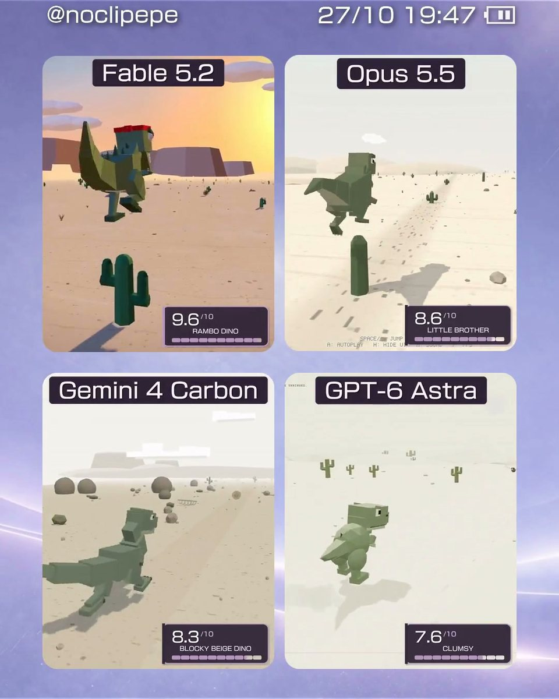</a> | **[Rambo Dino](#rambo-dino)** | [noclipepe](https://x.com/noclipepe) | Claude Fable 5.2 | [▶ Play URL](https://noclipepe.pages.dev/dino) | [page](https://vibegamer.io/game/rambo-dino?utm_source=github&utm_medium=readme&utm_campaign=awesome-claude-fable-games) | [X](https://x.com/noclipepe/status/2119927838321328577) | 183 |  | 8.2/10 |
| <a href="#cozy-lisbon"></a> | **[Cozy Lisbon](#cozy-lisbon)** | [goncalo_canhoto](https://x.com/goncalo_canhoto) | Claude Fable 5.2 | [▶ Play URL](https://cozylisbon.vercel.app) | [page](https://vibegamer.io/game/cozy-lisbon?utm_source=github&utm_medium=readme&utm_campaign=awesome-claude-fable-games) | [X](https://x.com/goncalo_canhoto/status/2119932946346094690) | 172 |  | 8.2/10 |
| <a href="#market-order"></a> | **[Market Order](#market-order)** | [emollick](https://x.com/emollick) | Claude Fable 5.2 | [▶ Play URL](https://market-order-city.netlify.app/) | [page](https://vibegamer.io/game/market-order?utm_source=github&utm_medium=readme&utm_campaign=awesome-claude-fable-games) | [X](https://x.com/emollick/status/2123520499368263977) | 170 |  | 8.2/10 |
| <a href="#voxel-world-in-a-bottle"></a> | **[Voxel World in a Bottle](#voxel-world-in-a-bottle)** | [vib3coded](https://x.com/vib3coded) | Claude Fable 5.2 | [▶ Play URL](https://claude.ai/artifact/9EgZpErM17kH2a9Q3WXW6f) | [page](https://vibegamer.io/game/voxel-world-in-a-bottle?utm_source=github&utm_medium=readme&utm_campaign=awesome-claude-fable-games) | [X](https://x.com/vib3coded/status/2120104517282775514) | 164 |  | 8.2/10 |
| <a href="#frontline-warfare-deathmatch"></a> | **[Frontline Warfare Deathmatch](#frontline-warfare-deathmatch)** | [alightinastorm](https://x.com/alightinastorm) | Claude Fable 5.2 | [▶ Play URL](https://spawn.co/@robot/frontline-warfare-deathmatch) | [page](https://vibegamer.io/game/frontline-warfare-deathmatch?utm_source=github&utm_medium=readme&utm_campaign=awesome-claude-fable-games) | [X](https://x.com/alightinastorm/status/2120020469487440210) | 163 |  | 8.2/10 |
| <a href="#valley-ride"></a> | **[Valley Ride](#valley-ride)** | [Prasenjit](https://x.com/prasenx) | Claude Opus 5.5 and Claude Fable 5.2 | [▶ Play URL](https://starknightt.github.io/valley-ride/) | [page](https://vibegamer.io/game/valley-ride?utm_source=github&utm_medium=readme&utm_campaign=awesome-claude-fable-games) | [X](https://x.com/prasenx/status/2120565971270459430) | 162 |  | 8.2/10 |
| <a href="#nightclub-drift-speed"></a> | **[NightClub: Drift & Speed](#nightclub-drift-speed)** | [Story91](https://x.com/Story91_) | Claude Fable 5.2 | [▶ Play URL](https://www.nightclub-driftspeed.xyz/) | [page](https://vibegamer.io/game/nightclub-drift-speed?utm_source=github&utm_medium=readme&utm_campaign=awesome-claude-fable-games) | [X](https://x.com/Story91_/status/2121016763190059194) |  |  | 8.2/10 |
| <a href="#cold-smoke"></a> | **[Cold Smoke](#cold-smoke)** | Huisky (灰斯基) | Claude Fable 5.2 | [▶ Play URL](https://huisky.xyz/cold-smoke/play) | [page](https://vibegamer.io/game/cold-smoke?utm_source=github&utm_medium=readme&utm_campaign=awesome-claude-fable-games) | [blog post](https://www.xiaohongshu.com/explore/6af76cd8000000002a01d9ea) | 307 |  | 8.1/10 |
| <a href="#fable-5-2-fps-repro"></a> | **[Fable 5.2 FPS Repro](#fable-5-2-fps-repro)** | [wquguru](https://x.com/wquguru) | Claude Fable 5.2 | [▶ Play URL](https://wquguru.github.io/fable52-fps-repro/) | [page](https://vibegamer.io/game/fable-5-2-fps-repro?utm_source=github&utm_medium=readme&utm_campaign=awesome-claude-fable-games) | [X](https://x.com/wquguru/status/2120383332722905400) | 158 |  | 8.1/10 |
| <a href="#banana-mine-rush"></a> | **[Banana Mine Rush](#banana-mine-rush)** | [0xChuckstock](https://x.com/0xChuckstock) | Claude Fable 5.2 | [▶ Play URL](https://remix.gg/g/banana-mine-rush) | [page](https://vibegamer.io/game/banana-mine-rush?utm_source=github&utm_medium=readme&utm_campaign=awesome-claude-fable-games) | [X](https://x.com/0xChuckstock/status/2120125184606658728) | 154 |  | 8.1/10 |
| <a href="#impossible-spaces"></a> | **[Impossible Spaces](#impossible-spaces)** | [BlendiByl](https://x.com/BlendiByl) | Claude Fable 5.2 | [▶ Play URL](https://patch.gg/blendi/impossible-spaces) | [page](https://vibegamer.io/game/impossible-spaces?utm_source=github&utm_medium=readme&utm_campaign=awesome-claude-fable-games) | [X](https://x.com/BlendiByl/status/2120314459793355262) | 137 |  | 8.1/10 |
| <a href="#lumina-zombies"></a> | **[Lumina Zombies](#lumina-zombies)** | [LuminaBench](https://x.com/LuminaBench) | Claude Fable 5.2 | [▶ Play URL](https://luminazombies.com/) | [page](https://vibegamer.io/game/lumina-zombies?utm_source=github&utm_medium=readme&utm_campaign=awesome-claude-fable-games) | [X](https://x.com/LuminaBench/status/2120660076927099048) | 123 |  | 8.1/10 |
| <a href="#danfo-run"></a> | **[Danfo Run](#danfo-run)** | [Eureka](https://x.com/eureka_seamless) | Claude (version not stated) | [▶ Play URL](https://danforun.com) | [page](https://vibegamer.io/game/danfo-run?utm_source=github&utm_medium=readme&utm_campaign=awesome-claude-fable-games) | [X](https://x.com/eureka_seamless/status/2103938108668420286) | 36.8K |  | 8/10 |
| <a href="#the-clockmakers-heart"></a> | **[The Clockmaker's Heart](#the-clockmakers-heart)** | [Felix Rieseberg](https://x.com/felixrieseberg) | Claude Fable 5.2 | [▶ Play URL](https://claude.ai/artifact/6MjtQjf4ee1ZZjEpafaEpa) | [page](https://vibegamer.io/game/the-clockmakers-heart?utm_source=github&utm_medium=readme&utm_campaign=awesome-claude-fable-games) | [X](https://x.com/felixrieseberg/status/2119867839033352596) | 283 |  | 8/10 |
| <a href="#aestra-the-last-wish"></a> | **[Aestra: The Last Wish](#aestra-the-last-wish)** | [Mike Houser](https://x.com/M__Houser) | Claude Opus 5.5 (on Tesana) | [▶ Play URL](https://tesana.com/game/aestra-the-last-wish) | [page](https://vibegamer.io/game/aestra-the-last-wish?utm_source=github&utm_medium=readme&utm_campaign=awesome-claude-fable-games) | [X](https://x.com/M__Houser/status/2115438489995190285) | 281 |  | 8/10 |
| <a href="#cayley"></a> | **[Cayley](#cayley)** | [Lionel Mora](https://x.com/lionel_mora) | Claude Fable 5.2 | [▶ Play URL](https://lauramionel.github.io/cayley-flight-simulator/) | [page](https://vibegamer.io/game/cayley?utm_source=github&utm_medium=readme&utm_campaign=awesome-claude-fable-games) | [X](https://x.com/lionel_mora/status/2120554787812860294) | 280 |  | 8/10 |
| <a href="#maad-maxxing"></a> | **[MAAD MAXXING](#maad-maxxing)** | [Andrew Blumson](https://x.com/Andrew_Blumson) | Claude Fable 5.2 | [▶ Play URL](https://maad-maxxing.vercel.app) | [page](https://vibegamer.io/game/maad-maxxing?utm_source=github&utm_medium=readme&utm_campaign=awesome-claude-fable-games) | [X](https://x.com/Andrew_Blumson/status/2120599812512833557) | 165 |  | 8/10 |
| <a href="#turbo-tails"></a> | **[Turbo Tails](#turbo-tails)** | [Peter Yang](https://x.com/petergyang) | Claude Fable 5.2 | [▶ Play URL](https://turbo-tails.vercel.app) | [page](https://vibegamer.io/game/turbo-tails?utm_source=github&utm_medium=readme&utm_campaign=awesome-claude-fable-games) | [X](https://x.com/petergyang/status/2119901658394358005) | 137 | ✓ | 8/10 |
| <a href="#3d-sailing-ship"></a> | **[3D Sailing Ship](#3d-sailing-ship)** | [marcthecreatorr](https://x.com/marcthecreatorr) | Claude Fable 5.2 | [▶ Play URL](https://claude.ai/artifact/7ge282etTXSS4edGFTFa85) | [page](https://vibegamer.io/game/3d-sailing-ship?utm_source=github&utm_medium=readme&utm_campaign=awesome-claude-fable-games) | [X](https://x.com/marcthecreatorr/status/2119890973560054072) | 111 |  | 8.0/10 |
| <a href="#pirate-ship"></a> | **[Pirate Ship](#pirate-ship)** | [notjazii](https://x.com/notjazii) | Claude Fable 5.2 | [▶ Play URL](https://tests.jazii.dev/) | [page](https://vibegamer.io/game/pirate-ship?utm_source=github&utm_medium=readme&utm_campaign=awesome-claude-fable-games) | [X](https://x.com/notjazii/status/2119905661505122575) | 110 |  | 8.0/10 |
| <a href="#thunder-valley-dino-chase"></a> | **[Thunder Valley dino chase](#thunder-valley-dino-chase)** | [loktar00](https://x.com/loktar00) | Claude Fable 5.2 | [▶ Play URL](https://loktar00.github.io/llm-test-pages/fable52-dino-chase/) | [page](https://vibegamer.io/game/thunder-valley-dino-chase?utm_source=github&utm_medium=readme&utm_campaign=awesome-claude-fable-games) | [X](https://x.com/loktar00/status/2120905457380507991) | 99 |  | 8.0/10 |
| <a href="#party-royale"></a> | **[Party Royale](#party-royale)** | [Matthew Berman](https://x.com/MatthewBerman) | Claude Fable 5.2 | video only | [page](https://vibegamer.io/game/party-royale?utm_source=github&utm_medium=readme&utm_campaign=awesome-claude-fable-games) | [X](https://x.com/MatthewBerman/status/2119868630989254665) | 97 |  | 8/10 |
| <a href="#feed-the-backrooms"></a> | **[Feed the Backrooms](#feed-the-backrooms)** | [LexnLin](https://x.com/LexnLin) | Claude Fable 5.2 | [▶ Play URL](https://feed-backrooms.vercel.app) | [page](https://vibegamer.io/game/feed-the-backrooms?utm_source=github&utm_medium=readme&utm_campaign=awesome-claude-fable-games) | [X](https://x.com/LexnLin/status/2119966127149429093) | 96 |  | 8.0/10 |
| <a href="#fablecraft"></a> | **[Fablecraft](#fablecraft)** | [@RezAIT00](https://x.com/RezAIT00) | Claude Fable 5.2 | video only | [page](https://vibegamer.io/game/fablecraft?utm_source=github&utm_medium=readme&utm_campaign=awesome-claude-fable-games) | [X](https://x.com/RezAIT00/status/2119902470205997344) | 71 | ✓ | 8/10 |
| <a href="#lumenvale"></a> | **[Lumenvale](#lumenvale)** | [Sai](https://x.com/sai0xgen) | Claude Fable 5.2 | [▶ Play URL](https://claude.ai/artifact/9bekwKPUpCNDqEfgR8zwQa) | [page](https://vibegamer.io/game/lumenvale?utm_source=github&utm_medium=readme&utm_campaign=awesome-claude-fable-games) | [X](https://x.com/sai0xgen/status/2120758436581589369) | 35 |  | 8/10 |
| <a href="#rifts"></a> | **[Rifts](#rifts)** | [Abbi](https://x.com/Pumpnasterr) | Claude Fable 5.2 | [▶ Play URL](https://www.spawn.co/@abbidabbi/rifts) | [page](https://vibegamer.io/game/rifts?utm_source=github&utm_medium=readme&utm_campaign=awesome-claude-fable-games) | [X](https://x.com/Pumpnasterr/status/2119895877250609238) | 31 |  | 8/10 |
| <a href="#memory-of-teresa-the-storm-spire"></a> | **[Memory of Teresa: The Storm Spire](#memory-of-teresa-the-storm-spire)** | [@OneHitKillDev](https://x.com/OneHitKillDev) | Claude Fable 5.2 | [▶ Play URL](https://www.spawn.co/@chocopuff/one-hit-kill) | [page](https://vibegamer.io/game/memory-of-teresa-the-storm-spire?utm_source=github&utm_medium=readme&utm_campaign=awesome-claude-fable-games) | [X](https://x.com/OneHitKillDev/status/2119882801222709524) | 31 |  | 8/10 |
| <a href="#street-brawler-ii"></a> | **[Street Brawler II](#street-brawler-ii)** | [@BertrandDiouly](https://x.com/BertrandDiouly) | Claude Fable 5.2 | video only | [page](https://vibegamer.io/game/street-brawler-ii?utm_source=github&utm_medium=readme&utm_campaign=awesome-claude-fable-games) | [X](https://x.com/BertrandDiouly/status/2119886197648765001) | 21 |  | 8/10 |
| <a href="#toy-room-adventure"></a> | **[Toy Room Adventure](#toy-room-adventure)** | [Sotiris Kaniras](https://x.com/itssotsot) | Claude Fable 5.2 | video only | [page](https://vibegamer.io/game/toy-room-adventure?utm_source=github&utm_medium=readme&utm_campaign=awesome-claude-fable-games) | [X](https://x.com/itssotsot/status/2119909017216491720) | 5 | ✓ | 8/10 |
| <a href="#tokyo-night-gp"></a> | **[Tokyo Night GP](#tokyo-night-gp)** | [@nikodemszymansk](https://x.com/nikodemszymansk) | Claude Fable 5.2 | video only | [page](https://vibegamer.io/game/tokyo-night-gp?utm_source=github&utm_medium=readme&utm_campaign=awesome-claude-fable-games) | [X](https://x.com/nikodemszymansk/status/2119880518875435022) | 4 |  | 8/10 |
| <a href="#samurai-duel"></a> | **[Samurai Duel](#samurai-duel)** | [@tymarsha](https://x.com/tymarsha) | Claude Fable 5.2 | video only | [page](https://vibegamer.io/game/samurai-duel?utm_source=github&utm_medium=readme&utm_campaign=awesome-claude-fable-games) | [X](https://x.com/tymarsha/status/2119904015454810582) |  |  | 8/10 |
| <a href="#aidens-revenge"></a> | **[Aiden's Revenge](#aidens-revenge)** | Lex Toumbourou | Claude Fable 5.2 | [▶ Play URL](https://aidens-revenge.pages.dev/) | [page](https://vibegamer.io/game/aidens-revenge?utm_source=github&utm_medium=readme&utm_campaign=awesome-claude-fable-games) | [blog post](https://notesbylex.com/fable-5-2-one-shotted-my-nephews-dream-game) |  |  | 8/10 |
| <a href="#brasidas"></a> | **[Brasidas](#brasidas)** | [Mike Houser](https://x.com/M__Houser) | Tesana (model not stated) | [▶ Play URL](https://tesana.com/game/brasidas) | [page](https://vibegamer.io/game/brasidas?utm_source=github&utm_medium=readme&utm_campaign=awesome-claude-fable-games) | [X](https://x.com/TesanaAI/status/2115049380382437886) |  |  | 8/10 |
| <a href="#geminisland"></a> | **[Geminisland](#geminisland)** | [Google AI](https://x.com/GoogleAI) | Gemini 4 Hydrogen | [▶ Play URL](https://aistudio.google.com/apps/bundled/geminisland?showPreview=true&showAssistant=true&fullscreenApplet=true) | [page](https://vibegamer.io/game/geminisland?utm_source=github&utm_medium=readme&utm_campaign=awesome-claude-fable-games) | [X](https://x.com/GoogleAI/status/2120940684924403798) |  |  | 8/10 |
| <a href="#tumblebuds-the-journey-home"></a> | **[Tumblebuds: The Journey Home](#tumblebuds-the-journey-home)** | Mossbell Games | Claude Code, Claude Fable 5.2 | [▶ Play URL](https://johnnyffm.github.io/tumblebuds/) | [page](https://vibegamer.io/game/tumblebuds-the-journey-home?utm_source=github&utm_medium=readme&utm_campaign=awesome-claude-fable-games) | [blog post](https://www.reddit.com/r/ClaudeAI/comments/1xx4y79/i_built_a_3d_puzzle_game_for_my_5yearold_with/) |  |  | 8.0/10 |
| <a href="#kumokiri"></a> | **[KUMOKIRI](#kumokiri)** | [aniketjart](https://x.com/aniketjart) | Claude Fable 5.2 | [▶ Play URL](https://app.usecrayon.ai/play/0cd7624e-1297-417e-a5be-b3c3036a496a) | [page](https://vibegamer.io/game/kumokiri?utm_source=github&utm_medium=readme&utm_campaign=awesome-claude-fable-games) | [X](https://x.com/aniketjart/status/2121101334900617631) | 73 |  | 7.9/10 |
| <a href="#pogo-riot"></a> | **[Pogo Riot](#pogo-riot)** | [Pumpnasterr](https://x.com/Pumpnasterr) | Claude Fable 5.2 | [▶ Play URL](https://www.spawn.co/@abbidabbi/pogo-riot) | [page](https://vibegamer.io/game/pogo-riot?utm_source=github&utm_medium=readme&utm_campaign=awesome-claude-fable-games) | [X](https://x.com/Pumpnasterr/status/2121343507885682917) | 63 |  | 7.9/10 |
| <a href="#ringfall"></a> | **[Ringfall](#ringfall)** | [rehan_shei](https://x.com/rehan_shei) | Claude Fable 5.2 | [▶ Play URL](https://patch.gg/games/rehan/ringfall) | [page](https://vibegamer.io/game/ringfall?utm_source=github&utm_medium=readme&utm_campaign=awesome-claude-fable-games) | [X](https://x.com/rehan_shei/status/2119994607291584962) | 63 |  | 7.9/10 |
| <a href="#save-the-world"></a> | **[Save the World](#save-the-world)** | [global_techgirl](https://x.com/global_techgirl) | Claude Fable 5.2 | [▶ Play URL](https://save-the-world-fable.vercel.app/) | [page](https://vibegamer.io/game/save-the-world?utm_source=github&utm_medium=readme&utm_campaign=awesome-claude-fable-games) | [X](https://x.com/global_techgirl/status/2120246750459961453) | 63 |  | 7.9/10 |
| <a href="#paletterider"></a> | **[PaletteRider](#paletterider)** | [Aashish Tiwari](https://x.com/Aashish_Tiwari_) | Claude Fable 5.2 | [▶ Play URL](https://aashishgtbit.github.io/PaletteRider/) | [page](https://vibegamer.io/game/paletterider?utm_source=github&utm_medium=readme&utm_campaign=awesome-claude-fable-games) | [X](https://x.com/Aashish_Tiwari_/status/2120963463610880150) |  |  | 7.9/10 |
| <a href="#chasm"></a> | **[Chasm](#chasm)** | dpsmkr7 | Claude Opus 5.5, Claude Fable 5.2 | [▶ Play URL](https://chasm.layero.app/) | [page](https://vibegamer.io/game/chasm?utm_source=github&utm_medium=readme&utm_campaign=awesome-claude-fable-games) | [blog post](https://www.reddit.com/r/aigamedev/comments/1y13am9/im_making_an_isometric_soulslike_that_runs_in_the/) |  |  | 7.9/10 |
| <a href="#kestrel-head-solstice-racing"></a> | **[Kestrel Head — Solstice racing](#kestrel-head-solstice-racing)** | [SamGCoder](https://x.com/SamGCoder) | Claude Fable 5.2 | [▶ Play URL](https://samg-coder.github.io/solstice-racing/) | [page](https://vibegamer.io/game/kestrel-head-solstice-racing?utm_source=github&utm_medium=readme&utm_campaign=awesome-claude-fable-games) | [X](https://x.com/SamGCoder/status/2120044542087070066) | 56 |  | 7.8/10 |
| <a href="#hitofude"></a> | **[HITOFUDE](#hitofude)** | [positronx_](https://x.com/positronx_) | Claude Fable 5.2 | [▶ Play URL](https://shubhu121.github.io/hitdude/play/) | [page](https://vibegamer.io/game/hitofude?utm_source=github&utm_medium=readme&utm_campaign=awesome-claude-fable-games) | [X](https://x.com/positronx_/status/2120374208043876422) | 52 |  | 7.8/10 |
| <a href="#midnight-pass"></a> | **[Midnight Pass](#midnight-pass)** | [andreysuperior](https://x.com/andreysuperior) | Claude Fable 5.2 | [▶ Play URL](https://claude.ai/artifact/UD9pGEN4QFA8F5EadRw8eL) | [page](https://vibegamer.io/game/midnight-pass?utm_source=github&utm_medium=readme&utm_campaign=awesome-claude-fable-games) | [X](https://x.com/andreysuperior/status/2120666660130746458) | 49 |  | 7.8/10 |
| <a href="#vowlorn"></a> | **[VOWLORN](#vowlorn)** | [higgsfield_ai](https://x.com/higgsfield_ai) | Claude Fable 5.2 | [▶ Play URL](https://higgsfield.ai/@higgsfield.studio/blogs/fable-5-2-built-this-rpg-from-pure-code-here-s-every-step) | [page](https://vibegamer.io/game/vowlorn?utm_source=github&utm_medium=readme&utm_campaign=awesome-claude-fable-games) | [X](https://x.com/higgsfield_ai/status/2119997122896601269) | 48 |  | 7.8/10 |
| <a href="#chairmageddon"></a> | **[Chairmageddon](#chairmageddon)** | [argofowl](https://x.com/argofowl) | Claude Fable 5.2 | [▶ Play URL](https://fowllabs.com/fable-5-2/chairmageddon/) | [page](https://vibegamer.io/game/chairmageddon?utm_source=github&utm_medium=readme&utm_campaign=awesome-claude-fable-games) | [X](https://x.com/argofowl/status/2120568779537273263) | 48 |  | 7.8/10 |
| <a href="#stray-cat"></a> | **[Stray Cat](#stray-cat)** | [aimikoda](https://x.com/aimikoda) | Claude Fable 5.2 | [▶ Play URL](https://claude.ai/artifact/4nPXUKJjQWNsZEHVNmXXCt) | [page](https://vibegamer.io/game/stray-cat?utm_source=github&utm_medium=readme&utm_campaign=awesome-claude-fable-games) | [X](https://x.com/aimikoda/status/2120120133712593118) | 44 |  | 7.8/10 |
| <a href="#farewell-light"></a> | **[Farewell Light](#farewell-light)** | [RyanSael](https://x.com/RyanSael) | Claude Fable 5.2 | [▶ Play URL](https://sael.net/demo/farewell-light/) | [page](https://vibegamer.io/game/farewell-light?utm_source=github&utm_medium=readme&utm_campaign=awesome-claude-fable-games) | [X](https://x.com/RyanSael/status/2120695866684231998) | 44 |  | 7.8/10 |
| <a href="#knock-it-off"></a> | **[Knock It Off](#knock-it-off)** | [argofowl](https://x.com/argofowl) | Claude Fable 5.2 | [▶ Play URL](https://fowllabs.com/fable-5-2/knock-it-off/) | [page](https://vibegamer.io/game/knock-it-off?utm_source=github&utm_medium=readme&utm_campaign=awesome-claude-fable-games) | [X](https://x.com/argofowl/status/2121276206683410839) | 43 |  | 7.8/10 |
| <a href="#jerusalem-at-passover"></a> | **[Jerusalem at Passover](#jerusalem-at-passover)** | [kplikethebird](https://x.com/kplikethebird) | Claude Fable 5.2 | [▶ Play URL](https://fable-jerusalem.vercel.app/) | [page](https://vibegamer.io/game/jerusalem-at-passover?utm_source=github&utm_medium=readme&utm_campaign=awesome-claude-fable-games) | [X](https://x.com/kplikethebird/status/2119900775727902732) | 43 |  | 7.8/10 |
| <a href="#handful-island-god-game"></a> | **[Handful: Island God Game](#handful-island-god-game)** | [Nil Ni](https://x.com/_nilni) | Claude Fable 5.2 | [▶ Play URL](https://www.aigameshare.com/games/island-god-game) | [page](https://vibegamer.io/game/handful-island-god-game?utm_source=github&utm_medium=readme&utm_campaign=awesome-claude-fable-games) | [X](https://x.com/_nilni/status/2120639452146250153) | 11 |  | 7.8/10 |
| <a href="#body-cam"></a> | **[BODY-CAM](#body-cam)** | Juicer | Tesana (model not stated) | [▶ Play URL](https://tesana.com/game/body-cam) | [page](https://vibegamer.io/game/body-cam?utm_source=github&utm_medium=readme&utm_campaign=awesome-claude-fable-games) | [X](https://x.com/TesanaAI/status/2112043090043449620) |  |  | 7.8/10 |
| <a href="#go-again"></a> | **[GO AGAIN](#go-again)** | Tushar | Claude Fable 5.2 | [▶ Play URL](https://app.usecrayon.ai/play/d3fe1760-e2cf-4eca-a25d-ee3b789c802e) | [page](https://vibegamer.io/game/go-again?utm_source=github&utm_medium=readme&utm_campaign=awesome-claude-fable-games) | [X](https://x.com/usecrayon/status/2120714883759247664) |  |  | 7.8/10 |
| <a href="#survivors"></a> | **[Survivors](#survivors)** | [BLACKST0CK](https://x.com/BLACKST0CK) | Claude Fable 5.2 | [▶ Play URL](https://remix.gg/g/survivors) | [page](https://vibegamer.io/game/survivors?utm_source=github&utm_medium=readme&utm_campaign=awesome-claude-fable-games) | [X](https://x.com/BLACKST0CK/status/2120329788896498123) | 40 |  | 7.7/10 |
| <a href="#thermal"></a> | **[Thermal](#thermal)** | [loktar00](https://x.com/loktar00) | Claude Fable 5.2 | [▶ Play URL](https://loktar00.github.io/llm-test-pages/fable52-hang-glider/) | [page](https://vibegamer.io/game/thermal?utm_source=github&utm_medium=readme&utm_campaign=awesome-claude-fable-games) | [X](https://x.com/loktar00/status/2121005021131083851) | 40 |  | 7.7/10 |
| <a href="#summer-festival"></a> | **[Summer Festival](#summer-festival)** | [prasenx](https://x.com/prasenx) | Claude Fable 5.2 | [▶ Play URL](https://starknightt.github.io/summer-festival/) | [page](https://vibegamer.io/game/summer-festival?utm_source=github&utm_medium=readme&utm_campaign=awesome-claude-fable-games) | [X](https://x.com/prasenx/status/2121961933540917658) | 36 |  | 7.7/10 |
| <a href="#harbor-lights-grand-prix"></a> | **[Harbor Lights Grand Prix](#harbor-lights-grand-prix)** | [Tetriss112](https://x.com/Tetriss112) | Claude Fable 5.2 | [▶ Play URL](https://tetriss22.github.io/harbor-gp/) | [page](https://vibegamer.io/game/harbor-lights-grand-prix?utm_source=github&utm_medium=readme&utm_campaign=awesome-claude-fable-games) | [X](https://x.com/Tetriss112/status/2120946576663134308) | 34 |  | 7.7/10 |
| <a href="#fighting-game-plays-on-phones"></a> | **[Fighting game (plays on phones)](#fighting-game-plays-on-phones)** | [s_shigel](https://x.com/s_shigel) | Claude Fable 5.2 | [▶ Play URL](https://claude.ai/artifact/QvSjL7Hexf3nKdUP9Zerr7) | [page](https://vibegamer.io/game/fighting-game-plays-on-phones?utm_source=github&utm_medium=readme&utm_campaign=awesome-claude-fable-games) | [X](https://x.com/s_shigel/status/2120300080569975034) | 32 |  | 7.7/10 |
| <a href="#tilt-labyrinth"></a> | **[Tilt Labyrinth](#tilt-labyrinth)** | [mylifcc](https://x.com/mylifcc) | Claude Fable 5.2 | [▶ Play URL](https://blog.silencestar.com/posts/tilt-labyrinth/play/) | [page](https://vibegamer.io/game/tilt-labyrinth?utm_source=github&utm_medium=readme&utm_campaign=awesome-claude-fable-games) | [X](https://x.com/mylifcc/status/2120054646282870910) | 32 |  | 7.7/10 |
| <a href="#aussie-outback-4x4"></a> | **[Aussie Outback 4x4](#aussie-outback-4x4)** | [SamGCoder](https://x.com/SamGCoder) | Claude Fable 5.2 | [▶ Play URL](https://rust4x4.com/) | [page](https://vibegamer.io/game/aussie-outback-4x4?utm_source=github&utm_medium=readme&utm_campaign=awesome-claude-fable-games) | [X](https://x.com/SamGCoder/status/2121513178303811931) | 31 |  | 7.7/10 |
| <a href="#pine-hollow-a-living-ski-hill"></a> | **[Pine Hollow — a living ski hill](#pine-hollow-a-living-ski-hill)** | [loktar00](https://x.com/loktar00) | Claude Fable 5.2 | [▶ Play URL](https://loktar00.github.io/pine-hollow/) | [page](https://vibegamer.io/game/pine-hollow-a-living-ski-hill?utm_source=github&utm_medium=readme&utm_campaign=awesome-claude-fable-games) | [X](https://x.com/loktar00/status/2120432591606067359) | 30 |  | 7.6/10 |
| <a href="#pixel-art-to-3d-world"></a> | **[Pixel art to 3D world](#pixel-art-to-3d-world)** | [dfeinition](https://x.com/dfeinition) | Claude Fable 5.2 | [▶ Play URL](https://claude.ai/artifact/HGk1WNqTgrGEE8ndBkEipB) | [page](https://vibegamer.io/game/pixel-art-to-3d-world?utm_source=github&utm_medium=readme&utm_campaign=awesome-claude-fable-games) | [X](https://x.com/dfeinition/status/2120933859999059970) | 29 |  | 7.6/10 |
| <a href="#midnight-grid"></a> | **[Midnight Grid](#midnight-grid)** | [mikenevermiss](https://x.com/mikenevermiss) | Claude Fable 5.2 | [▶ Play URL](https://mikenevermiss.github.io/midnight-grid/) | [page](https://vibegamer.io/game/midnight-grid?utm_source=github&utm_medium=readme&utm_campaign=awesome-claude-fable-games) | [X](https://x.com/mikenevermiss/status/2121900977959612500) | 28 |  | 7.6/10 |
| <a href="#the-vast-horizon"></a> | **[The Vast Horizon](#the-vast-horizon)** | [OdinLovis](https://x.com/OdinLovis) | Claude Fable 5.2 | [▶ Play URL](https://the-vast-horizon.vercel.app) | [page](https://vibegamer.io/game/the-vast-horizon?utm_source=github&utm_medium=readme&utm_campaign=awesome-claude-fable-games) | [X](https://x.com/OdinLovis/status/2120198469755503091) | 27 |  | 7.6/10 |
| <a href="#open-world-kart-adventure"></a> | **[Open-world kart adventure](#open-world-kart-adventure)** | [realWeZZard](https://x.com/realWeZZard) | Claude Fable 5.2 | [▶ Play URL](https://claude.ai/artifact/FpdQ81sJs1KiV1a6JCY4jj) | [page](https://vibegamer.io/game/open-world-kart-adventure?utm_source=github&utm_medium=readme&utm_campaign=awesome-claude-fable-games) | [X](https://x.com/realWeZZard/status/2120379500492185939) | 24 |  | 7.6/10 |
| <a href="#galaxy-dive"></a> | **[Galaxy Dive](#galaxy-dive)** | [handsher_NGU](https://x.com/handsher_NGU) | Claude Fable 5.2 | [▶ Play URL](https://galaxy-dive.vercel.app) | [page](https://vibegamer.io/game/galaxy-dive?utm_source=github&utm_medium=readme&utm_campaign=awesome-claude-fable-games) | [X](https://x.com/handsher_NGU/status/2119910478025789655) | 24 |  | 7.6/10 |
| <a href="#giant-leap"></a> | **[Giant Leap](#giant-leap)** | [handsher_NGU](https://x.com/handsher_NGU) | Claude Fable 5.2 | [▶ Play URL](https://giant-leap.vercel.app) | [page](https://vibegamer.io/game/giant-leap?utm_source=github&utm_medium=readme&utm_campaign=awesome-claude-fable-games) | [X](https://x.com/handsher_NGU/status/2120287667141374212) | 22 |  | 7.6/10 |
| <a href="#patchwork-quilt"></a> | **[Patchwork Quilt](#patchwork-quilt)** | [Blendi](https://x.com/BlendiByl) | Claude Fable 5.2 | [▶ Play URL](https://patch.gg/blendi/patchwork-quilt) | [page](https://vibegamer.io/game/patchwork-quilt?utm_source=github&utm_medium=readme&utm_campaign=awesome-claude-fable-games) | [X](https://x.com/BlendiByl/status/2120746541636047347) |  |  | 7.6/10 |
| <a href="#neon-canyon-run-claude-fable-5-2-shell"></a> | **[Neon Canyon Run (Claude Fable 5.2, with shell)](#neon-canyon-run-claude-fable-5-2-shell)** | VibeGamer | Claude Fable 5.2 | [▶ Play URL](https://cdn.vibegamer.io/play/neon-canyon-run/claude-fable-5-2-shell/index.html) | [page](https://vibegamer.io/game/neon-canyon-run-claude-fable-5-2-shell?utm_source=github&utm_medium=readme&utm_campaign=awesome-claude-fable-games) |  |  |  | 7.6/10 |
| <a href="#skyseed-pips-tempest-run"></a> | **[Skyseed: Pip's Tempest Run](#skyseed-pips-tempest-run)** | [Sahil Panhotra](https://x.com/SahilPanhotra) | Gemini 4 Hydrogen | [▶ Play URL](https://01a1b677-97ba-7006-a384-e83b3e5793db.arena.site/) | [page](https://vibegamer.io/game/skyseed-pips-tempest-run?utm_source=github&utm_medium=readme&utm_campaign=awesome-claude-fable-games) | [X](https://x.com/SahilPanhotra/status/2119102771173769262) | 60 |  | 7.5/10 |
| <a href="#voxel-colosseum"></a> | **[Voxel Colosseum](#voxel-colosseum)** | [aGim_asf](https://x.com/aGim_asf) | Claude Fable 5.2 | [▶ Play URL](https://claude.ai/artifact/7nmzhxeamcunJbKVK32ptz) | [page](https://vibegamer.io/game/voxel-colosseum?utm_source=github&utm_medium=readme&utm_campaign=awesome-claude-fable-games) | [X](https://x.com/aGim_asf/status/2119918363799376270) | 20 |  | 7.5/10 |
| <a href="#cozy-bakery"></a> | **[Cozy Bakery](#cozy-bakery)** | [goncalo_canhoto](https://x.com/goncalo_canhoto) | Claude Fable 5.2 | [▶ Play URL](https://cozybakery.vercel.app) | [page](https://vibegamer.io/game/cozy-bakery?utm_source=github&utm_medium=readme&utm_campaign=awesome-claude-fable-games) | [X](https://x.com/goncalo_canhoto/status/2120530199649432063) | 19 |  | 7.5/10 |
| <a href="#ink-flight"></a> | **[Ink Flight](#ink-flight)** | [prasenx](https://x.com/prasenx) | Claude Fable 5.2 | [▶ Play URL](https://wavedash.com/games/ink-flight) | [page](https://vibegamer.io/game/ink-flight?utm_source=github&utm_medium=readme&utm_campaign=awesome-claude-fable-games) | [X](https://x.com/prasenx/status/2123467881170243808) | 16 |  | 7.5/10 |
| <a href="#painted-valley"></a> | **[Painted Valley](#painted-valley)** | [Blendi](https://x.com/BlendiByl) | Claude Fable 5.2 | [▶ Play URL](https://patch.gg/blendi/painted-valley) | [page](https://vibegamer.io/game/painted-valley?utm_source=github&utm_medium=readme&utm_campaign=awesome-claude-fable-games) | [X](https://x.com/BlendiByl/status/2120694003230560585) |  |  | 7.5/10 |
| <a href="#drift-a-harma-story"></a> | **[DRIFT: A Harma Story](#drift-a-harma-story)** | [Rencrypta](https://x.com/Rencrypta) | Claude Fable 5.2 | [▶ Play URL](https://drift.harma.cc/en) | [page](https://vibegamer.io/game/drift-a-harma-story?utm_source=github&utm_medium=readme&utm_campaign=awesome-claude-fable-games) | [X](https://x.com/Rencrypta/status/2123527249064321465) | 18 |  | 7.4/10 |
| <a href="#ignition-fighting-game"></a> | **[IGNITION fighting game](#ignition-fighting-game)** | [s_shigel](https://x.com/s_shigel) | Claude Fable 5.2 | [▶ Play URL](https://fighting-game-ignition.saito-931.workers.dev) | [page](https://vibegamer.io/game/ignition-fighting-game?utm_source=github&utm_medium=readme&utm_campaign=awesome-claude-fable-games) | [X](https://x.com/s_shigel/status/2120895161890914336) | 13 |  | 7.4/10 |
| <a href="#silicon-seduction"></a> | **[Silicon Seduction](#silicon-seduction)** | [ZryMiller](https://x.com/ZryMiller) | Claude Fable 5.2 | [▶ Play URL](https://silicon-seduction.vercel.app/) | [page](https://vibegamer.io/game/silicon-seduction?utm_source=github&utm_medium=readme&utm_campaign=awesome-claude-fable-games) | [X](https://x.com/ZryMiller/status/2119918766691954691) | 12 |  | 7.4/10 |
| <a href="#watercolour"></a> | **[Watercolour](#watercolour)** | [Blendi](https://x.com/BlendiByl) | not stated | [▶ Play URL](https://patch.gg/blendi/watercolour) | [page](https://vibegamer.io/game/watercolour?utm_source=github&utm_medium=readme&utm_campaign=awesome-claude-fable-games) | [X](https://x.com/BlendiByl/status/2121177279451844707) |  |  | 7.4/10 |
| <a href="#napoleon-x-locke"></a> | **[Napoleon x Locke](#napoleon-x-locke)** | [lockeorca](https://x.com/lockeorca) | Claude Fable 5.2 | [▶ Play URL](https://napolehim.com) | [page](https://vibegamer.io/game/napoleon-x-locke?utm_source=github&utm_medium=readme&utm_campaign=awesome-claude-fable-games) | [X](https://x.com/lockeorca/status/2123044026152890803) | 9 |  | 7.3/10 |
| <a href="#red-wing-private-jet"></a> | **[Red Wing private jet](#red-wing-private-jet)** | [titepommee](https://x.com/titepommee) | Claude Fable 5.2 | [▶ Play URL](https://madebysourasith-sudo.github.io/red-wing-jet/) | [page](https://vibegamer.io/game/red-wing-private-jet?utm_source=github&utm_medium=readme&utm_campaign=awesome-claude-fable-games) | [X](https://x.com/titepommee/status/2121259736217911357) | 8 |  | 7.3/10 |
| <a href="#room-13"></a> | **[Room 13](#room-13)** | [MartinaBuilds](https://x.com/MartinaBuilds) | Claude Fable 5.2 | [▶ Play URL](https://room13.srv1903550.hstgr.cloud) | [page](https://vibegamer.io/game/room-13?utm_source=github&utm_medium=readme&utm_campaign=awesome-claude-fable-games) | [X](https://x.com/MartinaBuilds/status/2123424275462053893) | 7 |  | 7.2/10 |
| <a href="#hello-jello"></a> | **[Hello Jello](#hello-jello)** | [photonstorm](https://x.com/photonstorm) | Claude Fable 5.2 | [▶ Play URL](https://jello.sixfingerpunch.com/) | [page](https://vibegamer.io/game/hello-jello?utm_source=github&utm_medium=readme&utm_campaign=awesome-claude-fable-games) | [X](https://x.com/photonstorm/status/2122879821986627587) | 6 |  | 7.2/10 |
| <a href="#roost"></a> | **[Roost](#roost)** | [tejas3732](https://x.com/tejas3732) | Claude Fable 5.2 | [▶ Play URL](https://claude.ai/artifact/DLnFodkTwvawCNwurDmSZK?sk=5N6PtC07f1niB7h3I6clZQ) | [page](https://vibegamer.io/game/roost?utm_source=github&utm_medium=readme&utm_campaign=awesome-claude-fable-games) | [X](https://x.com/tejas3732/status/2120091513657139549) | 6 |  | 7.2/10 |
| <a href="#neon-canyon-run-claude-fable-5-2"></a> | **[Neon Canyon Run (Claude Fable 5.2)](#neon-canyon-run-claude-fable-5-2)** | VibeGamer | Claude Fable 5.2 | [▶ Play URL](https://cdn.vibegamer.io/play/neon-canyon-run/claude-fable-5-2/index.html) | [page](https://vibegamer.io/game/neon-canyon-run-claude-fable-5-2?utm_source=github&utm_medium=readme&utm_campaign=awesome-claude-fable-games) |  |  |  | 7.2/10 |
| <a href="#infall-you-are-the-black-hole"></a> | **[INFALL — you are the black hole](#infall-you-are-the-black-hole)** | [AugustCastilIo](https://x.com/AugustCastilIo) | Claude Fable 5.2 | [▶ Play URL](https://infall-game.vercel.app) | [page](https://vibegamer.io/game/infall-you-are-the-black-hole?utm_source=github&utm_medium=readme&utm_campaign=awesome-claude-fable-games) | [X](https://x.com/AugustCastilIo/status/2121350653037756557) | 4 |  | 7.1/10 |
| <a href="#four-character-fighting-game"></a> | **[Four-character fighting game](#four-character-fighting-game)** | [promodenstudio](https://x.com/promodenstudio) | Claude Fable 5.2 | [▶ Play URL](https://claude.ai/artifact/1QGGhB68jMCjjjeeKtKNUo) | [page](https://vibegamer.io/game/four-character-fighting-game?utm_source=github&utm_medium=readme&utm_campaign=awesome-claude-fable-games) | [X](https://x.com/promodenstudio/status/2120085977079107788) | 4 |  | 7.1/10 |
| <a href="#hogwarts-royale"></a> | **[Hogwarts Royale](#hogwarts-royale)** | [Matt Shumer](https://x.com/mattshumer_) | Claude Fable 5.2 | [▶ Play URL](https://www.spawn.co/@mattshumer/hogwarts-royale) | [page](https://vibegamer.io/game/hogwarts-royale?utm_source=github&utm_medium=readme&utm_campaign=awesome-claude-fable-games) | [X](https://x.com/mattshumer_/status/2119872098306810226) | 307 | ✓ | 7/10 |
| <a href="#the-clockmakers-mansion"></a> | **[The Clockmaker's Mansion](#the-clockmakers-mansion)** | [@mihawkxxxxx](https://x.com/mihawkxxxxx) | Claude Fable 5.2 | video only | [page](https://vibegamer.io/game/the-clockmakers-mansion?utm_source=github&utm_medium=readme&utm_campaign=awesome-claude-fable-games) | [X](https://x.com/mihawkxxxxx/status/2119909865296699749) | 11 |  | 7/10 |
| <a href="#neon-coast"></a> | **[Neon Coast](#neon-coast)** | [@ashwinntwt](https://x.com/ashwinntwt) | Claude Fable 5.2 | video only | [page](https://vibegamer.io/game/neon-coast?utm_source=github&utm_medium=readme&utm_campaign=awesome-claude-fable-games) | [X](https://x.com/ashwinntwt/status/2119890312382603459) | 8 |  | 7/10 |
| <a href="#vippi"></a> | **[Vippi](#vippi)** | [Shrit1401](https://x.com/Shrit1401) | Claude Fable 5.2 | [▶ Play URL](https://vippi.vercel.app/) | [page](https://vibegamer.io/game/vippi?utm_source=github&utm_medium=readme&utm_campaign=awesome-claude-fable-games) | [X](https://x.com/Shrit1401/status/2120060593763926314) | 2 |  | 6.9/10 |
| <a href="#a-hamlet-on-a-giant-snail"></a> | **[A Hamlet on a Giant Snail](#a-hamlet-on-a-giant-snail)** | [L34342Lin](https://x.com/L34342Lin) | Claude Fable 5.2 | [▶ Play URL](https://claude.ai/artifact/BCDCNHRTq3y9W4Px3xc4DN) | [page](https://vibegamer.io/game/a-hamlet-on-a-giant-snail?utm_source=github&utm_medium=readme&utm_campaign=awesome-claude-fable-games) | [X](https://x.com/L34342Lin/status/2120030246108066195) |  |  | 6.8/10 |
| <a href="#the-lost-storm"></a> | **[The Lost Storm](#the-lost-storm)** | [Mark Arguinbaev](https://x.com/marginsystems) | Claude Fable 5.2 | [▶ Play URL](https://theloststorm.com/play/) | [page](https://vibegamer.io/game/the-lost-storm?utm_source=github&utm_medium=readme&utm_campaign=awesome-claude-fable-games) | [X](https://x.com/marginsystems/status/2120813222098071936) |  |  | 6.4/10 |

## Games

### Saltline
<a id="saltline"></a>

<a href="https://vibegamer.io/game/saltline?utm_source=github&utm_medium=readme&utm_campaign=awesome-claude-fable-games"></a>

A rain-soaked container-port FPS that Claude Fable 5.2 built in about eight hours, every model and sound included.

<p>  </p>

- **Made by:** Felix Rieseberg ([@felixrieseberg](https://x.com/felixrieseberg))
- **Model:** Claude Fable 5.2
- **Saltline game URL:** https://claude.ai/artifact/BGY1SztrAYcJQHSsnHHGmp
- **Original post:** https://x.com/felixrieseberg/status/2119925633564463609 (13.6K likes, 4.0M views, checked November 11, 2026)
- **Tags:** FPS, Shooter, 3D
- **Saltline on VibeGamer (trailer, screenshots, reviews):** [vibegamer.io/game/saltline](https://vibegamer.io/game/saltline?utm_source=github&utm_medium=readme&utm_campaign=awesome-claude-fable-games)

**Prompt** (verbatim from the maker; the opening of the prompt, from the maker's reply):

```text
You know, you should also build me a FPS. Insanely detailed quality pls, something that looks visually like it can keep up with AAA. Make it small in scope (like a tiny level) but …
```

<sub>Our score: 10/10 for visuals and polish.</sub>

### What the Water Keeps
<a id="what-the-water-keeps"></a>

<a href="https://vibegamer.io/game/what-the-water-keeps?utm_source=github&utm_medium=readme&utm_campaign=awesome-claude-fable-games"></a>

A slow, lantern-lit boat ride through eight dreamlike worlds, made with Claude Fable 5.2 and Three.js.

<p>  </p>

- **Made by:** Kevin Ngo ([@kevin_t_ngo](https://x.com/kevin_t_ngo))
- **Model:** Claude Fable 5.2
- **What the Water Keeps game URL:** https://what-the-water-keeps.vercel.app/
- **Original post:** https://x.com/kevin_t_ngo/status/2119868968307695818 (4.1K likes, 465K views, checked November 11, 2026)
- **Tags:** Adventure, 3D, Cosy
- **What the Water Keeps on VibeGamer (trailer, screenshots, reviews):** [vibegamer.io/game/what-the-water-keeps](https://vibegamer.io/game/what-the-water-keeps?utm_source=github&utm_medium=readme&utm_campaign=awesome-claude-fable-games)

<sub>Our score: 9/10 for visuals and polish.</sub>

### Oil Paint
<a id="oil-paint"></a>

<a href="https://vibegamer.io/game/oil-paint?utm_source=github&utm_medium=readme&utm_campaign=awesome-claude-fable-games"></a>

Walk through an autumn forest that looks hand-painted: about 1.5 million brush strokes a frame, at 200 fps in a browser tab.

<p>  </p>

- **Made by:** Blendi ([@BlendiByl](https://x.com/BlendiByl))
- **Model:** Claude Fable 5.2
- **Oil Paint game URL:** https://patch.gg/blendi/oil-paint
- **Original post:** https://x.com/BlendiByl/status/2120341251178594532 (4K likes, 193.1K views, checked November 11, 2026)
- **Source:** open source, https://patch.gg/blendi/oil-paint
- **Tags:** 3D, Cosy, Sandbox
- **Oil Paint on VibeGamer (trailer, screenshots, reviews):** [vibegamer.io/game/oil-paint](https://vibegamer.io/game/oil-paint?utm_source=github&utm_medium=readme&utm_campaign=awesome-claude-fable-games)

<sub>Our score: 9/10 for visuals and polish.</sub>

### Starry Night Rider
<a id="starry-night-rider"></a>

<a href="https://vibegamer.io/game/starry-night-rider?utm_source=github&utm_medium=readme&utm_campaign=awesome-claude-fable-games"></a>

Ride a bicycle through the village of Van Gogh's The Starry Night, every street painted in swirling brushstrokes.

<p>  </p>

- **Made by:** Ebby Amir ([@ebbyamir](https://x.com/ebbyamir))
- **Model:** Claude Fable 5.2
- **Starry Night Rider game URL:** https://starrynightrider.com
- **Original post:** https://x.com/ebbyamir/status/2120284261089673376 (3K likes, 173.4K views, checked November 11, 2026)
- **Tags:** 3D, Cosy, Adventure
- **Starry Night Rider on VibeGamer (trailer, screenshots, reviews):** [vibegamer.io/game/starry-night-rider](https://vibegamer.io/game/starry-night-rider?utm_source=github&utm_medium=readme&utm_campaign=awesome-claude-fable-games)

<sub>Our score: 9/10 for visuals and polish.</sub>

### Age of Dragon
<a id="age-of-dragon"></a>

<a href="https://x.com/M__Houser/status/2120253236309569696"></a>

A huge open-world 3D fantasy RPG on a 12 × 12 km island, which its maker puts at about twice Skyrim's map: fly a dragon, ride horses and clear nine dungeons. He says he can't code and built it in a few days with Fable 5.2 and Opus 5.5; a free playable version is promised soon.

<p>  </p>

- **Made by:** Mike Houser ([@M__Houser](https://x.com/M__Houser))
- **Model:** Claude Fable 5.2 and Claude Opus 5.5
- **Play:** no public build yet; watch the gameplay video in the post
- **Original post:** https://x.com/M__Houser/status/2120253236309569696 (2.5K likes, 350.5K views, checked November 13, 2026)
- **Tags:** Open world, RPG, 3D

<sub>Our score: 9/10 for visuals and polish.</sub>

### Mirror Earth
<a id="mirror-earth"></a>

<a href="https://vibegamer.io/game/mirror-earth?utm_source=github&utm_medium=readme&utm_campaign=awesome-claude-fable-games"></a>

The whole planet in voxels, in your browser: go anywhere, break anything, with weather that matches the real Earth live.

<p>  </p>

- **Made by:** Matt Shumer ([@mattshumer_](https://x.com/mattshumer_))
- **Model:** Claude Fable 5.2
- **Mirror Earth game URL:** https://www.spawn.co/@mattshumer/earth?room=local
- **Original post:** https://x.com/mattshumer_/status/2119877065701036047 (2.4K likes, 398.6K views, checked November 11, 2026)
- **Tags:** Open world, Sandbox, 3D
- **Mirror Earth on VibeGamer (trailer, screenshots, reviews):** [vibegamer.io/game/mirror-earth](https://vibegamer.io/game/mirror-earth?utm_source=github&utm_medium=readme&utm_campaign=awesome-claude-fable-games)

<sub>Our score: 9/10 for visuals and polish.</sub>

### Mist-Locked Gate (雾锁山门)
<a id="mist-locked-gate"></a>

<a href="https://vibegamer.io/game/mist-locked-gate?utm_source=github&utm_medium=readme&utm_campaign=awesome-claude-fable-games"></a>

A wuxia action game in a snowy, lantern-lit mountain shrine, built by Claude Fable 5.2 in one afternoon as a single HTML file.

<p>  </p>

- **Made by:** 歸藏 (Guizang) ([@op7418](https://x.com/op7418))
- **Model:** Claude Fable 5.2
- **Mist-Locked Gate (雾锁山门) game URL:** https://op7418.github.io/guizang-game-skill/
- **Original post:** https://x.com/op7418/status/2120694045299327187 (769 likes, 176.4K views, checked November 12, 2026)
- **Tags:** Action, Combat, 3D
- **Mist-Locked Gate (雾锁山门) on VibeGamer (trailer, screenshots, reviews):** [vibegamer.io/game/mist-locked-gate](https://vibegamer.io/game/mist-locked-gate?utm_source=github&utm_medium=readme&utm_campaign=awesome-claude-fable-games)

<sub>Our score: 9/10 for visuals and polish.</sub>

### I Would Have Gotten Away With It
<a id="i-would-have-gotten-away-with-it"></a>

<a href="https://vibegamer.io/game/i-would-have-gotten-away-with-it?utm_source=github&utm_medium=readme&utm_campaign=awesome-claude-fable-games"></a>

A reverse Scooby-Doo: you are the villain of Grimsby Manor, and your job is to scare off the meddling kids and their capybara.

<p>  </p>

- **Made by:** Ethan Mollick ([@emollick](https://x.com/emollick))
- **Model:** Claude Fable 5.2
- **I Would Have Gotten Away With It game URL:** https://i-would-have-gotten-away-with-it.netlify.app
- **Original post:** https://x.com/emollick/status/2119876449494540554 (503 likes, 31.8K views, checked November 11, 2026)
- **Tags:** Strategy, Story, 3D
- **I Would Have Gotten Away With It on VibeGamer (trailer, screenshots, reviews):** [vibegamer.io/game/i-would-have-gotten-away-with-it](https://vibegamer.io/game/i-would-have-gotten-away-with-it?utm_source=github&utm_medium=readme&utm_campaign=awesome-claude-fable-games)

<sub>Our score: 9/10 for visuals and polish.</sub>

### Gilt & Gutter
<a id="gilt-and-gutter"></a>

<a href="https://vibegamer.io/game/gilt-and-gutter?utm_source=github&utm_medium=readme&utm_campaign=awesome-claude-fable-games"></a>

A stylish 1v1 first-person shooter in a gilded arcade hall, where shots of your own colour charge your gun.

<p>  </p>

- **Made by:** Kevin Ngo ([@kevin_t_ngo](https://x.com/kevin_t_ngo))
- **Model:** Claude Fable 5.2
- **Gilt & Gutter game URL:** https://gilt-and-gutter.vercel.app
- **Original post:** https://x.com/kevin_t_ngo/status/2119900487688622171 (318 likes, 102.1K views, checked November 11, 2026)
- **Tags:** FPS, Shooter, 3D
- **Gilt & Gutter on VibeGamer (trailer, screenshots, reviews):** [vibegamer.io/game/gilt-and-gutter](https://vibegamer.io/game/gilt-and-gutter?utm_source=github&utm_medium=readme&utm_campaign=awesome-claude-fable-games)

<sub>Our score: 9/10 for visuals and polish.</sub>

### The Waking River
<a id="the-waking-river"></a>

<a href="https://vibegamer.io/game/the-waking-river?utm_source=github&utm_medium=readme&utm_campaign=awesome-claude-fable-games"></a>

Sail a golden boat through five sleeping worlds that wake as you pass, in a browser fantasy game made by Claude Fable 5.2.

<p>  </p>

- **Made by:** Florence ([@flxrnc](https://x.com/flxrnc))
- **Model:** Claude Fable 5.2
- **The Waking River game URL:** https://rivergame-kappa.vercel.app
- **Original post:** https://x.com/flxrnc/status/2120494277528580110 (86 likes, 4K views, checked November 12, 2026)
- **Prompt:** the maker shared the full prompt as a PDF, https://drive.google.com/file/d/1P-t5me9yKRK9JjiAZlEfCfpacSv6cjM6/view
- **Tags:** Adventure, Story, 3D
- **The Waking River on VibeGamer (trailer, screenshots, reviews):** [vibegamer.io/game/the-waking-river](https://vibegamer.io/game/the-waking-river?utm_source=github&utm_medium=readme&utm_campaign=awesome-claude-fable-games)

<sub>Our score: 9/10 for visuals and polish.</sub>

### Tidewright
<a id="tidewright"></a>

<a href="https://vibegamer.io/game/tidewright?utm_source=github&utm_medium=readme&utm_campaign=awesome-claude-fable-games"></a>

Sail a storm-tossed night sea and relight the lighthouses of the Thrumming Isles, built by Claude Fable 5.2.

<p> </p>

- **Made by:** Felix Rieseberg ([@felixrieseberg](https://x.com/felixrieseberg))
- **Model:** Claude Fable 5.2
- **Tidewright game URL:** https://claude.ai/artifact/JTgyEMn7sn1q2riWrMb7D4
- **Original post:** https://x.com/felixrieseberg/status/2119867839033352596
- **Tags:** Adventure, 3D
- **Tidewright on VibeGamer (trailer, screenshots, reviews):** [vibegamer.io/game/tidewright](https://vibegamer.io/game/tidewright?utm_source=github&utm_medium=readme&utm_campaign=awesome-claude-fable-games)

<sub>Our score: 9/10 for visuals and polish.</sub>

### Small Magic
<a id="small-magic"></a>

<a href="https://vibegamer.io/game/small-magic?utm_source=github&utm_medium=readme&utm_campaign=awesome-claude-fable-games"></a>

A first-person wizard sandbox where you blow up a meadow, a castle and a ring of standing stones with seven spells: explosions, a singularity, a fire tornado and a burst of flowers. Blendi made it with Claude Fable 5.2 in one day, all in code, no 3D models or textures.

<p>  </p>

- **Made by:** Blendi ([@BlendiByl](https://x.com/BlendiByl))
- **Model:** Claude Fable 5.2
- **Small Magic game URL:** https://patch.gg/play/blendi/small-magic
- **Original post:** https://x.com/BlendiByl/status/2121594536153718972 (1.5K likes, 76.7K views, checked November 15, 2026)
- **Tags:** Sandbox, 3D, Physics
- **Small Magic on VibeGamer (trailer, screenshots, reviews):** [vibegamer.io/game/small-magic](https://vibegamer.io/game/small-magic?utm_source=github&utm_medium=readme&utm_campaign=awesome-claude-fable-games)

<sub>Our score: 8.8/10 for visuals and polish.</sub>

### CROSSTOWN
<a id="crosstown"></a>

<a href="https://vibegamer.io/game/crosstown?utm_source=github&utm_medium=readme&utm_campaign=awesome-claude-fable-games"></a>

A GTA-style open world of all of Manhattan, to scale, in the browser: drive the avenues, fly a helicopter over Central Park, parachute off towers and shoot, by day and night. Matt Shumer says Claude Fable 5.2 built it.

<p>  </p>

- **Made by:** Matt Shumer ([@mattshumer_](https://x.com/mattshumer_))
- **Model:** Claude Fable 5.2
- **CROSSTOWN game URL:** https://nyc.somethingbig.ai/
- **Original post:** https://x.com/mattshumer_/status/2123134336891318350 (234 likes, 36.3K views, checked November 19, 2026)
- **Tags:** Open world, Driving, 3D, Shooter
- **CROSSTOWN on VibeGamer (trailer, screenshots, reviews):** [vibegamer.io/game/crosstown](https://vibegamer.io/game/crosstown?utm_source=github&utm_medium=readme&utm_campaign=awesome-claude-fable-games)

<sub>Our score: 8.8/10 for visuals and polish.</sub>

### HEAT
<a id="heat"></a>

<a href="https://vibegamer.io/game/heat?utm_source=github&utm_medium=readme&utm_campaign=awesome-claude-fable-games"></a>

An open-world driving game in a neon 1986 Miami, in the browser: pick a car in a neon garage and cruise beaches, bridges and rainy downtown at night. Perplexity CEO Aravind Srinivas says a Teammate agent on Claude Fable 5.2 built it with its own WebGL2 renderer and no external assets.

<p>  </p>

- **Made by:** Aravind Srinivas ([@AravSrinivas](https://x.com/AravSrinivas))
- **Model:** Claude Fable 5.2
- **HEAT game URL:** https://heat.pplx.app/
- **Original post:** https://x.com/AravSrinivas/status/2122338465648103676 (765 likes, 45.6K views, checked November 17, 2026)
- **Tags:** Driving, Open world, 3D
- **HEAT on VibeGamer (trailer, screenshots, reviews):** [vibegamer.io/game/heat](https://vibegamer.io/game/heat?utm_source=github&utm_medium=readme&utm_campaign=awesome-claude-fable-games)

<sub>Our score: 8.7/10 for visuals and polish.</sub>

### Uno com Escada
<a id="uno-com-escada"></a>

<a href="https://vibegamer.io/game/uno-com-escada?utm_source=github&utm_medium=readme&utm_campaign=awesome-claude-fable-games"></a>

Drive a 1996 Uno Mille with a ladder on the roof around a circuit

<p>  </p>

- **Made by:** ViktorKav ([@ViktorKav](https://x.com/ViktorKav))
- **Model:** Claude Fable 5.2
- **Uno com Escada game URL:** https://viktorkav.com.br/apoio/uno-com-escada/fable/
- **Original post:** https://x.com/ViktorKav/status/2122647483281015155 (9.2K likes, checked November 21, 2026)
- **Tags:** 3D, Racing
- **Uno com Escada on VibeGamer (trailer, screenshots, reviews):** [vibegamer.io/game/uno-com-escada](https://vibegamer.io/game/uno-com-escada?utm_source=github&utm_medium=readme&utm_campaign=awesome-claude-fable-games)

<sub>Our score: 8.6/10 for visuals and polish.</sub>

### Papertrails
<a id="papertrails"></a>

<a href="https://vibegamer.io/game/papertrails?utm_source=github&utm_medium=readme&utm_campaign=awesome-claude-fable-games"></a>

A paper figure walks on while trees, houses and hills fold up from the ground like a pop-up book, through desert, snow, forest and day and night

<p>  </p>

- **Made by:** xikhar ([@xikhar](https://x.com/xikhar))
- **Model:** Claude Fable 5.2
- **Papertrails game URL:** https://xikhar.github.io/papertrails/
- **Original post:** https://x.com/xikhar/status/2122682962647122403 (2.2K likes, checked November 21, 2026)
- **Tags:** 3D, Exploration
- **Papertrails on VibeGamer (trailer, screenshots, reviews):** [vibegamer.io/game/papertrails](https://vibegamer.io/game/papertrails?utm_source=github&utm_medium=readme&utm_campaign=awesome-claude-fable-games)

<sub>Our score: 8.6/10 for visuals and polish.</sub>

### Portals: Endless Worlds
<a id="portals-endless-worlds"></a>

<a href="https://vibegamer.io/game/portals-endless-worlds?utm_source=github&utm_medium=readme&utm_campaign=awesome-claude-fable-games"></a>

25,000 agents built 450+ code-only 3D worlds inspired by books, art and places, linked by portals you drift through

<p>  </p>

- **Made by:** emollick ([@emollick](https://x.com/emollick))
- **Model:** Claude Fable 5.2
- **Portals: Endless Worlds game URL:** https://portals-endless-worlds.netlify.app/
- **Original post:** https://x.com/emollick/status/2119918307457577163 (1.9K likes, checked November 21, 2026)
- **Tags:** 3D
- **Portals: Endless Worlds on VibeGamer (trailer, screenshots, reviews):** [vibegamer.io/game/portals-endless-worlds](https://vibegamer.io/game/portals-endless-worlds?utm_source=github&utm_medium=readme&utm_campaign=awesome-claude-fable-games)

<sub>Our score: 8.6/10 for visuals and polish.</sub>

### Evensong
<a id="evensong"></a>

<a href="https://vibegamer.io/game/evensong?utm_source=github&utm_medium=readme&utm_campaign=awesome-claude-fable-games"></a>

A dark-fantasy souls-like boss fight, playable in the browser

<p>  </p>

- **Made by:** kevin_t_ngo ([@kevin_t_ngo](https://x.com/kevin_t_ngo))
- **Model:** Claude Fable 5.2
- **Evensong game URL:** https://evensong-phi.vercel.app/
- **Original post:** https://x.com/kevin_t_ngo/status/2120238844754923874 (1.8K likes, checked November 21, 2026)
- **Tags:** 3D, Combat
- **Evensong on VibeGamer (trailer, screenshots, reviews):** [vibegamer.io/game/evensong](https://vibegamer.io/game/evensong?utm_source=github&utm_medium=readme&utm_campaign=awesome-claude-fable-games)

<sub>Our score: 8.6/10 for visuals and polish.</sub>

### LANTERNFALL
<a id="lanternfall"></a>

<a href="https://vibegamer.io/game/lanternfall?utm_source=github&utm_medium=readme&utm_campaign=awesome-claude-fable-games"></a>

The whole game — animations, models, everything — generated by Fable

<p>  </p>

- **Made by:** loktar00 ([@loktar00](https://x.com/loktar00))
- **Model:** Claude Fable 5.2
- **LANTERNFALL game URL:** https://loktar00.github.io/lanternfall/
- **Original post:** https://x.com/loktar00/status/2120192761542615271 (1.4K likes, checked November 21, 2026)
- **Tags:** 3D
- **LANTERNFALL on VibeGamer (trailer, screenshots, reviews):** [vibegamer.io/game/lanternfall](https://vibegamer.io/game/lanternfall?utm_source=github&utm_medium=readme&utm_campaign=awesome-claude-fable-games)

<sub>Our score: 8.6/10 for visuals and polish.</sub>

### Ancient Babylon, 600 BC
<a id="ancient-babylon-600-bc"></a>

<a href="https://vibegamer.io/game/ancient-babylon-600-bc?utm_source=github&utm_medium=readme&utm_campaign=awesome-claude-fable-games"></a>

Babylon rebuilt from historical documents and plans it found itself, over an 8-hour run

<p>  </p>

- **Made by:** literallydenis ([@literallydenis](https://x.com/literallydenis))
- **Model:** Claude Fable 5.2
- **Ancient Babylon, 600 BC game URL:** https://claude.ai/artifact/CTjrZXVdUgKJ6qJXrvvr28
- **Original post:** https://x.com/literallydenis/status/2120866958790848953 (1.2K likes, checked November 21, 2026)
- **Tags:** 3D, Exploration, Runner
- **Ancient Babylon, 600 BC on VibeGamer (trailer, screenshots, reviews):** [vibegamer.io/game/ancient-babylon-600-bc](https://vibegamer.io/game/ancient-babylon-600-bc?utm_source=github&utm_medium=readme&utm_campaign=awesome-claude-fable-games)

<sub>Our score: 8.6/10 for visuals and polish.</sub>

### 1 km² of Indiranagar
<a id="1-km-of-indiranagar"></a>

<a href="https://vibegamer.io/game/1-km-of-indiranagar?utm_source=github&utm_medium=readme&utm_campaign=awesome-claude-fable-games"></a>

A live 3D slice of Bengaluru from map data and one prompt

<p>  </p>

- **Made by:** anshu4321 ([@anshu4321](https://x.com/anshu4321))
- **Model:** Claude Fable 5.2
- **1 km² of Indiranagar game URL:** https://indiranagar-live.vercel.app
- **Original post:** https://x.com/anshu4321/status/2119938067758772403 (1.2K likes, checked November 21, 2026)
- **Tags:** 3D, Exploration
- **1 km² of Indiranagar on VibeGamer (trailer, screenshots, reviews):** [vibegamer.io/game/1-km-of-indiranagar](https://vibegamer.io/game/1-km-of-indiranagar?utm_source=github&utm_medium=readme&utm_campaign=awesome-claude-fable-games)

<sub>Our score: 8.6/10 for visuals and polish.</sub>

### Rome, AD 320
<a id="rome-ad-320"></a>

<a href="https://vibegamer.io/game/rome-ad-320?utm_source=github&utm_medium=readme&utm_campaign=awesome-claude-fable-games"></a>

One prompt, Fable 5.2 (Max) running overnight, $2,618

<p>  </p>

- **Made by:** petergostev ([@petergostev](https://x.com/petergostev))
- **Model:** Claude Fable 5.2
- **Rome, AD 320 game URL:** https://fable-rome.surge.sh/
- **Original post:** https://x.com/petergostev/status/2120167560700383572 (973 likes, checked November 21, 2026)
- **Tags:** 3D, Exploration
- **Rome, AD 320 on VibeGamer (trailer, screenshots, reviews):** [vibegamer.io/game/rome-ad-320](https://vibegamer.io/game/rome-ad-320?utm_source=github&utm_medium=readme&utm_campaign=awesome-claude-fable-games)

<sub>Our score: 8.6/10 for visuals and polish.</sub>

### ER-6 Terrain Explorer
<a id="er-6-terrain-explorer"></a>

<a href="https://vibegamer.io/game/er-6-terrain-explorer?utm_source=github&utm_medium=readme&utm_campaign=awesome-claude-fable-games"></a>

Fable 5.2 designed a rocker-bogie suspension like NASA's Mars rovers, then simulated it driving over alien terrain

<p>  </p>

- **Made by:** DilumSanjaya ([@DilumSanjaya](https://x.com/DilumSanjaya))
- **Model:** Claude Fable 5.2
- **ER-6 Terrain Explorer game URL:** https://fable-rover.vercel.app
- **Original post:** https://x.com/DilumSanjaya/status/2120561077385867663 (794 likes, checked November 21, 2026)
- **Tags:** 3D, Exploration, Racing
- **ER-6 Terrain Explorer on VibeGamer (trailer, screenshots, reviews):** [vibegamer.io/game/er-6-terrain-explorer](https://vibegamer.io/game/er-6-terrain-explorer?utm_source=github&utm_medium=readme&utm_campaign=awesome-claude-fable-games)

<sub>Our score: 8.6/10 for visuals and polish.</sub>

### Solar
<a id="solar"></a>

<a href="https://vibegamer.io/game/solar?utm_source=github&utm_medium=readme&utm_campaign=awesome-claude-fable-games"></a>

Inspired by Outer Wilds: real orbits and gravity, unbroken flights between planets, and every world drawn by code

<p>  </p>

- **Made by:** BlendiByl ([@BlendiByl](https://x.com/BlendiByl))
- **Model:** Claude Fable 5.2
- **Solar game URL:** https://patch.gg/play/blendi/solar
- **Original post:** https://x.com/BlendiByl/status/2122673770607591855 (793 likes, checked November 21, 2026)
- **Tags:** 3D, Flight
- **Solar on VibeGamer (trailer, screenshots, reviews):** [vibegamer.io/game/solar](https://vibegamer.io/game/solar?utm_source=github&utm_medium=readme&utm_campaign=awesome-claude-fable-games)

<sub>Our score: 8.6/10 for visuals and polish.</sub>

### Coloured Pencil
<a id="coloured-pencil"></a>

<a href="https://vibegamer.io/game/coloured-pencil?utm_source=github&utm_medium=readme&utm_campaign=awesome-claude-fable-games"></a>

A colored-pencil game slice; every surface's shading and the whole town are code

<p>  </p>

- **Made by:** BlendiByl ([@BlendiByl](https://x.com/BlendiByl))
- **Model:** Claude Fable 5.2
- **Coloured Pencil game URL:** https://patch.gg/blendi/coloured-pencil
- **Original post:** https://x.com/BlendiByl/status/2121130385723789637 (763 likes, checked November 21, 2026)
- **Tags:** 3D
- **Coloured Pencil on VibeGamer (trailer, screenshots, reviews):** [vibegamer.io/game/coloured-pencil](https://vibegamer.io/game/coloured-pencil?utm_source=github&utm_medium=readme&utm_campaign=awesome-claude-fable-games)

<sub>Our score: 8.6/10 for visuals and polish.</sub>

### Voxel Engine
<a id="voxel-engine"></a>

<a href="https://vibegamer.io/game/voxel-engine?utm_source=github&utm_medium=readme&utm_campaign=awesome-claude-fable-games"></a>

Built from a single prompt

<p>  </p>

- **Made by:** mattshumer_ ([@mattshumer_](https://x.com/mattshumer_))
- **Model:** Claude Fable 5.2
- **Voxel Engine game URL:** https://www.spawn.co/@mattshumer/voxel-engine
- **Original post:** https://x.com/mattshumer_/status/2119870965106483384 (744 likes, checked November 21, 2026)
- **Tags:** 3D
- **Voxel Engine on VibeGamer (trailer, screenshots, reviews):** [vibegamer.io/game/voxel-engine](https://vibegamer.io/game/voxel-engine?utm_source=github&utm_medium=readme&utm_campaign=awesome-claude-fable-games)

<sub>Our score: 8.6/10 for visuals and polish.</sub>

### Saltfire
<a id="saltfire"></a>

<a href="https://vibegamer.io/game/saltfire?utm_source=github&utm_medium=readme&utm_campaign=awesome-claude-fable-games"></a>

Armed offshore powerboat racing: race five AI rivals across five-metre seas with homing rockets and gun turrets, past sea stacks, oil rigs and wind farms. Higgsfield built it with Claude Fable 5.2 and three.js.

<p>  </p>

- **Made by:** Higgsfield AI ([@higgsfield_ai](https://x.com/higgsfield_ai))
- **Model:** Claude Fable 5.2
- **Saltfire game URL:** https://saltfire.higgsfield.app/
- **Original post:** https://x.com/higgsfield_ai/status/2119928918035910668
- **Tags:** Racing, Combat, 3D
- **Saltfire on VibeGamer (trailer, screenshots, reviews):** [vibegamer.io/game/saltfire](https://vibegamer.io/game/saltfire?utm_source=github&utm_medium=readme&utm_campaign=awesome-claude-fable-games)

<sub>Our score: 8.6/10 for visuals and polish.</sub>

### Castle Valley
<a id="castle-valley"></a>

<a href="https://vibegamer.io/game/castle-valley?utm_source=github&utm_medium=readme&utm_campaign=awesome-claude-fable-games"></a>

A first-person fantasy walk painted in oil brush strokes: torch in one hand, sword in the other, you leave a dark forest for a village under a castle and fight goblins and trolls on the way. Tommy D. Rossi says Claude Fable 5.2 made it; it is open source.

<p>  </p>

- **Made by:** Tommy D. Rossi ([@__morse](https://x.com/__morse))
- **Model:** Claude Fable 5.2
- **Castle Valley game URL:** https://omw-game.kimaki.dev/
- **Original post:** https://x.com/__morse/status/2122013410309153042
- **Source:** open source, https://github.com/remorses/castle-valley
- **Tags:** 3D, Action, Adventure
- **Castle Valley on VibeGamer (trailer, screenshots, reviews):** [vibegamer.io/game/castle-valley](https://vibegamer.io/game/castle-valley?utm_source=github&utm_medium=readme&utm_campaign=awesome-claude-fable-games)

<sub>Our score: 8.6/10 for visuals and polish.</sub>

### Parallax
<a id="parallax"></a>

<a href="https://x.com/_sholtodouglas/status/2119935331499925557"></a>

An arena FPS where everyone carries a portal door: open one behind an enemy, shoot through it, or use it to board their platform, on white marble arenas under a ringed planet. Anthropic's Sholto Douglas made it with Claude Fable 5.2 and playtests it against colleagues at the office. No public build.

<p>  </p>

- **Made by:** Sholto Douglas ([@_sholtodouglas](https://x.com/_sholtodouglas))
- **Model:** Claude Fable 5.2
- **Play:** no public build yet; watch the gameplay video in the post
- **Original post:** https://x.com/_sholtodouglas/status/2119935331499925557 (1.9K likes, checked November 13, 2026)
- **Tags:** FPS, Shooter, Multiplayer, 3D

<sub>Our score: 8.5/10 for visuals and polish.</sub>

### Valsera — side-scrolling RPG
<a id="valsera-side-scrolling-rpg"></a>

<a href="https://vibegamer.io/game/valsera-side-scrolling-rpg?utm_source=github&utm_medium=readme&utm_campaign=awesome-claude-fable-games"></a>

A browser-playable side-scrolling RPG; every visual is drawn with code, no image model or pre-made art

<p>  </p>

- **Made by:** kevin_t_ngo ([@kevin_t_ngo](https://x.com/kevin_t_ngo))
- **Model:** Claude Fable 5.2
- **Valsera — side-scrolling RPG game URL:** https://valsera-game.vercel.app/
- **Original post:** https://x.com/kevin_t_ngo/status/2121701020598415465 (511 likes, checked November 21, 2026)
- **Tags:** Adventure, 2D
- **Valsera — side-scrolling RPG on VibeGamer (trailer, screenshots, reviews):** [vibegamer.io/game/valsera-side-scrolling-rpg](https://vibegamer.io/game/valsera-side-scrolling-rpg?utm_source=github&utm_medium=readme&utm_campaign=awesome-claude-fable-games)

<sub>Our score: 8.5/10 for visuals and polish.</sub>

### Dragon Rider
<a id="dragon-rider"></a>

<a href="https://x.com/ForwardEditor/status/2119867743965163994"></a>

A dragon riding sim made with early access to Claude Fable 5.2: leap off floating sky islands above a sea of clouds, dive, and breathe fire on the villages below. The maker says the jump off the island feels like a roller coaster in the stomach, and also ported it to Roblox. No public build yet.

<p>  </p>

- **Made by:** Future Brian ([@ForwardEditor](https://x.com/ForwardEditor))
- **Model:** Claude Fable 5.2
- **Play:** no public build yet; watch the gameplay video in the post
- **Original post:** https://x.com/ForwardEditor/status/2119867743965163994 (461 likes, checked November 13, 2026)
- **Tags:** Flight, Action, 3D

<sub>Our score: 8.5/10 for visuals and polish.</sub>

### The World of Hoodcraft
<a id="the-world-of-hoodcraft"></a>

<a href="https://vibegamer.io/game/the-world-of-hoodcraft?utm_source=github&utm_medium=readme&utm_campaign=awesome-claude-fable-games"></a>

World of Warcraft meets GTA in the browser: hijack wagons, hit 5-star heat until battlemages turn you into a sheep

<p>  </p>

- **Made by:** Izkimar ([@Izkimar](https://x.com/Izkimar))
- **Model:** Claude Fable 5.2
- **The World of Hoodcraft game URL:** https://www.spawn.co/@izkimar/the-world-of-hoodcraft
- **Original post:** https://x.com/Izkimar/status/2123188582836031910 (454 likes, checked November 21, 2026)
- **Tags:** 3D
- **The World of Hoodcraft on VibeGamer (trailer, screenshots, reviews):** [vibegamer.io/game/the-world-of-hoodcraft](https://vibegamer.io/game/the-world-of-hoodcraft?utm_source=github&utm_medium=readme&utm_campaign=awesome-claude-fable-games)

<sub>Our score: 8.5/10 for visuals and polish.</sub>

### Starfall (星陨战纪)
<a id="starfall-moba"></a>

<a href="https://vibegamer.io/game/starfall-moba?utm_source=github&utm_medium=readme&utm_campaign=awesome-claude-fable-games"></a>

A free 5v5 MOBA in the style of Honor of Kings, with heroes from Chinese history, that Cheetah Mobile CEO Fu Sheng built overnight with Claude Fable 5.2. You plus nine AI players, on a computer or a phone.

<p>  </p>

- **Made by:** Fu Sheng ([@FuSheng_0306](https://x.com/FuSheng_0306))
- **Model:** Claude Fable 5.2
- **Starfall (星陨战纪) game URL:** https://sanwan.ai/games/xingyun-moba/
- **Original post:** https://x.com/FuSheng_0306/status/2121237878097207583
- **Tags:** MOBA, 3D, Action
- **Starfall (星陨战纪) on VibeGamer (trailer, screenshots, reviews):** [vibegamer.io/game/starfall-moba](https://vibegamer.io/game/starfall-moba?utm_source=github&utm_medium=readme&utm_campaign=awesome-claude-fable-games)

<sub>Our score: 8.5/10 for visuals and polish.</sub>

### Reef Dive
<a id="reef-dive"></a>

<a href="https://vibegamer.io/game/reef-dive?utm_source=github&utm_medium=readme&utm_campaign=awesome-claude-fable-games"></a>

One tank of air, one speargun and a 140 m sinkhole: spear fish, fight off sharks, pilot a research sub and recover lost relics on a living 3D reef. Upgraded with Claude Fable 5.2.

<p>  </p>

- **Made by:** Ibrahim Boona ([@boona11](https://x.com/boona11))
- **Model:** Claude Fable 5.2
- **Reef Dive game URL:** https://wavedash.com/games/reef-dive
- **Original post:** https://x.com/boona11/status/2120482516733702472
- **Tags:** Adventure, Action, 3D
- **Reef Dive on VibeGamer (trailer, screenshots, reviews):** [vibegamer.io/game/reef-dive](https://vibegamer.io/game/reef-dive?utm_source=github&utm_medium=readme&utm_campaign=awesome-claude-fable-games)

<sub>Our score: 8.5/10 for visuals and polish.</sub>

### Childhood Rug Racer
<a id="childhood-rug-racer"></a>

<a href="https://vibegamer.io/game/childhood-rug-racer?utm_source=github&utm_medium=readme&utm_campaign=awesome-claude-fable-games"></a>

A racing game on your childhood play rug, same prompt as GPT-6.2 Sol

<p>  </p>

- **Made by:** noclipepe ([@noclipepe](https://x.com/noclipepe))
- **Model:** Claude Fable 5.2
- **Childhood Rug Racer game URL:** https://noclipepe.pages.dev/rug/
- **Original post:** https://x.com/noclipepe/status/2119728047754547326 (428 likes, checked November 21, 2026)
- **Tags:** 3D, Racing
- **Childhood Rug Racer on VibeGamer (trailer, screenshots, reviews):** [vibegamer.io/game/childhood-rug-racer](https://vibegamer.io/game/childhood-rug-racer?utm_source=github&utm_medium=readme&utm_campaign=awesome-claude-fable-games)

<sub>Our score: 8.4/10 for visuals and polish.</sub>

### Bay Area Through Time
<a id="bay-area-through-time"></a>

<a href="https://vibegamer.io/game/bay-area-through-time?utm_source=github&utm_medium=readme&utm_campaign=awesome-claude-fable-games"></a>

Zoom to any city or neighborhood, pick any year back to 1769 and see what it looked like

<p>  </p>

- **Made by:** theojaffee ([@theojaffee](https://x.com/theojaffee))
- **Model:** Claude Fable 5.2
- **Bay Area Through Time game URL:** https://bay.theojaffee.net
- **Original post:** https://x.com/theojaffee/status/2120312766544437738 (388 likes, checked November 21, 2026)
- **Tags:** 3D, Exploration, Strategy
- **Bay Area Through Time on VibeGamer (trailer, screenshots, reviews):** [vibegamer.io/game/bay-area-through-time](https://vibegamer.io/game/bay-area-through-time?utm_source=github&utm_medium=readme&utm_campaign=awesome-claude-fable-games)

<sub>Our score: 8.4/10 for visuals and polish.</sub>

### HADAL
<a id="hadal"></a>

<a href="https://vibegamer.io/game/hadal?utm_source=github&utm_medium=readme&utm_campaign=awesome-claude-fable-games"></a>

Start on a sunlit reef, board a submarine and descend past shipwrecks and a whale fall to Challenger Deep, scanning 18 discoveries

<p>  </p>

- **Made by:** AravSrinivas ([@AravSrinivas](https://x.com/AravSrinivas))
- **Model:** Claude Fable 5.2
- **HADAL game URL:** https://mariana.pplx.app
- **Original post:** https://x.com/AravSrinivas/status/2122713692324384793 (364 likes, checked November 21, 2026)
- **Tags:** 3D
- **HADAL on VibeGamer (trailer, screenshots, reviews):** [vibegamer.io/game/hadal](https://vibegamer.io/game/hadal?utm_source=github&utm_medium=readme&utm_campaign=awesome-claude-fable-games)

<sub>Our score: 8.4/10 for visuals and polish.</sub>

### Cloud Stunt 3D
<a id="cloud-stunt-3d"></a>

<a href="https://vibegamer.io/game/cloud-stunt-3d?utm_source=github&utm_medium=readme&utm_campaign=awesome-claude-fable-games"></a>

Generated in 30 minutes; an optimized "golden" version is linked too

<p>  </p>

- **Made by:** jev_chat ([@jev_chat](https://x.com/jev_chat))
- **Model:** Claude Fable 5.2
- **Cloud Stunt 3D game URL:** https://finderchangchang.github.io/cloud-stunt-3d/
- **Original post:** https://x.com/jev_chat/status/2120015641151426838 (328 likes, checked November 21, 2026)
- **Tags:** 3D
- **Cloud Stunt 3D on VibeGamer (trailer, screenshots, reviews):** [vibegamer.io/game/cloud-stunt-3d](https://vibegamer.io/game/cloud-stunt-3d?utm_source=github&utm_medium=readme&utm_campaign=awesome-claude-fable-games)

<sub>Our score: 8.4/10 for visuals and polish.</sub>

### Valle Morta
<a id="valle-morta"></a>

<a href="https://vibegamer.io/game/valle-morta?utm_source=github&utm_medium=readme&utm_campaign=awesome-claude-fable-games"></a>

A first-person zombie survival shooter in a war-torn alpine valley, built in two days

<p>  </p>

- **Made by:** LexnLin ([@LexnLin](https://x.com/LexnLin))
- **Model:** Claude Fable 5.2
- **Valle Morta game URL:** https://valle-morta.vercel.app/
- **Original post:** https://x.com/LexnLin/status/2121934071429468543 (323 likes, checked November 21, 2026)
- **Tags:** 3D, Shooter
- **Valle Morta on VibeGamer (trailer, screenshots, reviews):** [vibegamer.io/game/valle-morta](https://vibegamer.io/game/valle-morta?utm_source=github&utm_medium=readme&utm_campaign=awesome-claude-fable-games)

<sub>Our score: 8.4/10 for visuals and polish.</sub>

### CORDON 9
<a id="cordon-9"></a>

<a href="https://vibegamer.io/game/cordon-9?utm_source=github&utm_medium=readme&utm_campaign=awesome-claude-fable-games"></a>

An endless first-person zombie shooter on a rain-soaked quarantine street, with a scoped rifle and a killstreak drone, and not a single asset file: Perplexity CEO Aravind Srinivas had an agent build it with Claude Fable 5.2.

<p>  </p>

- **Made by:** Aravind Srinivas ([@AravSrinivas](https://x.com/AravSrinivas))
- **Model:** Claude Fable 5.2
- **CORDON 9 game URL:** https://cordon9.pplx.app
- **Original post:** https://x.com/AravSrinivas/status/2120506245131977026
- **Tags:** FPS, Shooter, 3D
- **CORDON 9 on VibeGamer (trailer, screenshots, reviews):** [vibegamer.io/game/cordon-9](https://vibegamer.io/game/cordon-9?utm_source=github&utm_medium=readme&utm_campaign=awesome-claude-fable-games)

<sub>Our score: 8.4/10 for visuals and polish.</sub>

### Dread & District
<a id="dread-district"></a>

<a href="https://vibegamer.io/game/dread-district?utm_source=github&utm_medium=readme&utm_campaign=awesome-claude-fable-games"></a>

A fantasy transport sim "with heart": one vague paragraph, then a bunch of agents arguing about art, lore and jokes

<p>  </p>

- **Made by:** emollick ([@emollick](https://x.com/emollick))
- **Model:** Claude Fable 5.2
- **Dread & District game URL:** https://dread-and-district.netlify.app
- **Original post:** https://x.com/emollick/status/2120248525254742318 (303 likes, checked November 21, 2026)
- **Tags:** 3D, Sports, Horror
- **Dread & District on VibeGamer (trailer, screenshots, reviews):** [vibegamer.io/game/dread-district](https://vibegamer.io/game/dread-district?utm_source=github&utm_medium=readme&utm_campaign=awesome-claude-fable-games)

<sub>Our score: 8.3/10 for visuals and polish.</sub>

### Unsung Vale — open-world RPG
<a id="unsung-vale-open-world-rpg"></a>

<a href="https://vibegamer.io/game/unsung-vale-open-world-rpg?utm_source=github&utm_medium=readme&utm_campaign=awesome-claude-fable-games"></a>

A third-person open-world RPG demo

<p>  </p>

- **Made by:** LexnLin ([@LexnLin](https://x.com/LexnLin))
- **Model:** Claude Fable 5.2
- **Unsung Vale — open-world RPG game URL:** https://unsung-vale.vercel.app/
- **Original post:** https://x.com/LexnLin/status/2121253191748669705 (302 likes, checked November 21, 2026)
- **Tags:** 3D, Adventure, Open world
- **Unsung Vale — open-world RPG on VibeGamer (trailer, screenshots, reviews):** [vibegamer.io/game/unsung-vale-open-world-rpg](https://vibegamer.io/game/unsung-vale-open-world-rpg?utm_source=github&utm_medium=readme&utm_campaign=awesome-claude-fable-games)

<sub>Our score: 8.3/10 for visuals and polish.</sub>

### Fall Line: downhill MTB
<a id="fall-line-downhill-mtb"></a>

<a href="https://vibegamer.io/game/fall-line-downhill-mtb?utm_source=github&utm_medium=readme&utm_campaign=awesome-claude-fable-games"></a>

A downhill mountain bike game in three.js, playable in the browser with a keyboard

<p>  </p>

- **Made by:** BananaOfMercy ([@BananaOfMercy](https://x.com/BananaOfMercy))
- **Model:** Claude Fable 5.2
- **Fall Line: downhill MTB game URL:** https://fallline-9zo.pages.dev
- **Original post:** https://x.com/BananaOfMercy/status/2123037856398733438 (279 likes, checked November 21, 2026)
- **Tags:** 3D, Sports
- **Fall Line: downhill MTB on VibeGamer (trailer, screenshots, reviews):** [vibegamer.io/game/fall-line-downhill-mtb](https://vibegamer.io/game/fall-line-downhill-mtb?utm_source=github&utm_medium=readme&utm_campaign=awesome-claude-fable-games)

<sub>Our score: 8.3/10 for visuals and polish.</sub>

### Chill Taoist Vibe
<a id="chill-taoist-vibe"></a>

<a href="https://vibegamer.io/game/chill-taoist-vibe?utm_source=github&utm_medium=readme&utm_campaign=awesome-claude-fable-games"></a>

A Ghibli-style Taoist temple on a small mountain

<p>  </p>

- **Made by:** qiqileyuan ([@qiqileyuan](https://x.com/qiqileyuan))
- **Model:** Claude Fable 5.2
- **Chill Taoist Vibe game URL:** http://taoistvibe.com
- **Original post:** https://x.com/qiqileyuan/status/2122006851298693277 (253 likes, checked November 21, 2026)
- **Tags:** 3D, Exploration
- **Chill Taoist Vibe on VibeGamer (trailer, screenshots, reviews):** [vibegamer.io/game/chill-taoist-vibe](https://vibegamer.io/game/chill-taoist-vibe?utm_source=github&utm_medium=readme&utm_campaign=awesome-claude-fable-games)

<sub>Our score: 8.3/10 for visuals and polish.</sub>

### First Crush
<a id="first-crush"></a>

<a href="https://vibegamer.io/game/first-crush?utm_source=github&utm_medium=readme&utm_campaign=awesome-claude-fable-games"></a>

A winemaking game: scrub the vat, crush 250 kg of fruit, read the hydrometer, pick a yeast — and it explains why

<p>  </p>

- **Made by:** kieranklaassen ([@kieranklaassen](https://x.com/kieranklaassen))
- **Model:** Claude Fable 5.2
- **First Crush game URL:** https://frontier.every.to/experiments/first-crush
- **Original post:** https://x.com/kieranklaassen/status/2119871673294037280 (230 likes, checked November 21, 2026)
- **Tags:** 3D, Runner
- **First Crush on VibeGamer (trailer, screenshots, reviews):** [vibegamer.io/game/first-crush](https://vibegamer.io/game/first-crush?utm_source=github&utm_medium=readme&utm_campaign=awesome-claude-fable-games)

<sub>Our score: 8.3/10 for visuals and polish.</sub>

### Hidden Layers
<a id="hidden-layers"></a>

<a href="https://vibegamer.io/game/hidden-layers?utm_source=github&utm_medium=readme&utm_campaign=awesome-claude-fable-games"></a>

Scroll to fly a glasswing butterfly that cannot get out of a glasshouse through six worlds

<p>  </p>

- **Made by:** ky__zo ([@ky__zo](https://x.com/ky__zo))
- **Model:** Claude Fable 5.2
- **Hidden Layers game URL:** https://butterfly.kyzo.io
- **Original post:** https://x.com/ky__zo/status/2122274109795054036 (229 likes, checked November 21, 2026)
- **Tags:** 3D, Exploration, Flight
- **Hidden Layers on VibeGamer (trailer, screenshots, reviews):** [vibegamer.io/game/hidden-layers](https://vibegamer.io/game/hidden-layers?utm_source=github&utm_medium=readme&utm_campaign=awesome-claude-fable-games)

<sub>Our score: 8.3/10 for visuals and polish.</sub>

### Great Wave
<a id="great-wave"></a>

<a href="https://vibegamer.io/game/great-wave?utm_source=github&utm_medium=readme&utm_campaign=awesome-claude-fable-games"></a>

Surf Hokusai's Great Wave off Kanagawa: the woodblock print becomes a game where you row a little boat through the barrel, past the gods of wind and thunder, toward Mount Fuji. Made with Claude Fable 5.2.

<p>  </p>

- **Made by:** Nil Ni ([@_nilni](https://x.com/_nilni))
- **Model:** Claude Fable 5.2
- **Great Wave game URL:** https://www.aigameshare.com/games/great-wave-off-kanagawa
- **Original post:** https://x.com/_nilni/status/2120797996610994355 (7 likes, checked November 13, 2026)
- **Tags:** Arcade, Sports
- **Great Wave on VibeGamer (trailer, screenshots, reviews):** [vibegamer.io/game/great-wave](https://vibegamer.io/game/great-wave?utm_source=github&utm_medium=readme&utm_campaign=awesome-claude-fable-games)

<sub>Our score: 8.3/10 for visuals and polish.</sub>

### Baseboard
<a id="baseboard"></a>

<a href="https://vibegamer.io/game/baseboard?utm_source=github&utm_medium=readme&utm_campaign=awesome-claude-fable-games"></a>

A 3D survival game where you are a mouse in a four-room apartment, scavenging crumbs under giant furniture and racing a rival mouse, with multiplayer. Chris DiMarco made it with Claude Fable 5.2 for about $60–80 in credits.

<p>  </p>

- **Made by:** Chris DiMarco ([@chrisjdimarco](https://x.com/chrisjdimarco))
- **Model:** Claude Fable 5.2
- **Baseboard game URL:** https://app.thinklet.io/t/baseboard-393600
- **Original post:** https://x.com/chrisjdimarco/status/2122455657034985828
- **Tags:** 3D, Multiplayer, Survival
- **Baseboard on VibeGamer (trailer, screenshots, reviews):** [vibegamer.io/game/baseboard](https://vibegamer.io/game/baseboard?utm_source=github&utm_medium=readme&utm_campaign=awesome-claude-fable-games)

<sub>Our score: 8.3/10 for visuals and polish.</sub>

### Atlantis
<a id="atlantis"></a>

<a href="https://vibegamer.io/game/atlantis?utm_source=github&utm_medium=readme&utm_campaign=awesome-claude-fable-games"></a>

Fly over the canals and crystal towers of a city built from code.

<p>  </p>

- **Made by:** Noniv
- **Model:** Claude Fable 5.2, Claude Opus 5.5, Claude Code
- **Atlantis game URL:** https://noniv.github.io/atlantis/
- **Original post:** https://www.reddit.com/r/singularity/comments/1y1z1cu/fable_52_built_a_flyable_atlantis_in_a_single_96/
- **Tags:** Flight, Open world, Sandbox
- **Atlantis on VibeGamer (trailer, screenshots, reviews):** [vibegamer.io/game/atlantis](https://vibegamer.io/game/atlantis?utm_source=github&utm_medium=readme&utm_campaign=awesome-claude-fable-games)

<sub>Our score: 8.3/10 for visuals and polish.</sub>

### A Claude demo you can walk into
<a id="a-claude-demo-you-can-walk-into"></a>

<a href="https://vibegamer.io/game/a-claude-demo-you-can-walk-into?utm_source=github&utm_medium=readme&utm_campaign=awesome-claude-fable-games"></a>

Inspired by @rileybrown: walk in and sit at any computer

<p>  </p>

- **Made by:** dfeinition ([@dfeinition](https://x.com/dfeinition))
- **Model:** Claude Fable 5.2
- **A Claude demo you can walk into game URL:** https://claude.ai/artifact/R6YBDkAm2GjAC5A65D9djx
- **Original post:** https://x.com/dfeinition/status/2120330644261589051 (214 likes, checked November 21, 2026)
- **Tags:** 3D, Exploration
- **A Claude demo you can walk into on VibeGamer (trailer, screenshots, reviews):** [vibegamer.io/game/a-claude-demo-you-can-walk-into](https://vibegamer.io/game/a-claude-demo-you-can-walk-into?utm_source=github&utm_medium=readme&utm_campaign=awesome-claude-fable-games)

<sub>Our score: 8.2/10 for visuals and polish.</sub>

### Skywake: Kite & Mo's Big Flight
<a id="skywake"></a>

<a href="https://vibegamer.io/game/skywake?utm_source=github&utm_medium=readme&utm_campaign=awesome-claude-fable-games"></a>

A storybook flying adventure: ride Mo, a big gliding sky creature, over a turquoise lagoon of rock spires, sing to giant masked Tallwalkers and dodge the lamps that throw nets. Made with Gemini 4 Argon, then refreshed with Claude Opus 5.5.

<p>  </p>

- **Made by:** Aniket J ([@aniketjart](https://x.com/aniketjart))
- **Model:** Gemini 4 Argon and Claude Opus 5.5
- **Skywake: Kite & Mo's Big Flight game URL:** https://app.usecrayon.ai/play/992c2130-43da-416b-a577-aed9514d3057
- **Original post:** https://x.com/aniketjart/status/2117508141076378029 (203 likes, checked November 13, 2026)
- **Tags:** Flight, Adventure, 3D, Cosy
- **Skywake: Kite & Mo's Big Flight on VibeGamer (trailer, screenshots, reviews):** [vibegamer.io/game/skywake](https://vibegamer.io/game/skywake?utm_source=github&utm_medium=readme&utm_campaign=awesome-claude-fable-games)

<sub>Our score: 8.2/10 for visuals and polish.</sub>

### Code Planet
<a id="code-planet"></a>

<a href="https://vibegamer.io/game/code-planet?utm_source=github&utm_medium=readme&utm_campaign=awesome-claude-fable-games"></a>

A whole planet in under 320KB of code

<p>  </p>

- **Made by:** KanaWorks_AI ([@KanaWorks_AI](https://x.com/KanaWorks_AI))
- **Model:** Claude Fable 5.2
- **Code Planet game URL:** https://planet.tokyoaivisuals.club/
- **Original post:** https://x.com/KanaWorks_AI/status/2121413647213932688 (198 likes, checked November 21, 2026)
- **Tags:** 3D, Exploration, Flight
- **Code Planet on VibeGamer (trailer, screenshots, reviews):** [vibegamer.io/game/code-planet](https://vibegamer.io/game/code-planet?utm_source=github&utm_medium=readme&utm_campaign=awesome-claude-fable-games)

<sub>Our score: 8.2/10 for visuals and polish.</sub>

### Rambo Dino
<a id="rambo-dino"></a>

<a href="https://vibegamer.io/game/rambo-dino?utm_source=github&utm_medium=readme&utm_campaign=awesome-claude-fable-games"></a>

The Chrome T-Rex game, rebuilt

<p>  </p>

- **Made by:** noclipepe ([@noclipepe](https://x.com/noclipepe))
- **Model:** Claude Fable 5.2
- **Rambo Dino game URL:** https://noclipepe.pages.dev/dino
- **Original post:** https://x.com/noclipepe/status/2119927838321328577 (183 likes, checked November 21, 2026)
- **Tags:** 3D
- **Rambo Dino on VibeGamer (trailer, screenshots, reviews):** [vibegamer.io/game/rambo-dino](https://vibegamer.io/game/rambo-dino?utm_source=github&utm_medium=readme&utm_campaign=awesome-claude-fable-games)

<sub>Our score: 8.2/10 for visuals and polish.</sub>

### Cozy Lisbon
<a id="cozy-lisbon"></a>

<a href="https://vibegamer.io/game/cozy-lisbon?utm_source=github&utm_medium=readme&utm_campaign=awesome-claude-fable-games"></a>

A one-prompt cozy game about a little plane flying over Lisbon

<p>  </p>

- **Made by:** goncalo_canhoto ([@goncalo_canhoto](https://x.com/goncalo_canhoto))
- **Model:** Claude Fable 5.2
- **Cozy Lisbon game URL:** https://cozylisbon.vercel.app
- **Original post:** https://x.com/goncalo_canhoto/status/2119932946346094690 (172 likes, checked November 21, 2026)
- **Tags:** 3D, Flight, Cosy
- **Cozy Lisbon on VibeGamer (trailer, screenshots, reviews):** [vibegamer.io/game/cozy-lisbon](https://vibegamer.io/game/cozy-lisbon?utm_source=github&utm_medium=readme&utm_campaign=awesome-claude-fable-games)

<sub>Our score: 8.2/10 for visuals and polish.</sub>

### Market Order
<a id="market-order"></a>

<a href="https://vibegamer.io/game/market-order?utm_source=github&utm_medium=readme&utm_campaign=awesome-claude-fable-games"></a>

An open-world driving game where you steal cars and run missions

<p>  </p>

- **Made by:** emollick ([@emollick](https://x.com/emollick))
- **Model:** Claude Fable 5.2
- **Market Order game URL:** https://market-order-city.netlify.app/
- **Original post:** https://x.com/emollick/status/2123520499368263977 (170 likes, checked November 21, 2026)
- **Tags:** 3D, Racing, Open world, Strategy
- **Market Order on VibeGamer (trailer, screenshots, reviews):** [vibegamer.io/game/market-order](https://vibegamer.io/game/market-order?utm_source=github&utm_medium=readme&utm_campaign=awesome-claude-fable-games)

<sub>Our score: 8.2/10 for visuals and polish.</sub>

### Voxel World in a Bottle
<a id="voxel-world-in-a-bottle"></a>

<a href="https://vibegamer.io/game/voxel-world-in-a-bottle?utm_source=github&utm_medium=readme&utm_campaign=awesome-claude-fable-games"></a>

30 minutes, $12.81

<p>  </p>

- **Made by:** vib3coded ([@vib3coded](https://x.com/vib3coded))
- **Model:** Claude Fable 5.2
- **Voxel World in a Bottle game URL:** https://claude.ai/artifact/9EgZpErM17kH2a9Q3WXW6f
- **Original post:** https://x.com/vib3coded/status/2120104517282775514 (164 likes, checked November 21, 2026)
- **Tags:** 3D, Exploration
- **Voxel World in a Bottle on VibeGamer (trailer, screenshots, reviews):** [vibegamer.io/game/voxel-world-in-a-bottle](https://vibegamer.io/game/voxel-world-in-a-bottle?utm_source=github&utm_medium=readme&utm_campaign=awesome-claude-fable-games)

<sub>Our score: 8.2/10 for visuals and polish.</sub>

### Frontline Warfare Deathmatch
<a id="frontline-warfare-deathmatch"></a>

<a href="https://vibegamer.io/game/frontline-warfare-deathmatch?utm_source=github&utm_medium=readme&utm_campaign=awesome-claude-fable-games"></a>

A Call of Duty-style shooter in the browser

<p>  </p>

- **Made by:** alightinastorm ([@alightinastorm](https://x.com/alightinastorm))
- **Model:** Claude Fable 5.2
- **Frontline Warfare Deathmatch game URL:** https://spawn.co/@robot/frontline-warfare-deathmatch
- **Original post:** https://x.com/alightinastorm/status/2120020469487440210 (163 likes, checked November 21, 2026)
- **Tags:** 3D, Shooter
- **Frontline Warfare Deathmatch on VibeGamer (trailer, screenshots, reviews):** [vibegamer.io/game/frontline-warfare-deathmatch](https://vibegamer.io/game/frontline-warfare-deathmatch?utm_source=github&utm_medium=readme&utm_campaign=awesome-claude-fable-games)

<sub>Our score: 8.2/10 for visuals and polish.</sub>

### Valley Ride
<a id="valley-ride"></a>

<a href="https://vibegamer.io/game/valley-ride?utm_source=github&utm_medium=readme&utm_campaign=awesome-claude-fable-games"></a>

A calm horse ride across a mountain valley to a campfire at sunset, in three.js and WebGPU. Built in two days with Claude Opus 5.5 and Fable 5.2, and open source.

<p>  </p>

- **Made by:** Prasenjit ([@prasenx](https://x.com/prasenx))
- **Model:** Claude Opus 5.5 and Claude Fable 5.2
- **Valley Ride game URL:** https://starknightt.github.io/valley-ride/
- **Original post:** https://x.com/prasenx/status/2120565971270459430 (162 likes, checked November 13, 2026)
- **Source:** open source, https://github.com/StarKnightt/valley-ride
- **Tags:** Cosy, Adventure, 3D
- **Valley Ride on VibeGamer (trailer, screenshots, reviews):** [vibegamer.io/game/valley-ride](https://vibegamer.io/game/valley-ride?utm_source=github&utm_medium=readme&utm_campaign=awesome-claude-fable-games)

<sub>Our score: 8.2/10 for visuals and polish.</sub>

### NightClub: Drift & Speed
<a id="nightclub-drift-speed"></a>

<a href="https://vibegamer.io/game/nightclub-drift-speed?utm_source=github&utm_medium=readme&utm_campaign=awesome-claude-fable-games"></a>

Drift through a rainy neon city at night, chain drift and speed zones for score, and race the maker's ghost on a worldwide leaderboard. Made in 72 hours with Claude Fable 5.2, Blender, three.js and Higgsfield.

<p>  </p>

- **Made by:** Story91 ([@Story91_](https://x.com/Story91_))
- **Model:** Claude Fable 5.2
- **NightClub: Drift & Speed game URL:** https://www.nightclub-driftspeed.xyz/
- **Original post:** https://x.com/Story91_/status/2121016763190059194
- **Tags:** Driving, Racing, 3D
- **NightClub: Drift & Speed on VibeGamer (trailer, screenshots, reviews):** [vibegamer.io/game/nightclub-drift-speed](https://vibegamer.io/game/nightclub-drift-speed?utm_source=github&utm_medium=readme&utm_campaign=awesome-claude-fable-games)

<sub>Our score: 8.2/10 for visuals and polish.</sub>

### Cold Smoke
<a id="cold-smoke"></a>

<a href="https://vibegamer.io/game/cold-smoke?utm_source=github&utm_medium=readme&utm_campaign=awesome-claude-fable-games"></a>

Carve your own tracks down an endless mountain.

<p>  </p>

- **Made by:** Huisky (灰斯基)
- **Model:** Claude Fable 5.2
- **Cold Smoke game URL:** https://huisky.xyz/cold-smoke/play
- **Original post:** https://www.xiaohongshu.com/explore/6af76cd8000000002a01d9ea (307 likes, checked November 23, 2026)
- **Tags:** Sports, Cosy, 3D
- **Cold Smoke on VibeGamer (trailer, screenshots, reviews):** [vibegamer.io/game/cold-smoke](https://vibegamer.io/game/cold-smoke?utm_source=github&utm_medium=readme&utm_campaign=awesome-claude-fable-games)

<sub>Our score: 8.1/10 for visuals and polish.</sub>

### Fable 5.2 FPS Repro
<a id="fable-5-2-fps-repro"></a>

<a href="https://vibegamer.io/game/fable-5-2-fps-repro?utm_source=github&utm_medium=readme&utm_campaign=awesome-claude-fable-games"></a>

Four single-file 3D FPS demos: models, sound and textures all in code

<p>  </p>

- **Made by:** wquguru ([@wquguru](https://x.com/wquguru))
- **Model:** Claude Fable 5.2
- **Fable 5.2 FPS Repro game URL:** https://wquguru.github.io/fable52-fps-repro/
- **Original post:** https://x.com/wquguru/status/2120383332722905400 (158 likes, checked November 21, 2026)
- **Tags:** 3D, Shooter
- **Fable 5.2 FPS Repro on VibeGamer (trailer, screenshots, reviews):** [vibegamer.io/game/fable-5-2-fps-repro](https://vibegamer.io/game/fable-5-2-fps-repro?utm_source=github&utm_medium=readme&utm_campaign=awesome-claude-fable-games)

<sub>Our score: 8.1/10 for visuals and polish.</sub>

### Banana Mine Rush
<a id="banana-mine-rush"></a>

<a href="https://vibegamer.io/game/banana-mine-rush?utm_source=github&utm_medium=readme&utm_campaign=awesome-claude-fable-games"></a>

A 3D kart racer on Remix: plays instantly in the browser with no account, with multiplayer and leaderboards

<p>  </p>

- **Made by:** 0xChuckstock ([@0xChuckstock](https://x.com/0xChuckstock))
- **Model:** Claude Fable 5.2
- **Banana Mine Rush game URL:** https://remix.gg/g/banana-mine-rush
- **Original post:** https://x.com/0xChuckstock/status/2120125184606658728 (154 likes, checked November 21, 2026)
- **Tags:** 3D, Racing, Runner
- **Banana Mine Rush on VibeGamer (trailer, screenshots, reviews):** [vibegamer.io/game/banana-mine-rush](https://vibegamer.io/game/banana-mine-rush?utm_source=github&utm_medium=readme&utm_campaign=awesome-claude-fable-games)

<sub>Our score: 8.1/10 for visuals and polish.</sub>

### Impossible Spaces
<a id="impossible-spaces"></a>

<a href="https://vibegamer.io/game/impossible-spaces?utm_source=github&utm_medium=readme&utm_campaign=awesome-claude-fable-games"></a>

A trippy "impossible spaces" experience

<p>  </p>

- **Made by:** BlendiByl ([@BlendiByl](https://x.com/BlendiByl))
- **Model:** Claude Fable 5.2
- **Impossible Spaces game URL:** https://patch.gg/blendi/impossible-spaces
- **Original post:** https://x.com/BlendiByl/status/2120314459793355262 (137 likes, checked November 21, 2026)
- **Tags:** 3D, Exploration
- **Impossible Spaces on VibeGamer (trailer, screenshots, reviews):** [vibegamer.io/game/impossible-spaces](https://vibegamer.io/game/impossible-spaces?utm_source=github&utm_medium=readme&utm_campaign=awesome-claude-fable-games)

<sub>Our score: 8.1/10 for visuals and polish.</sub>

### Lumina Zombies
<a id="lumina-zombies"></a>

<a href="https://vibegamer.io/game/lumina-zombies?utm_source=github&utm_medium=readme&utm_campaign=awesome-claude-fable-games"></a>

A brand-new map with easter eggs in a few prompts, plus upgrades that halved hardware demand and latency on the other two maps

<p>  </p>

- **Made by:** LuminaBench ([@LuminaBench](https://x.com/LuminaBench))
- **Model:** Claude Fable 5.2
- **Lumina Zombies game URL:** https://luminazombies.com/
- **Original post:** https://x.com/LuminaBench/status/2120660076927099048 (123 likes, checked November 21, 2026)
- **Tags:** 3D, Shooter
- **Lumina Zombies on VibeGamer (trailer, screenshots, reviews):** [vibegamer.io/game/lumina-zombies](https://vibegamer.io/game/lumina-zombies?utm_source=github&utm_medium=readme&utm_campaign=awesome-claude-fable-games)

<sub>Our score: 8.1/10 for visuals and polish.</sub>

### Danfo Run
<a id="danfo-run"></a>

<a href="https://vibegamer.io/game/danfo-run?utm_source=github&utm_medium=readme&utm_campaign=awesome-claude-fable-games"></a>

Drive a yellow danfo through Lagos traffic, load passengers and top the live leaderboard. The browser game that went viral in Nigeria as Lagos Run.

<p>  </p>

- **Made by:** Eureka ([@eureka_seamless](https://x.com/eureka_seamless))
- **Model:** Claude (version not stated)
- **Danfo Run game URL:** https://danforun.com
- **Original post:** https://x.com/eureka_seamless/status/2103938108668420286 (36.8K likes, 14.3M views, checked November 13, 2026)
- **Tags:** Driving, Runner, Arcade
- **Danfo Run on VibeGamer (trailer, screenshots, reviews):** [vibegamer.io/game/danfo-run](https://vibegamer.io/game/danfo-run?utm_source=github&utm_medium=readme&utm_campaign=awesome-claude-fable-games)

<sub>Our score: 8/10 for visuals and polish.</sub>

### The Clockmaker's Heart
<a id="the-clockmakers-heart"></a>

<a href="https://vibegamer.io/game/the-clockmakers-heart?utm_source=github&utm_medium=readme&utm_campaign=awesome-claude-fable-games"></a>

Wake a sleeping clockwork giant one gear puzzle at a time, a first draft by Claude Fable 5.2.

<p> </p>

- **Made by:** Felix Rieseberg ([@felixrieseberg](https://x.com/felixrieseberg))
- **Model:** Claude Fable 5.2
- **The Clockmaker's Heart game URL:** https://claude.ai/artifact/6MjtQjf4ee1ZZjEpafaEpa
- **Original post:** https://x.com/felixrieseberg/status/2119867839033352596 (283 likes, checked November 11, 2026)
- **Tags:** Puzzle, 3D
- **The Clockmaker's Heart on VibeGamer (trailer, screenshots, reviews):** [vibegamer.io/game/the-clockmakers-heart](https://vibegamer.io/game/the-clockmakers-heart?utm_source=github&utm_medium=readme&utm_campaign=awesome-claude-fable-games)

<sub>Our score: 8/10 for visuals and polish.</sub>

### Aestra: The Last Wish
<a id="aestra-the-last-wish"></a>

<a href="https://vibegamer.io/game/aestra-the-last-wish?utm_source=github&utm_medium=readme&utm_campaign=awesome-claude-fable-games"></a>

A permadeath pixel-art action RPG you play online with others: 9 classes, 100 levels, 3 raids and one life. Its maker quit his job, can't code, and built it with Opus 5.5 on the AI game maker Tesana; over 27,000 players so far.

<p>  </p>

- **Made by:** Mike Houser ([@M__Houser](https://x.com/M__Houser))
- **Model:** Claude Opus 5.5 (on Tesana)
- **Aestra: The Last Wish game URL:** https://tesana.com/game/aestra-the-last-wish
- **Original post:** https://x.com/M__Houser/status/2115438489995190285 (281 likes, 23.5K views, checked November 13, 2026)
- **Tags:** RPG, Action, Multiplayer, 2D
- **Aestra: The Last Wish on VibeGamer (trailer, screenshots, reviews):** [vibegamer.io/game/aestra-the-last-wish](https://vibegamer.io/game/aestra-the-last-wish?utm_source=github&utm_medium=readme&utm_campaign=awesome-claude-fable-games)

<sub>Our score: 8/10 for visuals and polish.</sub>

### Cayley
<a id="cayley"></a>

<a href="https://vibegamer.io/game/cayley?utm_source=github&utm_medium=readme&utm_campaign=awesome-claude-fable-games"></a>

A browser flight simulator with real wing physics, 9 real aircraft and the whole planet streamed in 3D, built overnight by Claude Fable 5.2.

<p>  </p>

- **Made by:** Lionel Mora ([@lionel_mora](https://x.com/lionel_mora))
- **Model:** Claude Fable 5.2
- **Cayley game URL:** https://lauramionel.github.io/cayley-flight-simulator/
- **Original post:** https://x.com/lionel_mora/status/2120554787812860294 (280 likes, 14.8K views, checked November 12, 2026)
- **Source:** open source, https://github.com/lauramionel/cayley-flight-simulator
- **Tags:** Flight, Simulation, 3D
- **Cayley on VibeGamer (trailer, screenshots, reviews):** [vibegamer.io/game/cayley](https://vibegamer.io/game/cayley?utm_source=github&utm_medium=readme&utm_campaign=awesome-claude-fable-games)

<sub>Our score: 8/10 for visuals and polish.</sub>

### MAAD MAXXING
<a id="maad-maxxing"></a>

<a href="https://vibegamer.io/game/maad-maxxing?utm_source=github&utm_medium=readme&utm_campaign=awesome-claude-fable-games"></a>

A Mad Max-style desert car-combat game in three.js and WebGPU, written by Claude Fable 5.2 in 100% code with no models or textures.

<p>  </p>

- **Made by:** Andrew Blumson ([@Andrew_Blumson](https://x.com/Andrew_Blumson))
- **Model:** Claude Fable 5.2
- **MAAD MAXXING game URL:** https://maad-maxxing.vercel.app
- **Original post:** https://x.com/Andrew_Blumson/status/2120599812512833557 (165 likes, 37.4K views, checked November 12, 2026)
- **Tags:** Driving, Action, 3D
- **MAAD MAXXING on VibeGamer (trailer, screenshots, reviews):** [vibegamer.io/game/maad-maxxing](https://vibegamer.io/game/maad-maxxing?utm_source=github&utm_medium=readme&utm_campaign=awesome-claude-fable-games)

<sub>Our score: 8/10 for visuals and polish.</sub>

### Turbo Tails
<a id="turbo-tails"></a>

<a href="https://vibegamer.io/game/turbo-tails?utm_source=github&utm_medium=readme&utm_campaign=awesome-claude-fable-games"></a>

A 3D kart racer with six animal drivers, drifting and items, playable free in the browser with friends.

<p>  </p>

- **Made by:** Peter Yang ([@petergyang](https://x.com/petergyang))
- **Model:** Claude Fable 5.2
- **Turbo Tails game URL:** https://turbo-tails.vercel.app
- **Original post:** https://x.com/petergyang/status/2119901658394358005 (137 likes, 31.7K views, checked November 11, 2026)
- **Tags:** Racing, Multiplayer, 3D
- **Turbo Tails on VibeGamer (trailer, screenshots, reviews):** [vibegamer.io/game/turbo-tails](https://vibegamer.io/game/turbo-tails?utm_source=github&utm_medium=readme&utm_campaign=awesome-claude-fable-games)

**Prompts** (verbatim from the maker; two of the three prompts, from the maker's replies):

```text
Let's make mobile work please
```
```text
Ok let's add multiplayer the simplest way
```

<sub>Our score: 8/10 for visuals and polish.</sub>

### 3D Sailing Ship
<a id="3d-sailing-ship"></a>

<a href="https://vibegamer.io/game/3d-sailing-ship?utm_source=github&utm_medium=readme&utm_campaign=awesome-claude-fable-games"></a>

Pure Three.js, no Blender or external assets

<p>  </p>

- **Made by:** marcthecreatorr ([@marcthecreatorr](https://x.com/marcthecreatorr))
- **Model:** Claude Fable 5.2
- **3D Sailing Ship game URL:** https://claude.ai/artifact/7ge282etTXSS4edGFTFa85
- **Original post:** https://x.com/marcthecreatorr/status/2119890973560054072 (111 likes, checked November 21, 2026)
- **Tags:** 3D, Exploration
- **3D Sailing Ship on VibeGamer (trailer, screenshots, reviews):** [vibegamer.io/game/3d-sailing-ship](https://vibegamer.io/game/3d-sailing-ship?utm_source=github&utm_medium=readme&utm_campaign=awesome-claude-fable-games)

<sub>Our score: 8.0/10 for visuals and polish.</sub>

### Pirate Ship
<a id="pirate-ship"></a>

<a href="https://vibegamer.io/game/pirate-ship?utm_source=github&utm_medium=readme&utm_campaign=awesome-claude-fable-games"></a>

One shot, ~1.5 hours, ~35M tokens (~$34)

<p>  </p>

- **Made by:** notjazii ([@notjazii](https://x.com/notjazii))
- **Model:** Claude Fable 5.2
- **Pirate Ship game URL:** https://tests.jazii.dev/
- **Original post:** https://x.com/notjazii/status/2119905661505122575 (110 likes, checked November 21, 2026)
- **Tags:** 3D, Exploration
- **Pirate Ship on VibeGamer (trailer, screenshots, reviews):** [vibegamer.io/game/pirate-ship](https://vibegamer.io/game/pirate-ship?utm_source=github&utm_medium=readme&utm_campaign=awesome-claude-fable-games)

<sub>Our score: 8.0/10 for visuals and polish.</sub>

### Thunder Valley dino chase
<a id="thunder-valley-dino-chase"></a>

<a href="https://vibegamer.io/game/thunder-valley-dino-chase?utm_source=github&utm_medium=readme&utm_campaign=awesome-claude-fable-games"></a>

Vanilla JS with its own WebGL renderer; dinos, trees and terrain are stacked 2D pixel slices

<p>  </p>

- **Made by:** loktar00 ([@loktar00](https://x.com/loktar00))
- **Model:** Claude Fable 5.2
- **Thunder Valley dino chase game URL:** https://loktar00.github.io/llm-test-pages/fable52-dino-chase/
- **Original post:** https://x.com/loktar00/status/2120905457380507991 (99 likes, checked November 21, 2026)
- **Tags:** 2D
- **Thunder Valley dino chase on VibeGamer (trailer, screenshots, reviews):** [vibegamer.io/game/thunder-valley-dino-chase](https://vibegamer.io/game/thunder-valley-dino-chase?utm_source=github&utm_medium=readme&utm_campaign=awesome-claude-fable-games)

<sub>Our score: 8.0/10 for visuals and polish.</sub>

### Party Royale
<a id="party-royale"></a>

<a href="https://vibegamer.io/game/party-royale?utm_source=github&utm_medium=readme&utm_campaign=awesome-claude-fable-games"></a>

A Fall Guys-style party royale with dozens of jelly-bean players, fake doors and slime floors, made in one try.

<p>  </p>

- **Made by:** Matthew Berman ([@MatthewBerman](https://x.com/MatthewBerman))
- **Model:** Claude Fable 5.2
- **Play:** no public build yet; watch the gameplay video in the post
- **Original post:** https://x.com/MatthewBerman/status/2119868630989254665 (97 likes, 11.7K views, checked November 11, 2026)
- **Tags:** Party, Multiplayer, 3D
- **Party Royale on VibeGamer (trailer, screenshots, reviews):** [vibegamer.io/game/party-royale](https://vibegamer.io/game/party-royale?utm_source=github&utm_medium=readme&utm_campaign=awesome-claude-fable-games)

<sub>Our score: 8/10 for visuals and polish.</sub>

### Feed the Backrooms
<a id="feed-the-backrooms"></a>

<a href="https://vibegamer.io/game/feed-the-backrooms?utm_source=github&utm_medium=readme&utm_campaign=awesome-claude-fable-games"></a>

The Backrooms, reversed: you are the monster and your job is to catch people

<p>  </p>

- **Made by:** LexnLin ([@LexnLin](https://x.com/LexnLin))
- **Model:** Claude Fable 5.2
- **Feed the Backrooms game URL:** https://feed-backrooms.vercel.app
- **Original post:** https://x.com/LexnLin/status/2119966127149429093 (96 likes, checked November 21, 2026)
- **Tags:** 3D, Horror
- **Feed the Backrooms on VibeGamer (trailer, screenshots, reviews):** [vibegamer.io/game/feed-the-backrooms](https://vibegamer.io/game/feed-the-backrooms?utm_source=github&utm_medium=readme&utm_campaign=awesome-claude-fable-games)

<sub>Our score: 8.0/10 for visuals and polish.</sub>

### Fablecraft
<a id="fablecraft"></a>

<a href="https://vibegamer.io/game/fablecraft?utm_source=github&utm_medium=readme&utm_campaign=awesome-claude-fable-games"></a>

An infinite voxel sandbox with HDR lighting in a single HTML file, made in two prompts.

<p>  </p>

- **Made by:** @RezAIT00 ([X](https://x.com/RezAIT00))
- **Model:** Claude Fable 5.2
- **Play:** no public build yet; watch the gameplay video in the post
- **Original post:** https://x.com/RezAIT00/status/2119902470205997344 (71 likes, 7.9K views, checked November 11, 2026)
- **Tags:** Sandbox, Open world, 3D
- **Fablecraft on VibeGamer (trailer, screenshots, reviews):** [vibegamer.io/game/fablecraft](https://vibegamer.io/game/fablecraft?utm_source=github&utm_medium=readme&utm_campaign=awesome-claude-fable-games)

**Prompts** (verbatim from the maker; both prompts, run on extra-high effort):

```text
make minecraft single file
```
```text
eh looks basic, make it hdr
```

<sub>Our score: 8/10 for visuals and polish.</sub>

### Lumenvale
<a id="lumenvale"></a>

<a href="https://vibegamer.io/game/lumenvale?utm_source=github&utm_medium=readme&utm_campaign=awesome-claude-fable-games"></a>

A gentle open-world fantasy: wake the seven sleeping shrines of a flower valley. Claude Fable 5.2 made the game, its music and its trailer.

<p>  </p>

- **Made by:** Sai ([@sai0xgen](https://x.com/sai0xgen))
- **Model:** Claude Fable 5.2
- **Lumenvale game URL:** https://claude.ai/artifact/9bekwKPUpCNDqEfgR8zwQa
- **Original post:** https://x.com/sai0xgen/status/2120758436581589369 (35 likes, 1.1K views, checked November 12, 2026)
- **Tags:** Open world, Adventure, Cosy
- **Lumenvale on VibeGamer (trailer, screenshots, reviews):** [vibegamer.io/game/lumenvale](https://vibegamer.io/game/lumenvale?utm_source=github&utm_medium=readme&utm_campaign=awesome-claude-fable-games)

<sub>Our score: 8/10 for visuals and polish.</sub>

### Rifts
<a id="rifts"></a>

<a href="https://vibegamer.io/game/rifts?utm_source=github&utm_medium=readme&utm_campaign=awesome-claude-fable-games"></a>

An Overwatch-style 3v3 hero brawler with 12 heroes, world-hopping rifts and boss fights, free in the browser.

<p>  </p>

- **Made by:** Abbi ([@Pumpnasterr](https://x.com/Pumpnasterr))
- **Model:** Claude Fable 5.2
- **Rifts game URL:** https://www.spawn.co/@abbidabbi/rifts
- **Original post:** https://x.com/Pumpnasterr/status/2119895877250609238 (31 likes, 1.8K views, checked November 11, 2026)
- **Tags:** Action, Multiplayer, 3D
- **Rifts on VibeGamer (trailer, screenshots, reviews):** [vibegamer.io/game/rifts](https://vibegamer.io/game/rifts?utm_source=github&utm_medium=readme&utm_campaign=awesome-claude-fable-games)

<sub>Our score: 8/10 for visuals and polish.</sub>

### Memory of Teresa: The Storm Spire
<a id="memory-of-teresa-the-storm-spire"></a>

<a href="https://vibegamer.io/game/memory-of-teresa-the-storm-spire?utm_source=github&utm_medium=readme&utm_campaign=awesome-claude-fable-games"></a>

A dark gothic boss fight on a storm-lashed cathedral spire, lightning against blade, one-shotted with Claude Fable 5.2.

<p>  </p>

- **Made by:** @OneHitKillDev ([X](https://x.com/OneHitKillDev))
- **Model:** Claude Fable 5.2
- **Memory of Teresa: The Storm Spire game URL:** https://www.spawn.co/@chocopuff/one-hit-kill
- **Original post:** https://x.com/OneHitKillDev/status/2119882801222709524 (31 likes, 1.5K views, checked November 11, 2026)
- **Tags:** Dark fantasy, Action, 3D
- **Memory of Teresa: The Storm Spire on VibeGamer (trailer, screenshots, reviews):** [vibegamer.io/game/memory-of-teresa-the-storm-spire](https://vibegamer.io/game/memory-of-teresa-the-storm-spire?utm_source=github&utm_medium=readme&utm_campaign=awesome-claude-fable-games)

<sub>Our score: 8/10 for visuals and polish.</sub>

### Street Brawler II
<a id="street-brawler-ii"></a>

<a href="https://vibegamer.io/game/street-brawler-ii?utm_source=github&utm_medium=readme&utm_campaign=awesome-claude-fable-games"></a>

A pixel-art arcade fighter with eight original fighters and eight stages, one-shotted by Claude Fable 5.2 in 35 minutes.

<p>  </p>

- **Made by:** @BertrandDiouly ([X](https://x.com/BertrandDiouly))
- **Model:** Claude Fable 5.2
- **Play:** no public build yet; watch the gameplay video in the post
- **Original post:** https://x.com/BertrandDiouly/status/2119886197648765001 (21 likes, 559 views, checked November 11, 2026)
- **Tags:** Retro, Combat, 2D
- **Street Brawler II on VibeGamer (trailer, screenshots, reviews):** [vibegamer.io/game/street-brawler-ii](https://vibegamer.io/game/street-brawler-ii?utm_source=github&utm_medium=readme&utm_campaign=awesome-claude-fable-games)

<sub>Our score: 8/10 for visuals and polish.</sub>

### Toy Room Adventure
<a id="toy-room-adventure"></a>

<a href="https://vibegamer.io/game/toy-room-adventure?utm_source=github&utm_medium=readme&utm_campaign=awesome-claude-fable-games"></a>

Shrink down to toy size and explore a sunlit kids' bedroom, built by Claude Fable 5.2 from one shared prompt.

<p>  </p>

- **Made by:** Sotiris Kaniras ([@itssotsot](https://x.com/itssotsot))
- **Model:** Claude Fable 5.2
- **Play:** no public build yet; watch the gameplay video in the post
- **Original post:** https://x.com/itssotsot/status/2119909017216491720 (5 likes, 343 views, checked November 11, 2026)
- **Tags:** 3D, Adventure, Cosy
- **Toy Room Adventure on VibeGamer (trailer, screenshots, reviews):** [vibegamer.io/game/toy-room-adventure](https://vibegamer.io/game/toy-room-adventure?utm_source=github&utm_medium=readme&utm_campaign=awesome-claude-fable-games)

**Prompt** (verbatim from the maker):

```text
I want you to create a three.js third-person game where I am Woody from Toy Story inside the house, and I can walk and jump through furniture and objects and find the other characters. Make sure to capture the aesthetic and style of the movie.
```

<sub>Our score: 8/10 for visuals and polish.</sub>

### Tokyo Night GP
<a id="tokyo-night-gp"></a>

<a href="https://vibegamer.io/game/tokyo-night-gp?utm_source=github&utm_medium=readme&utm_campaign=awesome-claude-fable-games"></a>

Race five rivals through neon Tokyo at night on wet, reflective asphalt: one prompt, 30 minutes, three.js.

<p>  </p>

- **Made by:** @nikodemszymansk ([X](https://x.com/nikodemszymansk))
- **Model:** Claude Fable 5.2
- **Play:** no public build yet; watch the gameplay video in the post
- **Original post:** https://x.com/nikodemszymansk/status/2119880518875435022 (4 likes, 1K views, checked November 11, 2026)
- **Tags:** Racing, Driving, 3D
- **Tokyo Night GP on VibeGamer (trailer, screenshots, reviews):** [vibegamer.io/game/tokyo-night-gp](https://vibegamer.io/game/tokyo-night-gp?utm_source=github&utm_medium=readme&utm_campaign=awesome-claude-fable-games)

<sub>Our score: 8/10 for visuals and polish.</sub>

### Samurai Duel
<a id="samurai-duel"></a>

<a href="https://vibegamer.io/game/samurai-duel?utm_source=github&utm_medium=readme&utm_campaign=awesome-claude-fable-games"></a>

Two samurai, one red moon: a one-prompt sword-fighting game from Claude Fable 5.2 on High.

<p>  </p>

- **Made by:** @tymarsha ([X](https://x.com/tymarsha))
- **Model:** Claude Fable 5.2
- **Play:** no public build yet; watch the gameplay video in the post
- **Original post:** https://x.com/tymarsha/status/2119904015454810582
- **Tags:** Combat, Action, 3D
- **Samurai Duel on VibeGamer (trailer, screenshots, reviews):** [vibegamer.io/game/samurai-duel](https://vibegamer.io/game/samurai-duel?utm_source=github&utm_medium=readme&utm_campaign=awesome-claude-fable-games)

<sub>Our score: 8/10 for visuals and polish.</sub>

### Aiden's Revenge
<a id="aidens-revenge"></a>

<a href="https://vibegamer.io/game/aidens-revenge?utm_source=github&utm_medium=readme&utm_campaign=awesome-claude-fable-games"></a>

A 1–4 player pixel-art beat 'em up dreamed up and drawn by a kid named Aiden, finished overnight with Claude Fable 5.2.

<p></p>

- **Made by:** Lex Toumbourou
- **Model:** Claude Fable 5.2
- **Aiden's Revenge game URL:** https://aidens-revenge.pages.dev/
- **Original post:** https://notesbylex.com/fable-5-2-one-shotted-my-nephews-dream-game
- **Tags:** Action, 2D, Co-op, Retro
- **Aiden's Revenge on VibeGamer (trailer, screenshots, reviews):** [vibegamer.io/game/aidens-revenge](https://vibegamer.io/game/aidens-revenge?utm_source=github&utm_medium=readme&utm_campaign=awesome-claude-fable-games)

<sub>Our score: 8/10 for visuals and polish.</sub>

### Brasidas
<a id="brasidas"></a>

<a href="https://vibegamer.io/game/brasidas?utm_source=github&utm_medium=readme&utm_campaign=awesome-claude-fable-games"></a>

A Halo-style 10v10 team shooter on a ring world: storm a tropical beach or fight across a marble sanctum above the clouds. Made in a few prompts on the AI game maker Tesana by Mike Houser, who also made Aestra.

<p>  </p>

- **Made by:** Mike Houser ([@M__Houser](https://x.com/M__Houser))
- **Model:** Tesana (model not stated)
- **Brasidas game URL:** https://tesana.com/game/brasidas
- **Original post:** https://x.com/TesanaAI/status/2115049380382437886
- **Tags:** FPS, Shooter, Multiplayer, 3D
- **Brasidas on VibeGamer (trailer, screenshots, reviews):** [vibegamer.io/game/brasidas](https://vibegamer.io/game/brasidas?utm_source=github&utm_medium=readme&utm_campaign=awesome-claude-fable-games)

<sub>Our score: 8/10 for visuals and polish.</sub>

### Geminisland
<a id="geminisland"></a>

<a href="https://vibegamer.io/game/geminisland?utm_source=github&utm_medium=readme&utm_campaign=awesome-claude-fable-games"></a>

Google's launch demo for Gemini 4 Hydrogen: a shared voxel island where one prompt, like "huge banana statue", becomes a building in seconds, then you walk the streets and step inside in first person. Opens in Google AI Studio (Google sign-in needed).

<p>  </p>

- **Made by:** Google AI ([@GoogleAI](https://x.com/GoogleAI))
- **Model:** Gemini 4 Hydrogen
- **Geminisland game URL:** https://aistudio.google.com/apps/bundled/geminisland?showPreview=true&showAssistant=true&fullscreenApplet=true
- **Original post:** https://x.com/GoogleAI/status/2120940684924403798
- **Tags:** Sandbox, 3D, Multiplayer
- **Geminisland on VibeGamer (trailer, screenshots, reviews):** [vibegamer.io/game/geminisland](https://vibegamer.io/game/geminisland?utm_source=github&utm_medium=readme&utm_campaign=awesome-claude-fable-games)

<sub>Our score: 8/10 for visuals and polish.</sub>

### Tumblebuds: The Journey Home
<a id="tumblebuds-the-journey-home"></a>

<a href="https://vibegamer.io/game/tumblebuds-the-journey-home?utm_source=github&utm_medium=readme&utm_campaign=awesome-claude-fable-games"></a>

Give a little marching crew the skills to find its way home.

<p>  </p>

- **Made by:** Mossbell Games
- **Model:** Claude Code, Claude Fable 5.2
- **Tumblebuds: The Journey Home game URL:** https://johnnyffm.github.io/tumblebuds/
- **Original post:** https://www.reddit.com/r/ClaudeAI/comments/1xx4y79/i_built_a_3d_puzzle_game_for_my_5yearold_with/
- **Tags:** Puzzle, Strategy, 3D
- **Tumblebuds: The Journey Home on VibeGamer (trailer, screenshots, reviews):** [vibegamer.io/game/tumblebuds-the-journey-home](https://vibegamer.io/game/tumblebuds-the-journey-home?utm_source=github&utm_medium=readme&utm_campaign=awesome-claude-fable-games)

<sub>Our score: 8.0/10 for visuals and polish.</sub>

### KUMOKIRI
<a id="kumokiri"></a>

<a href="https://vibegamer.io/game/kumokiri?utm_source=github&utm_medium=readme&utm_campaign=awesome-claude-fable-games"></a>

A painterly samurai game made with Fable 5.2, Crayon and three.js

<p>  </p>

- **Made by:** aniketjart ([@aniketjart](https://x.com/aniketjart))
- **Model:** Claude Fable 5.2
- **KUMOKIRI game URL:** https://app.usecrayon.ai/play/0cd7624e-1297-417e-a5be-b3c3036a496a
- **Original post:** https://x.com/aniketjart/status/2121101334900617631 (73 likes, checked November 21, 2026)
- **Tags:** 3D
- **KUMOKIRI on VibeGamer (trailer, screenshots, reviews):** [vibegamer.io/game/kumokiri](https://vibegamer.io/game/kumokiri?utm_source=github&utm_medium=readme&utm_campaign=awesome-claude-fable-games)

<sub>Our score: 7.9/10 for visuals and polish.</sub>

### Pogo Riot
<a id="pogo-riot"></a>

<a href="https://vibegamer.io/game/pogo-riot?utm_source=github&utm_medium=readme&utm_campaign=awesome-claude-fable-games"></a>

A free-for-all FPS where you bounce on a pogo stick and aim at the same time

<p>  </p>

- **Made by:** Pumpnasterr ([@Pumpnasterr](https://x.com/Pumpnasterr))
- **Model:** Claude Fable 5.2
- **Pogo Riot game URL:** https://www.spawn.co/@abbidabbi/pogo-riot
- **Original post:** https://x.com/Pumpnasterr/status/2121343507885682917 (63 likes, checked November 21, 2026)
- **Tags:** 3D, Shooter
- **Pogo Riot on VibeGamer (trailer, screenshots, reviews):** [vibegamer.io/game/pogo-riot](https://vibegamer.io/game/pogo-riot?utm_source=github&utm_medium=readme&utm_campaign=awesome-claude-fable-games)

<sub>Our score: 7.9/10 for visuals and polish.</sub>

### Ringfall
<a id="ringfall"></a>

<a href="https://vibegamer.io/game/ringfall?utm_source=github&utm_medium=readme&utm_campaign=awesome-claude-fable-games"></a>

A Destiny-inspired FPS

<p>  </p>

- **Made by:** rehan_shei ([@rehan_shei](https://x.com/rehan_shei))
- **Model:** Claude Fable 5.2
- **Ringfall game URL:** https://patch.gg/games/rehan/ringfall
- **Original post:** https://x.com/rehan_shei/status/2119994607291584962 (63 likes, checked November 21, 2026)
- **Tags:** 3D, Shooter
- **Ringfall on VibeGamer (trailer, screenshots, reviews):** [vibegamer.io/game/ringfall](https://vibegamer.io/game/ringfall?utm_source=github&utm_medium=readme&utm_campaign=awesome-claude-fable-games)

<sub>Our score: 7.9/10 for visuals and polish.</sub>

### Save the World
<a id="save-the-world"></a>

<a href="https://vibegamer.io/game/save-the-world?utm_source=github&utm_medium=readme&utm_campaign=awesome-claude-fable-games"></a>

It built the street, found the 3D models and sounds, and played the game itself to record the trailer

<p>  </p>

- **Made by:** global_techgirl ([@global_techgirl](https://x.com/global_techgirl))
- **Model:** Claude Fable 5.2
- **Save the World game URL:** https://save-the-world-fable.vercel.app/
- **Original post:** https://x.com/global_techgirl/status/2120246750459961453 (63 likes, checked November 21, 2026)
- **Tags:** 3D
- **Save the World on VibeGamer (trailer, screenshots, reviews):** [vibegamer.io/game/save-the-world](https://vibegamer.io/game/save-the-world?utm_source=github&utm_medium=readme&utm_campaign=awesome-claude-fable-games)

<sub>Our score: 7.9/10 for visuals and polish.</sub>

### PaletteRider
<a id="paletterider"></a>

<a href="https://vibegamer.io/game/paletterider?utm_source=github&utm_medium=readme&utm_campaign=awesome-claude-fable-games"></a>

Ride a bicycle inside famous paintings, from Paul Klee's Castle and Sun to Van Gogh's Café Terrace at Night, collecting little suns before dawn. Built with Claude Fable 5.2, from the 3D cities to the music.

<p>  </p>

- **Made by:** Aashish Tiwari ([@Aashish_Tiwari_](https://x.com/Aashish_Tiwari_))
- **Model:** Claude Fable 5.2
- **PaletteRider game URL:** https://aashishgtbit.github.io/PaletteRider/
- **Original post:** https://x.com/Aashish_Tiwari_/status/2120963463610880150
- **Tags:** 3D, Cosy, Arcade
- **PaletteRider on VibeGamer (trailer, screenshots, reviews):** [vibegamer.io/game/paletterider](https://vibegamer.io/game/paletterider?utm_source=github&utm_medium=readme&utm_campaign=awesome-claude-fable-games)

<sub>Our score: 7.9/10 for visuals and polish.</sub>

### Chasm
<a id="chasm"></a>

<a href="https://vibegamer.io/game/chasm?utm_source=github&utm_medium=readme&utm_campaign=awesome-claude-fable-games"></a>

Guide a knight through a torchlit WebGPU dungeon.

<p>  </p>

- **Made by:** dpsmkr7
- **Model:** Claude Opus 5.5, Claude Fable 5.2
- **Chasm game URL:** https://chasm.layero.app/
- **Original post:** https://www.reddit.com/r/aigamedev/comments/1y13am9/im_making_an_isometric_soulslike_that_runs_in_the/
- **Tags:** RPG, Adventure, 3D
- **Chasm on VibeGamer (trailer, screenshots, reviews):** [vibegamer.io/game/chasm](https://vibegamer.io/game/chasm?utm_source=github&utm_medium=readme&utm_campaign=awesome-claude-fable-games)

<sub>Our score: 7.9/10 for visuals and polish.</sub>

### Kestrel Head — Solstice racing
<a id="kestrel-head-solstice-racing"></a>

<a href="https://vibegamer.io/game/kestrel-head-solstice-racing?utm_source=github&utm_medium=readme&utm_campaign=awesome-claude-fable-games"></a>

Built on the author's own Rust + WebGPU engine: a Porsche 992 GT3 R modeled in Blender and a 3 km island circuit

<p>  </p>

- **Made by:** SamGCoder ([@SamGCoder](https://x.com/SamGCoder))
- **Model:** Claude Fable 5.2
- **Kestrel Head — Solstice racing game URL:** https://samg-coder.github.io/solstice-racing/
- **Original post:** https://x.com/SamGCoder/status/2120044542087070066 (56 likes, checked November 21, 2026)
- **Tags:** 3D, Racing
- **Kestrel Head — Solstice racing on VibeGamer (trailer, screenshots, reviews):** [vibegamer.io/game/kestrel-head-solstice-racing](https://vibegamer.io/game/kestrel-head-solstice-racing?utm_source=github&utm_medium=readme&utm_campaign=awesome-claude-fable-games)

<sub>Our score: 7.8/10 for visuals and polish.</sub>

### HITOFUDE
<a id="hitofude"></a>

<a href="https://vibegamer.io/game/hitofude?utm_source=github&utm_medium=readme&utm_campaign=awesome-claude-fable-games"></a>

Every frame brushed in code as sumi ink on paper

<p>  </p>

- **Made by:** positronx_ ([@positronx_](https://x.com/positronx_))
- **Model:** Claude Fable 5.2
- **HITOFUDE game URL:** https://shubhu121.github.io/hitdude/play/
- **Original post:** https://x.com/positronx_/status/2120374208043876422 (52 likes, checked November 21, 2026)
- **Tags:** 3D, Runner
- **HITOFUDE on VibeGamer (trailer, screenshots, reviews):** [vibegamer.io/game/hitofude](https://vibegamer.io/game/hitofude?utm_source=github&utm_medium=readme&utm_campaign=awesome-claude-fable-games)

<sub>Our score: 7.8/10 for visuals and polish.</sub>

### Midnight Pass
<a id="midnight-pass"></a>

<a href="https://vibegamer.io/game/midnight-pass?utm_source=github&utm_medium=readme&utm_campaign=awesome-claude-fable-games"></a>

One HTML file, 603 lines, zero assets: real drift physics, a generated mountain, synthesized engine and tyres

<p>  </p>

- **Made by:** andreysuperior ([@andreysuperior](https://x.com/andreysuperior))
- **Model:** Claude Fable 5.2
- **Midnight Pass game URL:** https://claude.ai/artifact/UD9pGEN4QFA8F5EadRw8eL
- **Original post:** https://x.com/andreysuperior/status/2120666660130746458 (49 likes, checked November 21, 2026)
- **Tags:** 3D, Physics
- **Midnight Pass on VibeGamer (trailer, screenshots, reviews):** [vibegamer.io/game/midnight-pass](https://vibegamer.io/game/midnight-pass?utm_source=github&utm_medium=readme&utm_campaign=awesome-claude-fable-games)

<sub>Our score: 7.8/10 for visuals and polish.</sub>

### VOWLORN
<a id="vowlorn"></a>

<a href="https://vibegamer.io/game/vowlorn?utm_source=github&utm_medium=readme&utm_campaign=awesome-claude-fable-games"></a>

A dark RPG where even the voices are code, deployed through Higgsfield MCP

<p>  </p>

- **Made by:** higgsfield_ai ([@higgsfield_ai](https://x.com/higgsfield_ai))
- **Model:** Claude Fable 5.2
- **VOWLORN game URL:** https://higgsfield.ai/@higgsfield.studio/blogs/fable-5-2-built-this-rpg-from-pure-code-here-s-every-step
- **Original post:** https://x.com/higgsfield_ai/status/2119997122896601269 (48 likes, checked November 21, 2026)
- **Tags:** 3D, Adventure
- **VOWLORN on VibeGamer (trailer, screenshots, reviews):** [vibegamer.io/game/vowlorn](https://vibegamer.io/game/vowlorn?utm_source=github&utm_medium=readme&utm_campaign=awesome-claude-fable-games)

<sub>Our score: 7.8/10 for visuals and polish.</sub>

### Chairmageddon
<a id="chairmageddon"></a>

<a href="https://vibegamer.io/game/chairmageddon?utm_source=github&utm_medium=readme&utm_campaign=awesome-claude-fable-games"></a>

Destroy a peaceful town of blue chairs

<p>  </p>

- **Made by:** argofowl ([@argofowl](https://x.com/argofowl))
- **Model:** Claude Fable 5.2
- **Chairmageddon game URL:** https://fowllabs.com/fable-5-2/chairmageddon/
- **Original post:** https://x.com/argofowl/status/2120568779537273263 (48 likes, checked November 21, 2026)
- **Tags:** 3D
- **Chairmageddon on VibeGamer (trailer, screenshots, reviews):** [vibegamer.io/game/chairmageddon](https://vibegamer.io/game/chairmageddon?utm_source=github&utm_medium=readme&utm_campaign=awesome-claude-fable-games)

<sub>Our score: 7.8/10 for visuals and polish.</sub>

### Stray Cat
<a id="stray-cat"></a>

<a href="https://vibegamer.io/game/stray-cat?utm_source=github&utm_medium=readme&utm_campaign=awesome-claude-fable-games"></a>

Rescue kittens, hiss at dogs, yowl at an old tomcat

<p>  </p>

- **Made by:** aimikoda ([@aimikoda](https://x.com/aimikoda))
- **Model:** Claude Fable 5.2
- **Stray Cat game URL:** https://claude.ai/artifact/4nPXUKJjQWNsZEHVNmXXCt
- **Original post:** https://x.com/aimikoda/status/2120120133712593118 (44 likes, checked November 21, 2026)
- **Tags:** 3D
- **Stray Cat on VibeGamer (trailer, screenshots, reviews):** [vibegamer.io/game/stray-cat](https://vibegamer.io/game/stray-cat?utm_source=github&utm_medium=readme&utm_campaign=awesome-claude-fable-games)

<sub>Our score: 7.8/10 for visuals and polish.</sub>

### Farewell Light
<a id="farewell-light"></a>

<a href="https://vibegamer.io/game/farewell-light?utm_source=github&utm_medium=readme&utm_campaign=awesome-claude-fable-games"></a>

A gameplay demo made overnight

<p>  </p>

- **Made by:** RyanSael ([@RyanSael](https://x.com/RyanSael))
- **Model:** Claude Fable 5.2
- **Farewell Light game URL:** https://sael.net/demo/farewell-light/
- **Original post:** https://x.com/RyanSael/status/2120695866684231998 (44 likes, checked November 21, 2026)
- **Tags:** 3D
- **Farewell Light on VibeGamer (trailer, screenshots, reviews):** [vibegamer.io/game/farewell-light](https://vibegamer.io/game/farewell-light?utm_source=github&utm_medium=readme&utm_campaign=awesome-claude-fable-games)

<sub>Our score: 7.8/10 for visuals and polish.</sub>

### Knock It Off
<a id="knock-it-off"></a>

<a href="https://vibegamer.io/game/knock-it-off?utm_source=github&utm_medium=readme&utm_campaign=awesome-claude-fable-games"></a>

You're a cat at 3am, swatting everything off the desk without waking the human

<p>  </p>

- **Made by:** argofowl ([@argofowl](https://x.com/argofowl))
- **Model:** Claude Fable 5.2
- **Knock It Off game URL:** https://fowllabs.com/fable-5-2/knock-it-off/
- **Original post:** https://x.com/argofowl/status/2121276206683410839 (43 likes, checked November 21, 2026)
- **Tags:** 3D, Physics
- **Knock It Off on VibeGamer (trailer, screenshots, reviews):** [vibegamer.io/game/knock-it-off](https://vibegamer.io/game/knock-it-off?utm_source=github&utm_medium=readme&utm_campaign=awesome-claude-fable-games)

<sub>Our score: 7.8/10 for visuals and polish.</sub>

### Jerusalem at Passover
<a id="jerusalem-at-passover"></a>

<a href="https://vibegamer.io/game/jerusalem-at-passover?utm_source=github&utm_medium=readme&utm_campaign=awesome-claude-fable-games"></a>

An immersive, historically grounded 3D Jerusalem built with Blender

<p>  </p>

- **Made by:** kplikethebird ([@kplikethebird](https://x.com/kplikethebird))
- **Model:** Claude Fable 5.2
- **Jerusalem at Passover game URL:** https://fable-jerusalem.vercel.app/
- **Original post:** https://x.com/kplikethebird/status/2119900775727902732 (43 likes, checked November 21, 2026)
- **Tags:** 3D, Exploration
- **Jerusalem at Passover on VibeGamer (trailer, screenshots, reviews):** [vibegamer.io/game/jerusalem-at-passover](https://vibegamer.io/game/jerusalem-at-passover?utm_source=github&utm_medium=readme&utm_campaign=awesome-claude-fable-games)

<sub>Our score: 7.8/10 for visuals and polish.</sub>

### Handful: Island God Game
<a id="handful-island-god-game"></a>

<a href="https://vibegamer.io/game/handful-island-god-game?utm_source=github&utm_medium=readme&utm_campaign=awesome-claude-fable-games"></a>

A 3D god game on an island of 8 million simulated voxels: with one giant hand and powers like parting the sea, rain and wind, lead a dozen little cube villagers to the light. Made with Claude Fable 5.2.

<p>  </p>

- **Made by:** Nil Ni ([@_nilni](https://x.com/_nilni))
- **Model:** Claude Fable 5.2
- **Handful: Island God Game game URL:** https://www.aigameshare.com/games/island-god-game
- **Original post:** https://x.com/_nilni/status/2120639452146250153 (11 likes, checked November 13, 2026)
- **Tags:** Sandbox, Puzzle, 3D, Cosy
- **Handful: Island God Game on VibeGamer (trailer, screenshots, reviews):** [vibegamer.io/game/handful-island-god-game](https://vibegamer.io/game/handful-island-god-game?utm_source=github&utm_medium=readme&utm_campaign=awesome-claude-fable-games)

<sub>Our score: 7.8/10 for visuals and polish.</sub>

### BODY-CAM
<a id="body-cam"></a>

<a href="https://vibegamer.io/game/body-cam?utm_source=github&utm_medium=readme&utm_campaign=awesome-claude-fable-games"></a>

A realistic body-camera police shooter: serve a warrant at 1147 Elm St. and clear a run-down house room by room with your squad, now with 5v5 multiplayer. Made by a creator called Juicer on the AI game maker Tesana; its most-played game this week.

<p>  </p>

- **Made by:** Juicer
- **Model:** Tesana (model not stated)
- **BODY-CAM game URL:** https://tesana.com/game/body-cam
- **Original post:** https://x.com/TesanaAI/status/2112043090043449620
- **Tags:** FPS, Shooter, 3D, Multiplayer
- **BODY-CAM on VibeGamer (trailer, screenshots, reviews):** [vibegamer.io/game/body-cam](https://vibegamer.io/game/body-cam?utm_source=github&utm_medium=readme&utm_campaign=awesome-claude-fable-games)

<sub>Our score: 7.8/10 for visuals and polish.</sub>

### GO AGAIN
<a id="go-again"></a>

<a href="https://vibegamer.io/game/go-again?utm_source=github&utm_medium=readme&utm_campaign=awesome-claude-fable-games"></a>

A third-person squad shooter against waves of giant alien spiders: clear the breach, bring down the Hive Anchor, reach the dropship, and if you die, go again with upgrades. Built on Crayon with Claude Fable 5.2 in under two hours.

<p>  </p>

- **Made by:** Tushar
- **Model:** Claude Fable 5.2
- **GO AGAIN game URL:** https://app.usecrayon.ai/play/d3fe1760-e2cf-4eca-a25d-ee3b789c802e
- **Original post:** https://x.com/usecrayon/status/2120714883759247664
- **Tags:** Shooter, Action, 3D
- **GO AGAIN on VibeGamer (trailer, screenshots, reviews):** [vibegamer.io/game/go-again](https://vibegamer.io/game/go-again?utm_source=github&utm_medium=readme&utm_campaign=awesome-claude-fable-games)

<sub>Our score: 7.8/10 for visuals and polish.</sub>

### Survivors
<a id="survivors"></a>

<a href="https://vibegamer.io/game/survivors?utm_source=github&utm_medium=readme&utm_campaign=awesome-claude-fable-games"></a>

Vampire Survivors with WoW-style leveling and loot

<p>  </p>

- **Made by:** BLACKST0CK ([@BLACKST0CK](https://x.com/BLACKST0CK))
- **Model:** Claude Fable 5.2
- **Survivors game URL:** https://remix.gg/g/survivors
- **Original post:** https://x.com/BLACKST0CK/status/2120329788896498123 (40 likes, checked November 21, 2026)
- **Tags:** 3D
- **Survivors on VibeGamer (trailer, screenshots, reviews):** [vibegamer.io/game/survivors](https://vibegamer.io/game/survivors?utm_source=github&utm_medium=readme&utm_campaign=awesome-claude-fable-games)

<sub>Our score: 7.7/10 for visuals and polish.</sub>

### Thermal
<a id="thermal"></a>

<a href="https://vibegamer.io/game/thermal?utm_source=github&utm_medium=readme&utm_campaign=awesome-claude-fable-games"></a>

A little hang glider game: ride the thermals and reach the target

<p>  </p>

- **Made by:** loktar00 ([@loktar00](https://x.com/loktar00))
- **Model:** Claude Fable 5.2
- **Thermal game URL:** https://loktar00.github.io/llm-test-pages/fable52-hang-glider/
- **Original post:** https://x.com/loktar00/status/2121005021131083851 (40 likes, checked November 21, 2026)
- **Tags:** 3D, Flight
- **Thermal on VibeGamer (trailer, screenshots, reviews):** [vibegamer.io/game/thermal](https://vibegamer.io/game/thermal?utm_source=github&utm_medium=readme&utm_campaign=awesome-claude-fable-games)

<sub>Our score: 7.7/10 for visuals and polish.</sub>

### Summer Festival
<a id="summer-festival"></a>

<a href="https://vibegamer.io/game/summer-festival?utm_source=github&utm_medium=readme&utm_campaign=awesome-claude-fable-games"></a>

An anime-style seaside town holding a summer festival that you can walk through

<p>  </p>

- **Made by:** prasenx ([@prasenx](https://x.com/prasenx))
- **Model:** Claude Fable 5.2
- **Summer Festival game URL:** https://starknightt.github.io/summer-festival/
- **Original post:** https://x.com/prasenx/status/2121961933540917658 (36 likes, checked November 21, 2026)
- **Tags:** 3D, Exploration
- **Summer Festival on VibeGamer (trailer, screenshots, reviews):** [vibegamer.io/game/summer-festival](https://vibegamer.io/game/summer-festival?utm_source=github&utm_medium=readme&utm_campaign=awesome-claude-fable-games)

<sub>Our score: 7.7/10 for visuals and polish.</sub>

### Harbor Lights Grand Prix
<a id="harbor-lights-grand-prix"></a>

<a href="https://vibegamer.io/game/harbor-lights-grand-prix?utm_source=github&utm_medium=readme&utm_campaign=awesome-claude-fable-games"></a>

One HTML file: 20 pixel cars on a 22-corner street circuit, with a betting window before each race (play money)

<p>  </p>

- **Made by:** Tetriss112 ([@Tetriss112](https://x.com/Tetriss112))
- **Model:** Claude Fable 5.2
- **Harbor Lights Grand Prix game URL:** https://tetriss22.github.io/harbor-gp/
- **Original post:** https://x.com/Tetriss112/status/2120946576663134308 (34 likes, checked November 21, 2026)
- **Tags:** Racing, 2D
- **Harbor Lights Grand Prix on VibeGamer (trailer, screenshots, reviews):** [vibegamer.io/game/harbor-lights-grand-prix](https://vibegamer.io/game/harbor-lights-grand-prix?utm_source=github&utm_medium=readme&utm_campaign=awesome-claude-fable-games)

<sub>Our score: 7.7/10 for visuals and polish.</sub>

### Fighting game (plays on phones)
<a id="fighting-game-plays-on-phones"></a>

<a href="https://vibegamer.io/game/fighting-game-plays-on-phones?utm_source=github&utm_medium=readme&utm_campaign=awesome-claude-fable-games"></a>

A fighting game iterated overnight, playable in a mobile browser

<p>  </p>

- **Made by:** s_shigel ([@s_shigel](https://x.com/s_shigel))
- **Model:** Claude Fable 5.2
- **Fighting game (plays on phones) game URL:** https://claude.ai/artifact/QvSjL7Hexf3nKdUP9Zerr7
- **Original post:** https://x.com/s_shigel/status/2120300080569975034 (32 likes, checked November 21, 2026)
- **Tags:** 3D, Combat
- **Fighting game (plays on phones) on VibeGamer (trailer, screenshots, reviews):** [vibegamer.io/game/fighting-game-plays-on-phones](https://vibegamer.io/game/fighting-game-plays-on-phones?utm_source=github&utm_medium=readme&utm_campaign=awesome-claude-fable-games)

<sub>Our score: 7.7/10 for visuals and polish.</sub>

### Tilt Labyrinth
<a id="tilt-labyrinth"></a>

<a href="https://vibegamer.io/game/tilt-labyrinth?utm_source=github&utm_medium=readme&utm_campaign=awesome-claude-fable-games"></a>

A wooden ball maze in 2,000 lines of three.js

<p>  </p>

- **Made by:** mylifcc ([@mylifcc](https://x.com/mylifcc))
- **Model:** Claude Fable 5.2
- **Tilt Labyrinth game URL:** https://blog.silencestar.com/posts/tilt-labyrinth/play/
- **Original post:** https://x.com/mylifcc/status/2120054646282870910 (32 likes, checked November 21, 2026)
- **Tags:** 3D, Puzzle
- **Tilt Labyrinth on VibeGamer (trailer, screenshots, reviews):** [vibegamer.io/game/tilt-labyrinth](https://vibegamer.io/game/tilt-labyrinth?utm_source=github&utm_medium=readme&utm_campaign=awesome-claude-fable-games)

<sub>Our score: 7.7/10 for visuals and polish.</sub>

### Aussie Outback 4x4
<a id="aussie-outback-4x4"></a>

<a href="https://vibegamer.io/game/aussie-outback-4x4?utm_source=github&utm_medium=readme&utm_campaign=awesome-claude-fable-games"></a>

Off-roading in the Australian bush on the author's own Rust + WebGPU engine: mud, creek crossings, rock crawling, diff locks, tyre pressure and dynamic weather

<p>  </p>

- **Made by:** SamGCoder ([@SamGCoder](https://x.com/SamGCoder))
- **Model:** Claude Fable 5.2
- **Aussie Outback 4x4 game URL:** https://rust4x4.com/
- **Original post:** https://x.com/SamGCoder/status/2121513178303811931 (31 likes, checked November 21, 2026)
- **Tags:** 3D, Racing
- **Aussie Outback 4x4 on VibeGamer (trailer, screenshots, reviews):** [vibegamer.io/game/aussie-outback-4x4](https://vibegamer.io/game/aussie-outback-4x4?utm_source=github&utm_medium=readme&utm_campaign=awesome-claude-fable-games)

<sub>Our score: 7.7/10 for visuals and polish.</sub>

### Pine Hollow — a living ski hill
<a id="pine-hollow-a-living-ski-hill"></a>

<a href="https://vibegamer.io/game/pine-hollow-a-living-ski-hill?utm_source=github&utm_medium=readme&utm_campaign=awesome-claude-fable-games"></a>

A 3D ski hill based on an old 2D version, asked to "give it some character"

<p>  </p>

- **Made by:** loktar00 ([@loktar00](https://x.com/loktar00))
- **Model:** Claude Fable 5.2
- **Pine Hollow — a living ski hill game URL:** https://loktar00.github.io/pine-hollow/
- **Original post:** https://x.com/loktar00/status/2120432591606067359 (30 likes, checked November 21, 2026)
- **Tags:** 3D, Exploration, Sports
- **Pine Hollow — a living ski hill on VibeGamer (trailer, screenshots, reviews):** [vibegamer.io/game/pine-hollow-a-living-ski-hill](https://vibegamer.io/game/pine-hollow-a-living-ski-hill?utm_source=github&utm_medium=readme&utm_campaign=awesome-claude-fable-games)

<sub>Our score: 7.6/10 for visuals and polish.</sub>

### Pixel art to 3D world
<a id="pixel-art-to-3d-world"></a>

<a href="https://vibegamer.io/game/pixel-art-to-3d-world?utm_source=github&utm_medium=readme&utm_campaign=awesome-claude-fable-games"></a>

A piece of pixel art turned into an interactive 3D world, with a whale showing how it was made

<p>  </p>

- **Made by:** dfeinition ([@dfeinition](https://x.com/dfeinition))
- **Model:** Claude Fable 5.2
- **Pixel art to 3D world game URL:** https://claude.ai/artifact/HGk1WNqTgrGEE8ndBkEipB
- **Original post:** https://x.com/dfeinition/status/2120933859999059970 (29 likes, checked November 21, 2026)
- **Tags:** 3D, Exploration, Flight
- **Pixel art to 3D world on VibeGamer (trailer, screenshots, reviews):** [vibegamer.io/game/pixel-art-to-3d-world](https://vibegamer.io/game/pixel-art-to-3d-world?utm_source=github&utm_medium=readme&utm_campaign=awesome-claude-fable-games)

<sub>Our score: 7.6/10 for visuals and polish.</sub>

### Midnight Grid
<a id="midnight-grid"></a>

<a href="https://vibegamer.io/game/midnight-grid?utm_source=github&utm_medium=readme&utm_campaign=awesome-claude-fable-games"></a>

An open-world driving game from one prompt: race through the city, crash into traffic and get chased by the cops

<p>  </p>

- **Made by:** mikenevermiss ([@mikenevermiss](https://x.com/mikenevermiss))
- **Model:** Claude Fable 5.2
- **Midnight Grid game URL:** https://mikenevermiss.github.io/midnight-grid/
- **Original post:** https://x.com/mikenevermiss/status/2121900977959612500 (28 likes, checked November 21, 2026)
- **Tags:** 3D, Racing, Open world, Strategy
- **Midnight Grid on VibeGamer (trailer, screenshots, reviews):** [vibegamer.io/game/midnight-grid](https://vibegamer.io/game/midnight-grid?utm_source=github&utm_medium=readme&utm_campaign=awesome-claude-fable-games)

<sub>Our score: 7.6/10 for visuals and polish.</sub>

### The Vast Horizon
<a id="the-vast-horizon"></a>

<a href="https://vibegamer.io/game/the-vast-horizon?utm_source=github&utm_medium=readme&utm_campaign=awesome-claude-fable-games"></a>

A multiplayer surf game on a shared lake; type a word and the world changes

<p>  </p>

- **Made by:** OdinLovis ([@OdinLovis](https://x.com/OdinLovis))
- **Model:** Claude Fable 5.2
- **The Vast Horizon game URL:** https://the-vast-horizon.vercel.app
- **Original post:** https://x.com/OdinLovis/status/2120198469755503091 (27 likes, checked November 21, 2026)
- **Tags:** 3D
- **The Vast Horizon on VibeGamer (trailer, screenshots, reviews):** [vibegamer.io/game/the-vast-horizon](https://vibegamer.io/game/the-vast-horizon?utm_source=github&utm_medium=readme&utm_campaign=awesome-claude-fable-games)

<sub>Our score: 7.6/10 for visuals and polish.</sub>

### Open-world kart adventure
<a id="open-world-kart-adventure"></a>

<a href="https://vibegamer.io/game/open-world-kart-adventure?utm_source=github&utm_medium=readme&utm_campaign=awesome-claude-fable-games"></a>

One-shot in three hours; the main quest takes about half an hour

<p>  </p>

- **Made by:** realWeZZard ([@realWeZZard](https://x.com/realWeZZard))
- **Model:** Claude Fable 5.2
- **Open-world kart adventure game URL:** https://claude.ai/artifact/FpdQ81sJs1KiV1a6JCY4jj
- **Original post:** https://x.com/realWeZZard/status/2120379500492185939 (24 likes, checked November 21, 2026)
- **Tags:** 3D, Racing, Adventure, Open world
- **Open-world kart adventure on VibeGamer (trailer, screenshots, reviews):** [vibegamer.io/game/open-world-kart-adventure](https://vibegamer.io/game/open-world-kart-adventure?utm_source=github&utm_medium=readme&utm_campaign=awesome-claude-fable-games)

<sub>Our score: 7.6/10 for visuals and polish.</sub>

### Galaxy Dive
<a id="galaxy-dive"></a>

<a href="https://vibegamer.io/game/galaxy-dive?utm_source=github&utm_medium=readme&utm_campaign=awesome-claude-fable-games"></a>

"God took 6 days, Fable 5.2 took 20 min." Fly into a galaxy

<p>  </p>

- **Made by:** handsher_NGU ([@handsher_NGU](https://x.com/handsher_NGU))
- **Model:** Claude Fable 5.2
- **Galaxy Dive game URL:** https://galaxy-dive.vercel.app
- **Original post:** https://x.com/handsher_NGU/status/2119910478025789655 (24 likes, checked November 21, 2026)
- **Tags:** 3D, Exploration, Flight
- **Galaxy Dive on VibeGamer (trailer, screenshots, reviews):** [vibegamer.io/game/galaxy-dive](https://vibegamer.io/game/galaxy-dive?utm_source=github&utm_medium=readme&utm_campaign=awesome-claude-fable-games)

<sub>Our score: 7.6/10 for visuals and polish.</sub>

### Giant Leap
<a id="giant-leap"></a>

<a href="https://vibegamer.io/game/giant-leap?utm_source=github&utm_medium=readme&utm_campaign=awesome-claude-fable-games"></a>

Jump from the Moon to the Earth

<p>  </p>

- **Made by:** handsher_NGU ([@handsher_NGU](https://x.com/handsher_NGU))
- **Model:** Claude Fable 5.2
- **Giant Leap game URL:** https://giant-leap.vercel.app
- **Original post:** https://x.com/handsher_NGU/status/2120287667141374212 (22 likes, checked November 21, 2026)
- **Tags:** 3D
- **Giant Leap on VibeGamer (trailer, screenshots, reviews):** [vibegamer.io/game/giant-leap](https://vibegamer.io/game/giant-leap?utm_source=github&utm_medium=readme&utm_campaign=awesome-claude-fable-games)

<sub>Our score: 7.6/10 for visuals and polish.</sub>

### Patchwork Quilt
<a id="patchwork-quilt"></a>

<a href="https://vibegamer.io/game/patchwork-quilt?utm_source=github&utm_medium=readme&utm_campaign=awesome-claude-fable-games"></a>

Walk a little rag doll across a stop-motion world sewn from a patchwork quilt, with felt cottages, a fabric windmill and a ribbon river. Made with Claude Fable 5.2, and the whole map is code.

<p>  </p>

- **Made by:** Blendi ([@BlendiByl](https://x.com/BlendiByl))
- **Model:** Claude Fable 5.2
- **Patchwork Quilt game URL:** https://patch.gg/blendi/patchwork-quilt
- **Original post:** https://x.com/BlendiByl/status/2120746541636047347
- **Tags:** Cosy, 3D
- **Patchwork Quilt on VibeGamer (trailer, screenshots, reviews):** [vibegamer.io/game/patchwork-quilt](https://vibegamer.io/game/patchwork-quilt?utm_source=github&utm_medium=readme&utm_campaign=awesome-claude-fable-games)

<sub>Our score: 7.6/10 for visuals and polish.</sub>

### Neon Canyon Run (Claude Fable 5.2, with shell)
<a id="neon-canyon-run-claude-fable-5-2-shell"></a>

<a href="https://vibegamer.io/game/neon-canyon-run-claude-fable-5-2-shell?utm_source=github&utm_medium=readme&utm_campaign=awesome-claude-fable-games"></a>

Second run of our model test, with permission to run commands: Fable tested its own build in headless Chrome.

<p>  </p>

- **Made by:** VibeGamer
- **Model:** Claude Fable 5.2
- **Neon Canyon Run (Claude Fable 5.2, with shell) game URL:** https://cdn.vibegamer.io/play/neon-canyon-run/claude-fable-5-2-shell/index.html
- **Tags:** 3D, Runner, Arcade
- **Neon Canyon Run (Claude Fable 5.2, with shell) on VibeGamer (trailer, screenshots, reviews):** [vibegamer.io/game/neon-canyon-run-claude-fable-5-2-shell](https://vibegamer.io/game/neon-canyon-run-claude-fable-5-2-shell?utm_source=github&utm_medium=readme&utm_campaign=awesome-claude-fable-games)

<sub>Our score: 7.6/10 for visuals and polish.</sub>

### Skyseed: Pip's Tempest Run
<a id="skyseed-pips-tempest-run"></a>

<a href="https://vibegamer.io/game/skyseed-pips-tempest-run?utm_source=github&utm_medium=readme&utm_campaign=awesome-claude-fable-games"></a>

A cute one-level 3D platformer from one prompt to Gemini 4 Hydrogen: guide Pip the sky-cat across three floating islands and grab all 12 sun-seeds before the storm hits in 90 seconds.

<p>  </p>

- **Made by:** Sahil Panhotra ([@SahilPanhotra](https://x.com/SahilPanhotra))
- **Model:** Gemini 4 Hydrogen
- **Skyseed: Pip's Tempest Run game URL:** https://01a1b677-97ba-7006-a384-e83b3e5793db.arena.site/
- **Original post:** https://x.com/SahilPanhotra/status/2119102771173769262 (60 likes, checked November 13, 2026)
- **Tags:** Platformer, 3D, Cosy
- **Skyseed: Pip's Tempest Run on VibeGamer (trailer, screenshots, reviews):** [vibegamer.io/game/skyseed-pips-tempest-run](https://vibegamer.io/game/skyseed-pips-tempest-run?utm_source=github&utm_medium=readme&utm_campaign=awesome-claude-fable-games)

<sub>Our score: 7.5/10 for visuals and polish.</sub>

### Voxel Colosseum
<a id="voxel-colosseum"></a>

<a href="https://vibegamer.io/game/voxel-colosseum?utm_source=github&utm_medium=readme&utm_campaign=awesome-claude-fable-games"></a>

Walk around the ruined inner ring

<p>  </p>

- **Made by:** aGim_asf ([@aGim_asf](https://x.com/aGim_asf))
- **Model:** Claude Fable 5.2
- **Voxel Colosseum game URL:** https://claude.ai/artifact/7nmzhxeamcunJbKVK32ptz
- **Original post:** https://x.com/aGim_asf/status/2119918363799376270 (20 likes, checked November 21, 2026)
- **Tags:** 3D, Exploration
- **Voxel Colosseum on VibeGamer (trailer, screenshots, reviews):** [vibegamer.io/game/voxel-colosseum](https://vibegamer.io/game/voxel-colosseum?utm_source=github&utm_medium=readme&utm_campaign=awesome-claude-fable-games)

<sub>Our score: 7.5/10 for visuals and polish.</sub>

### Cozy Bakery
<a id="cozy-bakery"></a>

<a href="https://vibegamer.io/game/cozy-bakery?utm_source=github&utm_medium=readme&utm_campaign=awesome-claude-fable-games"></a>

An Overcooked-style co-op cooking game around Portugal, 1 to 4 players, works on mobile

<p>  </p>

- **Made by:** goncalo_canhoto ([@goncalo_canhoto](https://x.com/goncalo_canhoto))
- **Model:** Claude Fable 5.2
- **Cozy Bakery game URL:** https://cozybakery.vercel.app
- **Original post:** https://x.com/goncalo_canhoto/status/2120530199649432063 (19 likes, checked November 21, 2026)
- **Tags:** 3D, Cosy
- **Cozy Bakery on VibeGamer (trailer, screenshots, reviews):** [vibegamer.io/game/cozy-bakery](https://vibegamer.io/game/cozy-bakery?utm_source=github&utm_medium=readme&utm_campaign=awesome-claude-fable-games)

<sub>Our score: 7.5/10 for visuals and polish.</sub>

### Ink Flight
<a id="ink-flight"></a>

<a href="https://vibegamer.io/game/ink-flight?utm_source=github&utm_medium=readme&utm_campaign=awesome-claude-fable-games"></a>

Fly a folded paper plane through a world drawn entirely in code

<p>  </p>

- **Made by:** prasenx ([@prasenx](https://x.com/prasenx))
- **Model:** Claude Fable 5.2
- **Ink Flight game URL:** https://wavedash.com/games/ink-flight
- **Original post:** https://x.com/prasenx/status/2123467881170243808 (16 likes, checked November 21, 2026)
- **Tags:** 3D, Flight
- **Ink Flight on VibeGamer (trailer, screenshots, reviews):** [vibegamer.io/game/ink-flight](https://vibegamer.io/game/ink-flight?utm_source=github&utm_medium=readme&utm_campaign=awesome-claude-fable-games)

<sub>Our score: 7.5/10 for visuals and polish.</sub>

### Painted Valley
<a id="painted-valley"></a>

<a href="https://vibegamer.io/game/painted-valley?utm_source=github&utm_medium=readme&utm_campaign=awesome-claude-fable-games"></a>

Run through a Ghibli-inspired painted valley of wind-swept grass, distant villages and huge clouds, as the light turns from midday blue to evening lilac. Made with Claude Fable 5.2.

<p>  </p>

- **Made by:** Blendi ([@BlendiByl](https://x.com/BlendiByl))
- **Model:** Claude Fable 5.2
- **Painted Valley game URL:** https://patch.gg/blendi/painted-valley
- **Original post:** https://x.com/BlendiByl/status/2120694003230560585
- **Tags:** Cosy, 3D
- **Painted Valley on VibeGamer (trailer, screenshots, reviews):** [vibegamer.io/game/painted-valley](https://vibegamer.io/game/painted-valley?utm_source=github&utm_medium=readme&utm_campaign=awesome-claude-fable-games)

<sub>Our score: 7.5/10 for visuals and polish.</sub>

### DRIFT: A Harma Story
<a id="drift-a-harma-story"></a>

<a href="https://vibegamer.io/game/drift-a-harma-story?utm_source=github&utm_medium=readme&utm_campaign=awesome-claude-fable-games"></a>

A first-person 3D mystery on a dead mining station in the asteroid belt: silence the beacon, then find out why the crew never left. Made with Claude Fable 5.2 and Opus 5.5.

<p>  </p>

- **Made by:** Rencrypta ([@Rencrypta](https://x.com/Rencrypta))
- **Model:** Claude Fable 5.2
- **DRIFT: A Harma Story game URL:** https://drift.harma.cc/en
- **Original post:** https://x.com/Rencrypta/status/2123527249064321465 (18 likes, checked November 20, 2026)
- **Tags:** 3D, Adventure, Puzzle, Story, Space
- **DRIFT: A Harma Story on VibeGamer (trailer, screenshots, reviews):** [vibegamer.io/game/drift-a-harma-story](https://vibegamer.io/game/drift-a-harma-story?utm_source=github&utm_medium=readme&utm_campaign=awesome-claude-fable-games)

<sub>Our score: 7.4/10 for visuals and polish.</sub>

### IGNITION fighting game
<a id="ignition-fighting-game"></a>

<a href="https://vibegamer.io/game/ignition-fighting-game?utm_source=github&utm_medium=readme&utm_campaign=awesome-claude-fable-games"></a>

A 2D fighting game with generated voices and sound, play logs and replays

<p>  </p>

- **Made by:** s_shigel ([@s_shigel](https://x.com/s_shigel))
- **Model:** Claude Fable 5.2
- **IGNITION fighting game game URL:** https://fighting-game-ignition.saito-931.workers.dev
- **Original post:** https://x.com/s_shigel/status/2120895161890914336 (13 likes, checked November 21, 2026)
- **Tags:** Combat, 2D
- **IGNITION fighting game on VibeGamer (trailer, screenshots, reviews):** [vibegamer.io/game/ignition-fighting-game](https://vibegamer.io/game/ignition-fighting-game?utm_source=github&utm_medium=readme&utm_campaign=awesome-claude-fable-games)

<sub>Our score: 7.4/10 for visuals and polish.</sub>

### Silicon Seduction
<a id="silicon-seduction"></a>

<a href="https://vibegamer.io/game/silicon-seduction?utm_source=github&utm_medium=readme&utm_campaign=awesome-claude-fable-games"></a>

Can you make it out without being seduced?

<p>  </p>

- **Made by:** ZryMiller ([@ZryMiller](https://x.com/ZryMiller))
- **Model:** Claude Fable 5.2
- **Silicon Seduction game URL:** https://silicon-seduction.vercel.app/
- **Original post:** https://x.com/ZryMiller/status/2119918766691954691 (12 likes, checked November 21, 2026)
- **Tags:** 3D
- **Silicon Seduction on VibeGamer (trailer, screenshots, reviews):** [vibegamer.io/game/silicon-seduction](https://vibegamer.io/game/silicon-seduction?utm_source=github&utm_medium=readme&utm_campaign=awesome-claude-fable-games)

<sub>Our score: 7.4/10 for visuals and polish.</sub>

### Watercolour
<a id="watercolour"></a>

<a href="https://vibegamer.io/game/watercolour?utm_source=github&utm_medium=readme&utm_campaign=awesome-claude-fable-games"></a>

Walk a girl in a red hood through a pencil sketch that turns into watercolour wherever she goes: poppy meadows, a river, willows and a pink blossom tree bloom in as you walk.

<p>  </p>

- **Made by:** Blendi ([@BlendiByl](https://x.com/BlendiByl))
- **Model:** not stated by the maker
- **Watercolour game URL:** https://patch.gg/blendi/watercolour
- **Original post:** https://x.com/BlendiByl/status/2121177279451844707
- **Tags:** Cosy, 3D
- **Watercolour on VibeGamer (trailer, screenshots, reviews):** [vibegamer.io/game/watercolour](https://vibegamer.io/game/watercolour?utm_source=github&utm_medium=readme&utm_campaign=awesome-claude-fable-games)

<sub>Our score: 7.4/10 for visuals and polish.</sub>

### Napoleon x Locke
<a id="napoleon-x-locke"></a>

<a href="https://vibegamer.io/game/napoleon-x-locke?utm_source=github&utm_medium=readme&utm_campaign=awesome-claude-fable-games"></a>

Ride Napoleon's winged horse through Egypt, Italy, Paris and Saint Helena

<p>  </p>

- **Made by:** lockeorca ([@lockeorca](https://x.com/lockeorca))
- **Model:** Claude Fable 5.2
- **Napoleon x Locke game URL:** https://napolehim.com
- **Original post:** https://x.com/lockeorca/status/2123044026152890803 (9 likes, checked November 21, 2026)
- **Tags:** 3D, Flight
- **Napoleon x Locke on VibeGamer (trailer, screenshots, reviews):** [vibegamer.io/game/napoleon-x-locke](https://vibegamer.io/game/napoleon-x-locke?utm_source=github&utm_medium=readme&utm_campaign=awesome-claude-fable-games)

<sub>Our score: 7.3/10 for visuals and polish.</sub>

### Red Wing private jet
<a id="red-wing-private-jet"></a>

<a href="https://vibegamer.io/game/red-wing-private-jet?utm_source=github&utm_medium=readme&utm_campaign=awesome-claude-fable-games"></a>

Walk around the jet, click the door, the stairs come down and you step in: lounge, bedroom, even the bathroom

<p>  </p>

- **Made by:** titepommee ([@titepommee](https://x.com/titepommee))
- **Model:** Claude Fable 5.2
- **Red Wing private jet game URL:** https://madebysourasith-sudo.github.io/red-wing-jet/
- **Original post:** https://x.com/titepommee/status/2121259736217911357 (8 likes, checked November 21, 2026)
- **Tags:** 3D, Exploration, Flight
- **Red Wing private jet on VibeGamer (trailer, screenshots, reviews):** [vibegamer.io/game/red-wing-private-jet](https://vibegamer.io/game/red-wing-private-jet?utm_source=github&utm_medium=readme&utm_campaign=awesome-claude-fable-games)

<sub>Our score: 7.3/10 for visuals and polish.</sub>

### Room 13
<a id="room-13"></a>

<a href="https://vibegamer.io/game/room-13?utm_source=github&utm_medium=readme&utm_campaign=awesome-claude-fable-games"></a>

An interactive game for learning English through mystery stories: double-click any word to look it up, translate sentences, then clear reading quizzes

<p>  </p>

- **Made by:** MartinaBuilds ([@MartinaBuilds](https://x.com/MartinaBuilds))
- **Model:** Claude Fable 5.2
- **Room 13 game URL:** https://room13.srv1903550.hstgr.cloud
- **Original post:** https://x.com/MartinaBuilds/status/2123424275462053893 (7 likes, checked November 21, 2026)
- **Tags:** 3D
- **Room 13 on VibeGamer (trailer, screenshots, reviews):** [vibegamer.io/game/room-13](https://vibegamer.io/game/room-13?utm_source=github&utm_medium=readme&utm_campaign=awesome-claude-fable-games)

<sub>Our score: 7.2/10 for visuals and polish.</sub>

### Hello Jello
<a id="hello-jello"></a>

<a href="https://vibegamer.io/game/hello-jello?utm_source=github&utm_medium=readme&utm_campaign=awesome-claude-fable-games"></a>

A cute jelly physics toy: click and drag to stretch and fling a bunch of wobbly jellies

<p>  </p>

- **Made by:** photonstorm ([@photonstorm](https://x.com/photonstorm))
- **Model:** Claude Fable 5.2
- **Hello Jello game URL:** https://jello.sixfingerpunch.com/
- **Original post:** https://x.com/photonstorm/status/2122879821986627587 (6 likes, checked November 21, 2026)
- **Tags:** 3D, Physics
- **Hello Jello on VibeGamer (trailer, screenshots, reviews):** [vibegamer.io/game/hello-jello](https://vibegamer.io/game/hello-jello?utm_source=github&utm_medium=readme&utm_campaign=awesome-claude-fable-games)

<sub>Our score: 7.2/10 for visuals and polish.</sub>

### Roost
<a id="roost"></a>

<a href="https://vibegamer.io/game/roost?utm_source=github&utm_medium=readme&utm_campaign=awesome-claude-fable-games"></a>

3D dirt-bike racing in one chat: 5 prompts, 15 minutes, 3 tracks, AI rivals, nitro, handlebar cam

<p>  </p>

- **Made by:** tejas3732 ([@tejas3732](https://x.com/tejas3732))
- **Model:** Claude Fable 5.2
- **Roost game URL:** https://claude.ai/artifact/DLnFodkTwvawCNwurDmSZK?sk=5N6PtC07f1niB7h3I6clZQ
- **Original post:** https://x.com/tejas3732/status/2120091513657139549 (6 likes, checked November 21, 2026)
- **Tags:** 3D, Racing
- **Roost on VibeGamer (trailer, screenshots, reviews):** [vibegamer.io/game/roost](https://vibegamer.io/game/roost?utm_source=github&utm_medium=readme&utm_campaign=awesome-claude-fable-games)

<sub>Our score: 7.2/10 for visuals and polish.</sub>

### Neon Canyon Run (Claude Fable 5.2)
<a id="neon-canyon-run-claude-fable-5-2"></a>

<a href="https://vibegamer.io/game/neon-canyon-run-claude-fable-5-2?utm_source=github&utm_medium=readme&utm_campaign=awesome-claude-fable-games"></a>

Our model test: a neon hover-bike runner Claude Fable 5.2 made from one prompt with no follow-ups.

<p>  </p>

- **Made by:** VibeGamer
- **Model:** Claude Fable 5.2
- **Neon Canyon Run (Claude Fable 5.2) game URL:** https://cdn.vibegamer.io/play/neon-canyon-run/claude-fable-5-2/index.html
- **Tags:** 3D, Runner, Arcade
- **Neon Canyon Run (Claude Fable 5.2) on VibeGamer (trailer, screenshots, reviews):** [vibegamer.io/game/neon-canyon-run-claude-fable-5-2](https://vibegamer.io/game/neon-canyon-run-claude-fable-5-2?utm_source=github&utm_medium=readme&utm_campaign=awesome-claude-fable-games)

<sub>Our score: 7.2/10 for visuals and polish.</sub>

### INFALL — you are the black hole
<a id="infall-you-are-the-black-hole"></a>

<a href="https://vibegamer.io/game/infall-you-are-the-black-hole?utm_source=github&utm_medium=readme&utm_campaign=awesome-claude-fable-games"></a>

The only instruction was "go crazy and blow my mind"; it went from idea to game in one shot

<p>  </p>

- **Made by:** AugustCastilIo ([@AugustCastilIo](https://x.com/AugustCastilIo))
- **Model:** Claude Fable 5.2
- **INFALL — you are the black hole game URL:** https://infall-game.vercel.app
- **Original post:** https://x.com/AugustCastilIo/status/2121350653037756557 (4 likes, checked November 21, 2026)
- **Tags:** 3D
- **INFALL — you are the black hole on VibeGamer (trailer, screenshots, reviews):** [vibegamer.io/game/infall-you-are-the-black-hole](https://vibegamer.io/game/infall-you-are-the-black-hole?utm_source=github&utm_medium=readme&utm_campaign=awesome-claude-fable-games)

<sub>Our score: 7.1/10 for visuals and polish.</sub>

### Four-character fighting game
<a id="four-character-fighting-game"></a>

<a href="https://vibegamer.io/game/four-character-fighting-game?utm_source=github&utm_medium=readme&utm_campaign=awesome-claude-fable-games"></a>

Fable 5.2 + ElevenLabs MCP for 39 voice and sound clips, including an announcer it designed

<p>  </p>

- **Made by:** promodenstudio ([@promodenstudio](https://x.com/promodenstudio))
- **Model:** Claude Fable 5.2
- **Four-character fighting game game URL:** https://claude.ai/artifact/1QGGhB68jMCjjjeeKtKNUo
- **Original post:** https://x.com/promodenstudio/status/2120085977079107788 (4 likes, checked November 21, 2026)
- **Tags:** 3D, Combat
- **Four-character fighting game on VibeGamer (trailer, screenshots, reviews):** [vibegamer.io/game/four-character-fighting-game](https://vibegamer.io/game/four-character-fighting-game?utm_source=github&utm_medium=readme&utm_campaign=awesome-claude-fable-games)

<sub>Our score: 7.1/10 for visuals and polish.</sub>

### Hogwarts Royale
<a id="hogwarts-royale"></a>

<a href="https://vibegamer.io/game/hogwarts-royale?utm_source=github&utm_medium=readme&utm_campaign=awesome-claude-fable-games"></a>

A wizard-school battle royale on brooms, from a single prompt: "create a mashup of Harry Potter and Fortnite".

<p>  </p>

- **Made by:** Matt Shumer ([@mattshumer_](https://x.com/mattshumer_))
- **Model:** Claude Fable 5.2
- **Hogwarts Royale game URL:** https://www.spawn.co/@mattshumer/hogwarts-royale
- **Original post:** https://x.com/mattshumer_/status/2119872098306810226 (307 likes, 169.6K views, checked November 11, 2026)
- **Tags:** Battle royale, Fan game, 3D
- **Hogwarts Royale on VibeGamer (trailer, screenshots, reviews):** [vibegamer.io/game/hogwarts-royale](https://vibegamer.io/game/hogwarts-royale?utm_source=github&utm_medium=readme&utm_campaign=awesome-claude-fable-games)

**Prompt** (verbatim from the maker):

```text
Fable 5.2, create a mashup of Harry Potter and Fortnite
```

<sub>Our score: 7/10 for visuals and polish.</sub>

### The Clockmaker's Mansion
<a id="the-clockmakers-mansion"></a>

<a href="https://vibegamer.io/game/the-clockmakers-mansion?utm_source=github&utm_medium=readme&utm_campaign=awesome-claude-fable-games"></a>

A Roblox horror game where a clock-faced owner hunts you through his mansion, built and trailered by Claude Fable 5.2 over MCP.

<p>  </p>

- **Made by:** @mihawkxxxxx ([X](https://x.com/mihawkxxxxx))
- **Model:** Claude Fable 5.2
- **Play:** no public build yet; watch the gameplay video in the post
- **Original post:** https://x.com/mihawkxxxxx/status/2119909865296699749 (11 likes, 1.2K views, checked November 11, 2026)
- **Tags:** Horror, 3D, Adventure
- **The Clockmaker's Mansion on VibeGamer (trailer, screenshots, reviews):** [vibegamer.io/game/the-clockmakers-mansion](https://vibegamer.io/game/the-clockmakers-mansion?utm_source=github&utm_medium=readme&utm_campaign=awesome-claude-fable-games)

<sub>Our score: 7/10 for visuals and polish.</sub>

### Neon Coast
<a id="neon-coast"></a>

<a href="https://vibegamer.io/game/neon-coast?utm_source=github&utm_medium=readme&utm_campaign=awesome-claude-fable-games"></a>

Fast cars, hot nights, bad ideas: a GTA-style driving game in a pink-lit Miami beach city, from a single prompt.

<p>  </p>

- **Made by:** @ashwinntwt ([X](https://x.com/ashwinntwt))
- **Model:** Claude Fable 5.2
- **Play:** no public build yet; watch the gameplay video in the post
- **Original post:** https://x.com/ashwinntwt/status/2119890312382603459 (8 likes, 1.1K views, checked November 11, 2026)
- **Tags:** Driving, Open world, 3D
- **Neon Coast on VibeGamer (trailer, screenshots, reviews):** [vibegamer.io/game/neon-coast](https://vibegamer.io/game/neon-coast?utm_source=github&utm_medium=readme&utm_campaign=awesome-claude-fable-games)

<sub>Our score: 7/10 for visuals and polish.</sub>

### Vippi
<a id="vippi"></a>

<a href="https://vibegamer.io/game/vippi?utm_source=github&utm_medium=readme&utm_campaign=awesome-claude-fable-games"></a>

A COD-style shooter

<p>  </p>

- **Made by:** Shrit1401 ([@Shrit1401](https://x.com/Shrit1401))
- **Model:** Claude Fable 5.2
- **Vippi game URL:** https://vippi.vercel.app/
- **Original post:** https://x.com/Shrit1401/status/2120060593763926314 (2 likes, checked November 21, 2026)
- **Tags:** 3D, Shooter
- **Vippi on VibeGamer (trailer, screenshots, reviews):** [vibegamer.io/game/vippi](https://vibegamer.io/game/vippi?utm_source=github&utm_medium=readme&utm_campaign=awesome-claude-fable-games)

<sub>Our score: 6.9/10 for visuals and polish.</sub>

### A Hamlet on a Giant Snail
<a id="a-hamlet-on-a-giant-snail"></a>

<a href="https://vibegamer.io/game/a-hamlet-on-a-giant-snail?utm_source=github&utm_medium=readme&utm_campaign=awesome-claude-fable-games"></a>

"Bring a 3D castle to life in an HTML file." Hand-written WebGL2, no libraries, ~5,500 trees, day/night cycle

<p>  </p>

- **Made by:** L34342Lin ([@L34342Lin](https://x.com/L34342Lin))
- **Model:** Claude Fable 5.2
- **A Hamlet on a Giant Snail game URL:** https://claude.ai/artifact/BCDCNHRTq3y9W4Px3xc4DN
- **Original post:** https://x.com/L34342Lin/status/2120030246108066195
- **Tags:** 3D, Exploration
- **A Hamlet on a Giant Snail on VibeGamer (trailer, screenshots, reviews):** [vibegamer.io/game/a-hamlet-on-a-giant-snail](https://vibegamer.io/game/a-hamlet-on-a-giant-snail?utm_source=github&utm_medium=readme&utm_campaign=awesome-claude-fable-games)

<sub>Our score: 6.8/10 for visuals and polish.</sub>

### The Lost Storm
<a id="the-lost-storm"></a>

<a href="https://vibegamer.io/game/the-lost-storm?utm_source=github&utm_medium=readme&utm_campaign=awesome-claude-fable-games"></a>

An isometric dark-fantasy action RPG in the browser, in open alpha: wake in the mist, fight through rain-slick ruins and collect loot with legendary powers. Built in three.js with Claude Fable 5.2 and streamed live.

<p>  </p>

- **Made by:** Mark Arguinbaev ([@marginsystems](https://x.com/marginsystems))
- **Model:** Claude Fable 5.2
- **The Lost Storm game URL:** https://theloststorm.com/play/
- **Original post:** https://x.com/marginsystems/status/2120813222098071936
- **Tags:** RPG, Action, Dark fantasy
- **The Lost Storm on VibeGamer (trailer, screenshots, reviews):** [vibegamer.io/game/the-lost-storm](https://vibegamer.io/game/the-lost-storm?utm_source=github&utm_medium=readme&utm_campaign=awesome-claude-fable-games)

<sub>Our score: 6.4/10 for visuals and polish.</sub>

## How we pick and score

- Any model is welcome if the game is great. Each game names the model the maker says they used, or says the maker didn't name it.
- It looks good: we skip rough prototypes. The score (out of 10) is ours, for visuals, polish and ambition.
- We open every post and its replies by hand to find the play link, the tools used and any prompt the maker shared.
- Likes and views are what the original post showed on the day we checked it, given with each game.
- Machine-readable list: [`data/games.json`](data/games.json).

## Add a game

Made a great game with Claude Fable 5.2 or another model, or found one? Open an issue or a pull request with the post link, the play link if there is one, the model used, and the prompt if it's public. You can also submit it on [vibegamer.io/submit](https://vibegamer.io/submit?utm_source=github&utm_medium=readme&utm_campaign=awesome-claude-fable-games).

## Credits and removal

Every game, video and prompt belongs to its maker; this list only links to them and credits them. Cover art was generated for this list from each game's own screenshots. If you made one of these games and want it changed or removed, open an issue and we'll do it the same day.

The list text and data in this repository are under the [MIT License](LICENSE). Maintained by the team behind [vibegamer.io](https://vibegamer.io?utm_source=github&utm_medium=readme&utm_campaign=awesome-claude-fable-games). Not affiliated with Anthropic.
