# Awesome Claude Fable Games

[](https://awesome.re)    [](LICENSE)

<a href="https://vibegamer.io?utm_source=github&utm_medium=readme&utm_campaign=awesome-claude-fable-games">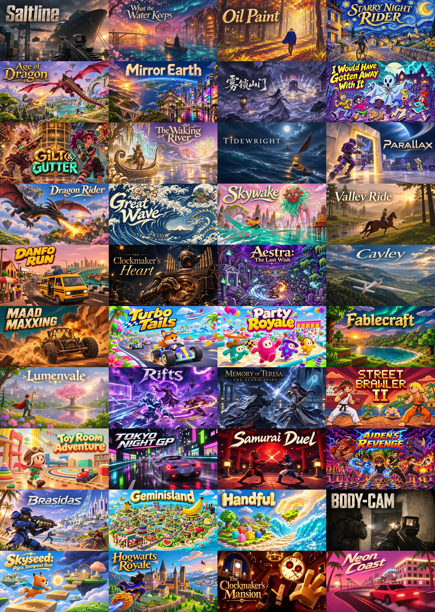</a>

A curated list of **games made with AI coding models**, most of them with Claude Fable 5.2, Anthropic's model released on November 9, 2026: browser games you can play right now, Unreal and Roblox projects, and one-prompt experiments. Each game names the model its maker says they used. Every game is credited to its maker and linked to the post where they shared it. Where the maker published the prompt, it's copied here word for word.

**40 games · 29 playable in the browser · 5 with prompts** · Updated 2026-11-13

Most games also have a page on **[vibegamer.io](https://vibegamer.io?utm_source=github&utm_medium=readme&utm_campaign=awesome-claude-fable-games)** with its trailer, screenshots and a play button.

More from Claude: **[awesome-claude-fable-videos](https://github.com/ummydev/awesome-claude-fable-videos)** (films and 3D worlds) and **[awesome-claude-motion-video](https://github.com/ummydev/awesome-claude-motion-video)** (launch films and motion graphics made with Opus 5.5).

## Contents

- [All games](#all-games)
- [Games](#games)
- [How we pick and score](#how-we-pick-and-score)
- [Add a game](#add-a-game)
- [Credits and removal](#credits-and-removal)

## All games

Sorted by our score, then by likes on the original post.

| | Game | Maker | Model | Play | Post | Likes | Prompt | Score |
|---|---|---|---|---|---|---|---|---|
| <a href="#saltline">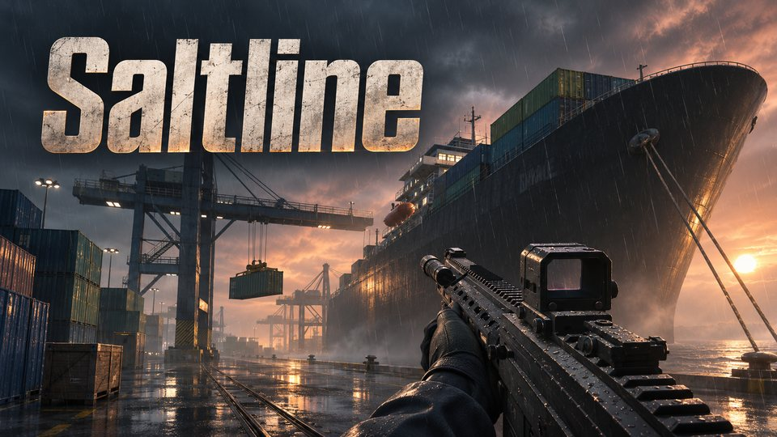</a> | **[Saltline](#saltline)** | [Felix Rieseberg](https://x.com/felixrieseberg) | Claude Fable 5.2 | [▶ Play URL](https://claude.ai/artifact/BGY1SztrAYcJQHSsnHHGmp) | [X](https://x.com/felixrieseberg/status/2119925633564463609) | 13.6K | ✓ | 10/10 |
| <a href="#what-the-water-keeps">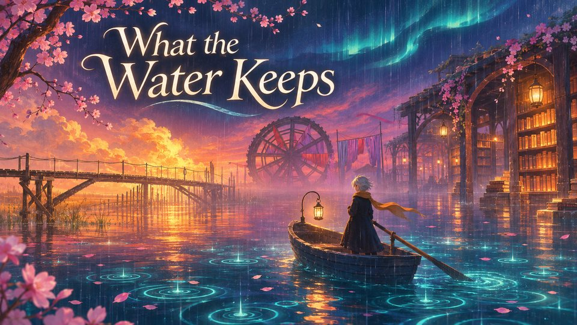</a> | **[What the Water Keeps](#what-the-water-keeps)** | [Kevin Ngo](https://x.com/kevin_t_ngo) | Claude Fable 5.2 | [▶ Play URL](https://what-the-water-keeps.vercel.app/) | [X](https://x.com/kevin_t_ngo/status/2119868968307695818) | 4.1K |  | 9/10 |
| <a href="#oil-paint">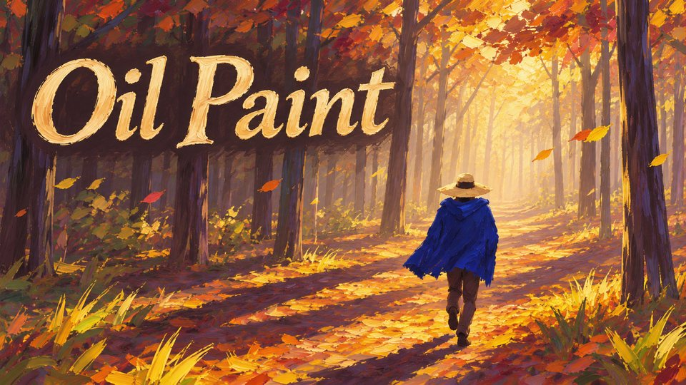</a> | **[Oil Paint](#oil-paint)** | [Blendi](https://x.com/BlendiByl) | Claude Fable 5.2 | [▶ Play URL](https://patch.gg/blendi/oil-paint) | [X](https://x.com/BlendiByl/status/2120341251178594532) | 4K |  | 9/10 |
| <a href="#starry-night-rider">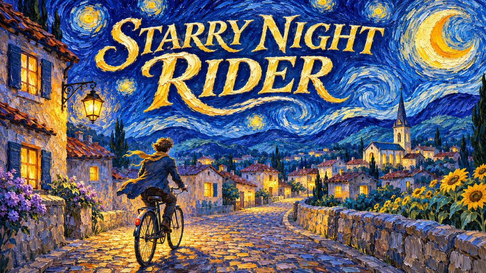</a> | **[Starry Night Rider](#starry-night-rider)** | [Ebby Amir](https://x.com/ebbyamir) | Claude Fable 5.2 | [▶ Play URL](https://starrynightrider.com) | [X](https://x.com/ebbyamir/status/2120284261089673376) | 3K |  | 9/10 |
| <a href="#age-of-dragon">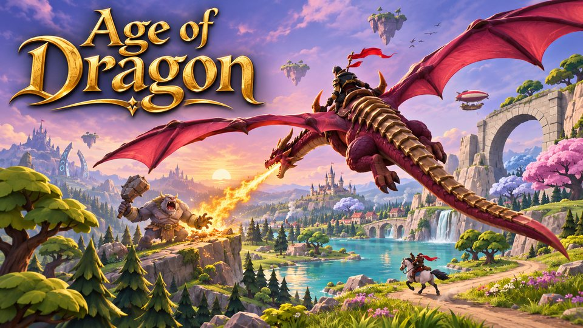</a> | **[Age of Dragon](#age-of-dragon)** | [Mike Houser](https://x.com/M__Houser) | Claude Fable 5.2 and Claude Opus 5.5 | video only | [X](https://x.com/M__Houser/status/2120253236309569696) | 2.5K |  | 9/10 |
| <a href="#mirror-earth">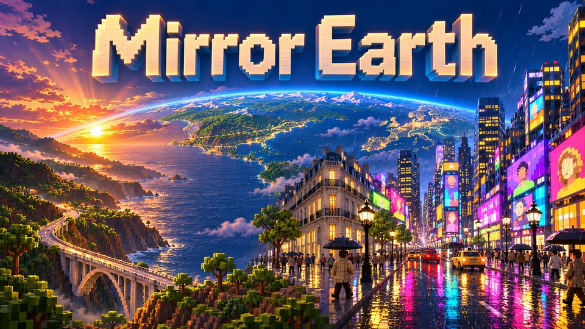</a> | **[Mirror Earth](#mirror-earth)** | [Matt Shumer](https://x.com/mattshumer_) | Claude Fable 5.2 | [▶ Play URL](https://www.spawn.co/@mattshumer/earth?room=local) | [X](https://x.com/mattshumer_/status/2119877065701036047) | 2.4K |  | 9/10 |
| <a href="#mist-locked-gate">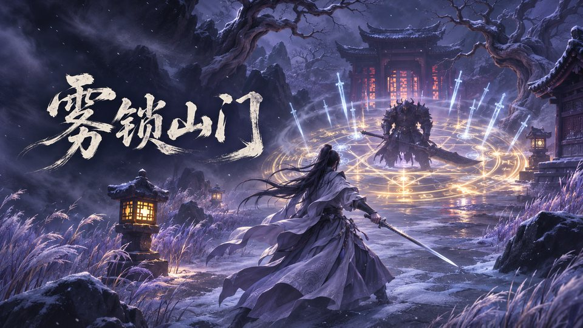</a> | **[Mist-Locked Gate (雾锁山门)](#mist-locked-gate)** | [歸藏 (Guizang)](https://x.com/op7418) | Claude Fable 5.2 | [▶ Play URL](https://op7418.github.io/guizang-game-skill/) | [X](https://x.com/op7418/status/2120694045299327187) | 769 |  | 9/10 |
| <a href="#i-would-have-gotten-away-with-it">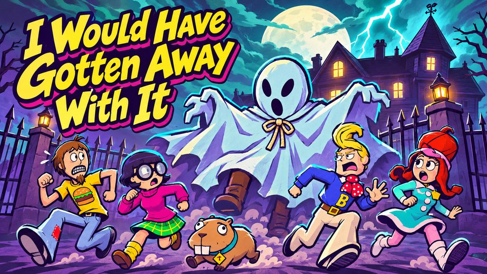</a> | **[I Would Have Gotten Away With It](#i-would-have-gotten-away-with-it)** | [Ethan Mollick](https://x.com/emollick) | Claude Fable 5.2 | [▶ Play URL](https://i-would-have-gotten-away-with-it.netlify.app) | [X](https://x.com/emollick/status/2119876449494540554) | 503 |  | 9/10 |
| <a href="#gilt-and-gutter">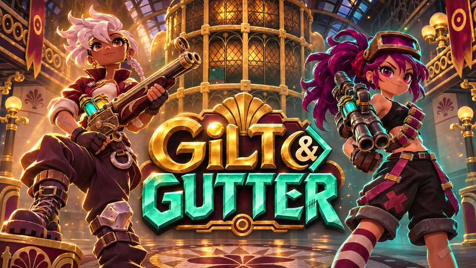</a> | **[Gilt & Gutter](#gilt-and-gutter)** | [Kevin Ngo](https://x.com/kevin_t_ngo) | Claude Fable 5.2 | [▶ Play URL](https://gilt-and-gutter.vercel.app) | [X](https://x.com/kevin_t_ngo/status/2119900487688622171) | 318 |  | 9/10 |
| <a href="#the-waking-river">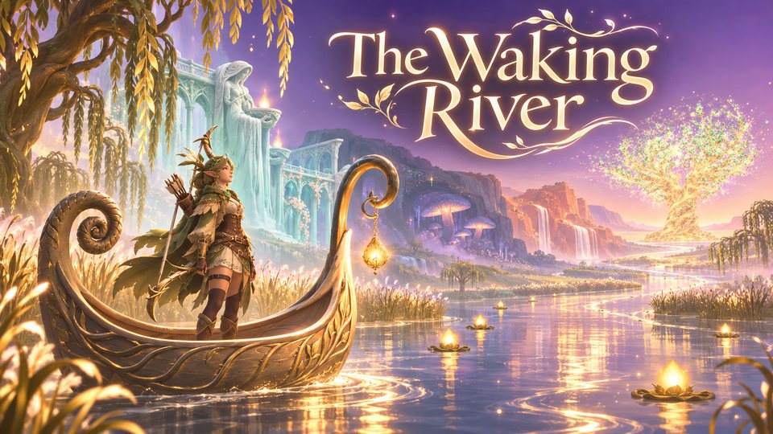</a> | **[The Waking River](#the-waking-river)** | [Florence](https://x.com/flxrnc) | Claude Fable 5.2 | [▶ Play URL](https://rivergame-kappa.vercel.app) | [X](https://x.com/flxrnc/status/2120494277528580110) | 86 |  | 9/10 |
| <a href="#tidewright">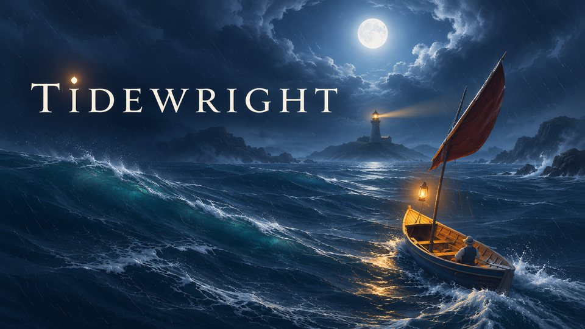</a> | **[Tidewright](#tidewright)** | [Felix Rieseberg](https://x.com/felixrieseberg) | Claude Fable 5.2 | [▶ Play URL](https://claude.ai/artifact/JTgyEMn7sn1q2riWrMb7D4) | [X](https://x.com/felixrieseberg/status/2119867839033352596) |  |  | 9/10 |
| <a href="#parallax">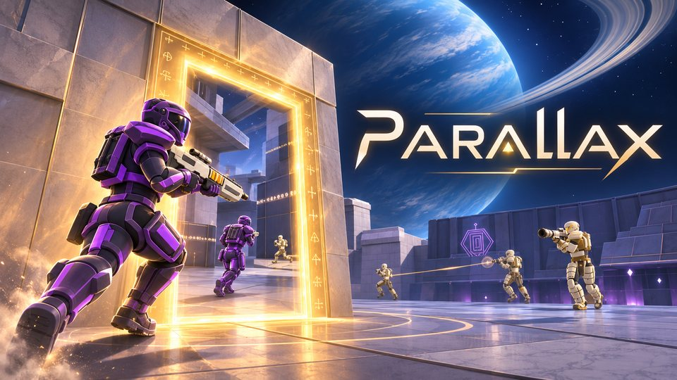</a> | **[Parallax](#parallax)** | [Sholto Douglas](https://x.com/_sholtodouglas) | Claude Fable 5.2 | video only | [X](https://x.com/_sholtodouglas/status/2119935331499925557) | 1.9K |  | 8.5/10 |
| <a href="#dragon-rider">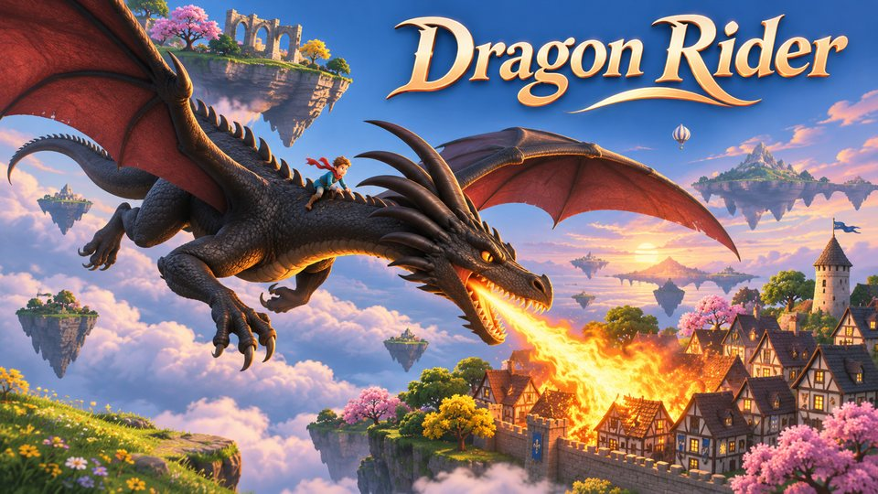</a> | **[Dragon Rider](#dragon-rider)** | [Future Brian](https://x.com/ForwardEditor) | Claude Fable 5.2 | video only | [X](https://x.com/ForwardEditor/status/2119867743965163994) | 461 |  | 8.5/10 |
| <a href="#great-wave">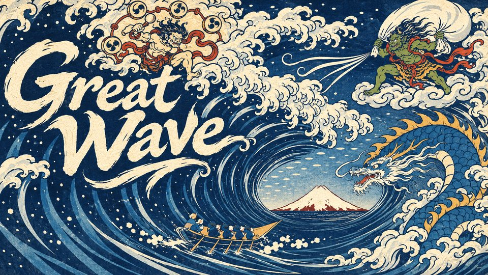</a> | **[Great Wave](#great-wave)** | [Nil Ni](https://x.com/_nilni) | Claude Fable 5.2 | [▶ Play URL](https://www.aigameshare.com/games/great-wave-off-kanagawa) | [X](https://x.com/_nilni/status/2120797996610994355) | 7 |  | 8.3/10 |
| <a href="#skywake">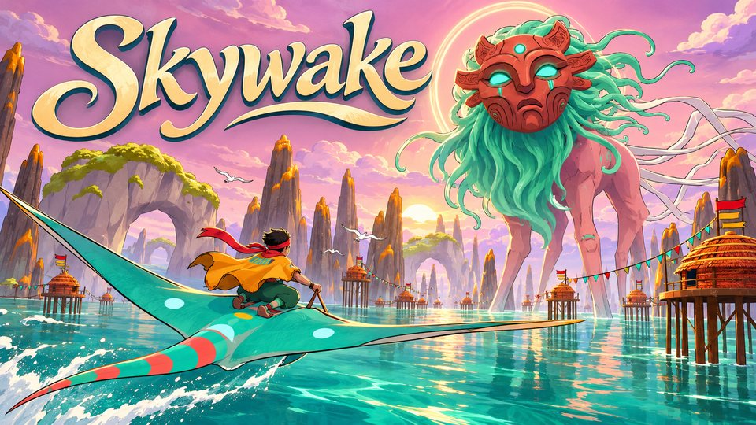</a> | **[Skywake: Kite & Mo's Big Flight](#skywake)** | [Aniket J](https://x.com/aniketjart) | Gemini 4 Argon and Claude Opus 5.5 | [▶ Play URL](https://app.usecrayon.ai/play/992c2130-43da-416b-a577-aed9514d3057) | [X](https://x.com/aniketjart/status/2117508141076378029) | 203 |  | 8.2/10 |
| <a href="#valley-ride">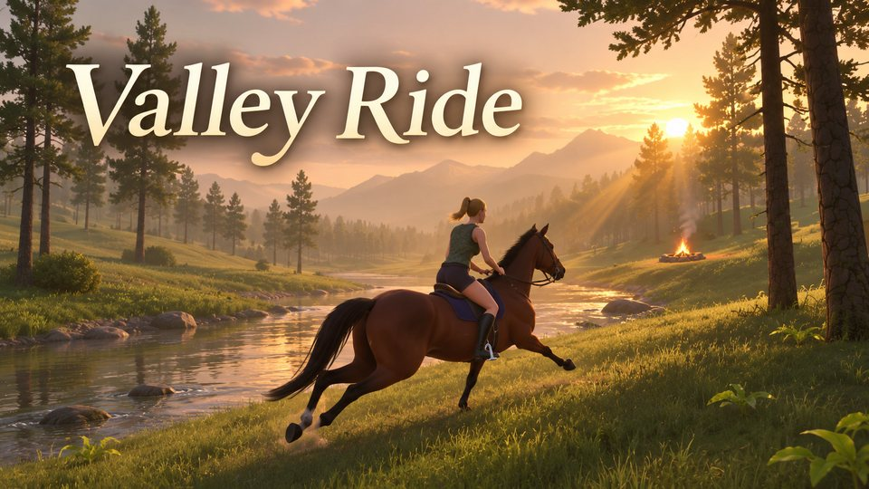</a> | **[Valley Ride](#valley-ride)** | [Prasenjit](https://x.com/prasenx) | Claude Opus 5.5 and Claude Fable 5.2 | [▶ Play URL](https://starknightt.github.io/valley-ride/) | [X](https://x.com/prasenx/status/2120565971270459430) | 162 |  | 8.2/10 |
| <a href="#danfo-run">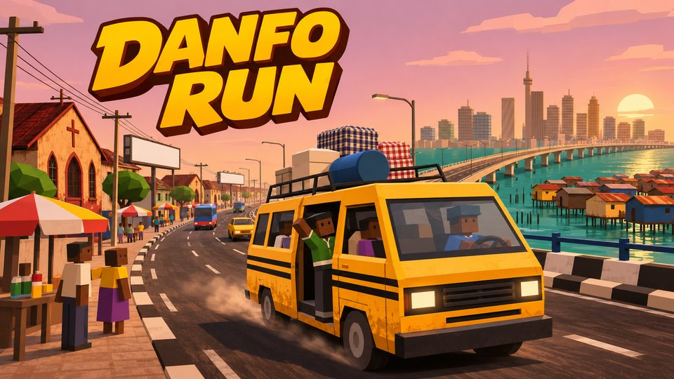</a> | **[Danfo Run](#danfo-run)** | [Eureka](https://x.com/eureka_seamless) | Claude (version not stated) | [▶ Play URL](https://danforun.com) | [X](https://x.com/eureka_seamless/status/2103938108668420286) | 36.8K |  | 8/10 |
| <a href="#the-clockmakers-heart">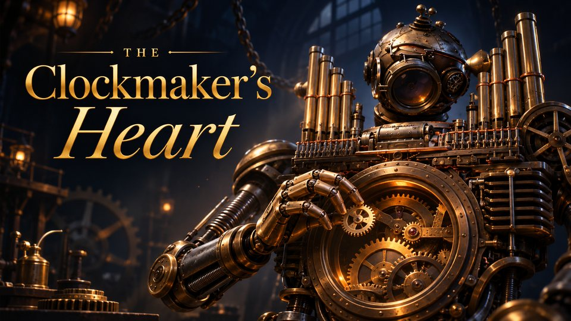</a> | **[The Clockmaker's Heart](#the-clockmakers-heart)** | [Felix Rieseberg](https://x.com/felixrieseberg) | Claude Fable 5.2 | [▶ Play URL](https://claude.ai/artifact/6MjtQjf4ee1ZZjEpafaEpa) | [X](https://x.com/felixrieseberg/status/2119867839033352596) | 283 |  | 8/10 |
| <a href="#aestra-the-last-wish">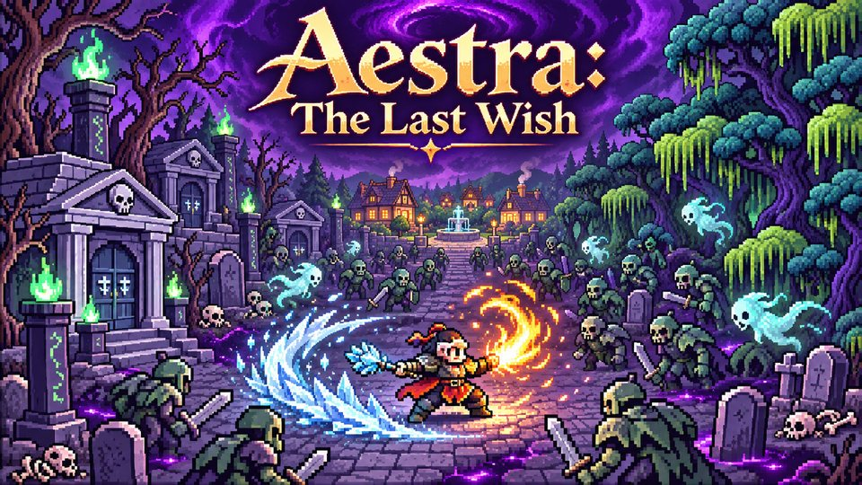</a> | **[Aestra: The Last Wish](#aestra-the-last-wish)** | [Mike Houser](https://x.com/M__Houser) | Claude Opus 5.5 (on Tesana) | [▶ Play URL](https://tesana.com/game/aestra-the-last-wish) | [X](https://x.com/M__Houser/status/2115438489995190285) | 281 |  | 8/10 |
| <a href="#cayley">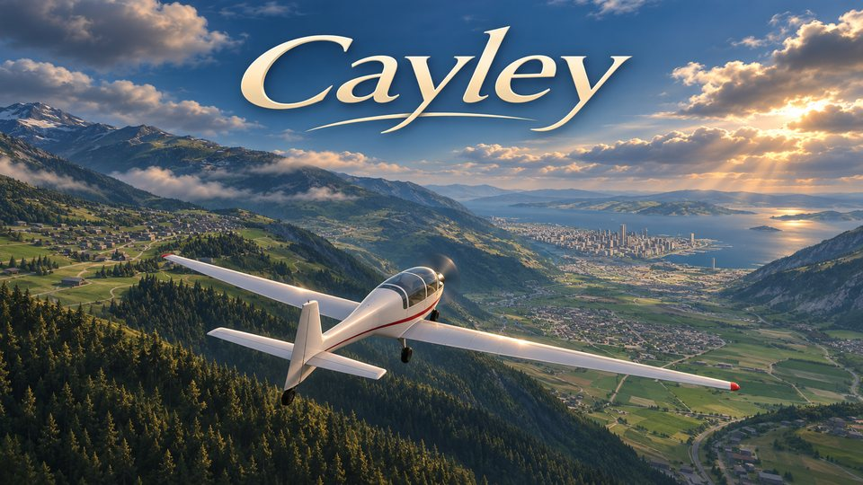</a> | **[Cayley](#cayley)** | [Lionel Mora](https://x.com/lionel_mora) | Claude Fable 5.2 | [▶ Play URL](https://lauramionel.github.io/cayley-flight-simulator/) | [X](https://x.com/lionel_mora/status/2120554787812860294) | 280 |  | 8/10 |
| <a href="#maad-maxxing"></a> | **[MAAD MAXXING](#maad-maxxing)** | [Andrew Blumson](https://x.com/Andrew_Blumson) | Claude Fable 5.2 | [▶ Play URL](https://maad-maxxing.vercel.app) | [X](https://x.com/Andrew_Blumson/status/2120599812512833557) | 165 |  | 8/10 |
| <a href="#turbo-tails">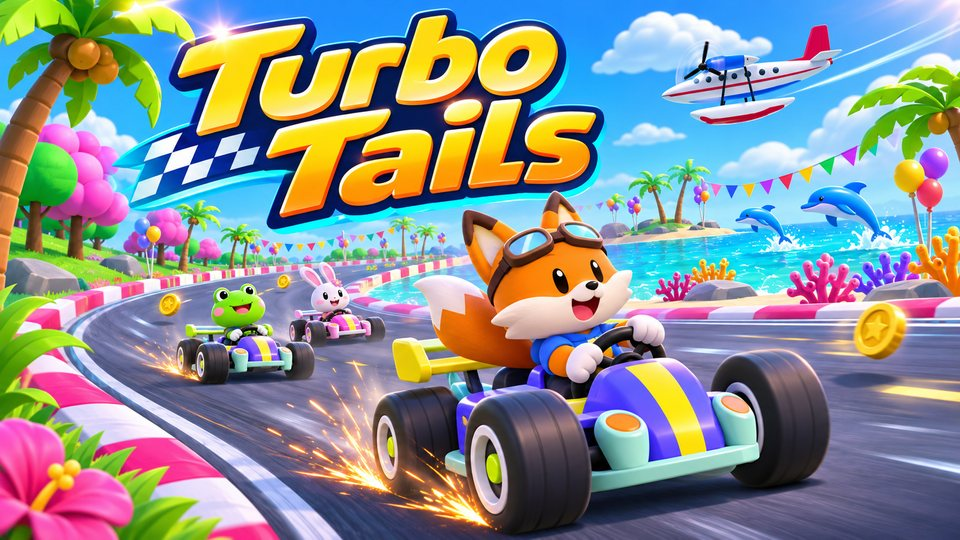</a> | **[Turbo Tails](#turbo-tails)** | [Peter Yang](https://x.com/petergyang) | Claude Fable 5.2 | [▶ Play URL](https://turbo-tails.vercel.app) | [X](https://x.com/petergyang/status/2119901658394358005) | 137 | ✓ | 8/10 |
| <a href="#party-royale"></a> | **[Party Royale](#party-royale)** | [Matthew Berman](https://x.com/MatthewBerman) | Claude Fable 5.2 | video only | [X](https://x.com/MatthewBerman/status/2119868630989254665) | 97 |  | 8/10 |
| <a href="#fablecraft">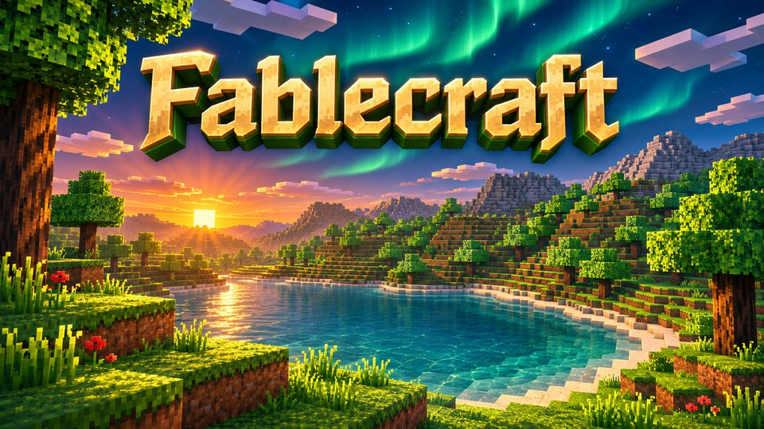</a> | **[Fablecraft](#fablecraft)** | [@RezAIT00](https://x.com/RezAIT00) | Claude Fable 5.2 | video only | [X](https://x.com/RezAIT00/status/2119902470205997344) | 71 | ✓ | 8/10 |
| <a href="#lumenvale">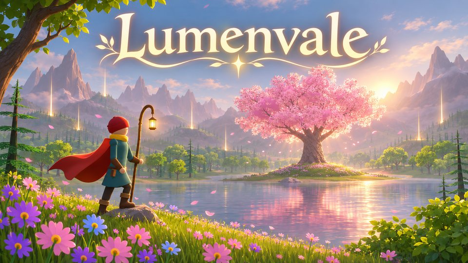</a> | **[Lumenvale](#lumenvale)** | [Sai](https://x.com/sai0xgen) | Claude Fable 5.2 | [▶ Play URL](https://claude.ai/artifact/9bekwKPUpCNDqEfgR8zwQa) | [X](https://x.com/sai0xgen/status/2120758436581589369) | 35 |  | 8/10 |
| <a href="#rifts">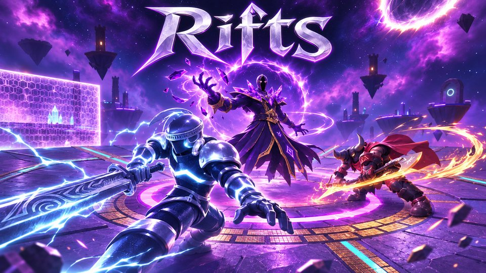</a> | **[Rifts](#rifts)** | [Abbi](https://x.com/Pumpnasterr) | Claude Fable 5.2 | [▶ Play URL](https://www.spawn.co/@abbidabbi/rifts) | [X](https://x.com/Pumpnasterr/status/2119895877250609238) | 31 |  | 8/10 |
| <a href="#memory-of-teresa-the-storm-spire">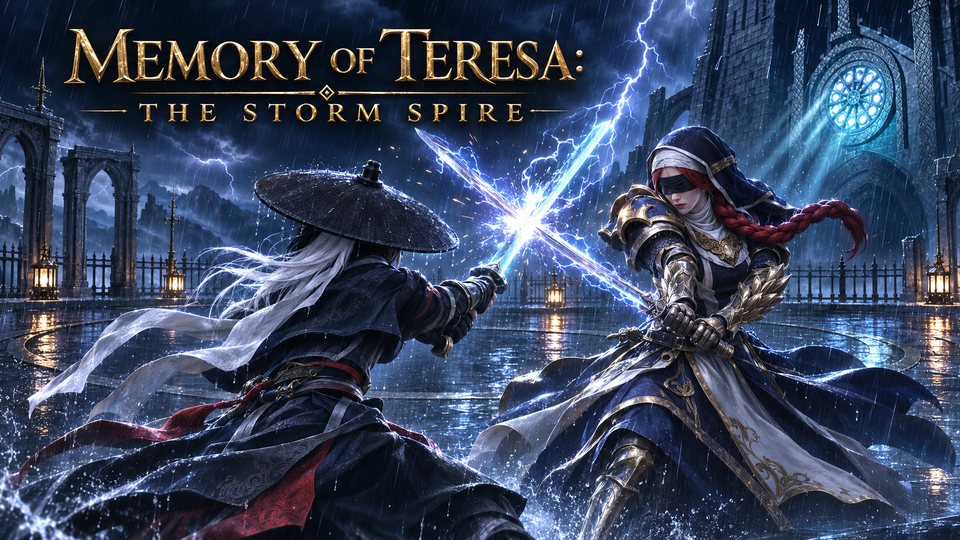</a> | **[Memory of Teresa: The Storm Spire](#memory-of-teresa-the-storm-spire)** | [@OneHitKillDev](https://x.com/OneHitKillDev) | Claude Fable 5.2 | [▶ Play URL](https://www.spawn.co/@chocopuff/one-hit-kill) | [X](https://x.com/OneHitKillDev/status/2119882801222709524) | 31 |  | 8/10 |
| <a href="#street-brawler-ii">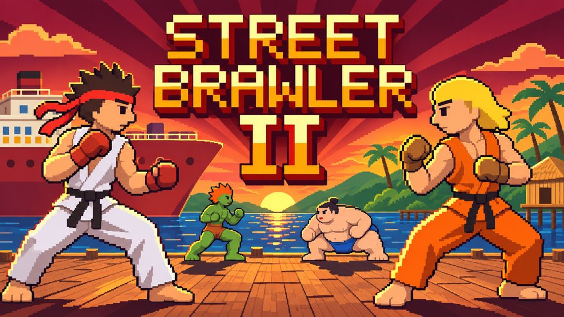</a> | **[Street Brawler II](#street-brawler-ii)** | [@BertrandDiouly](https://x.com/BertrandDiouly) | Claude Fable 5.2 | video only | [X](https://x.com/BertrandDiouly/status/2119886197648765001) | 21 |  | 8/10 |
| <a href="#toy-room-adventure">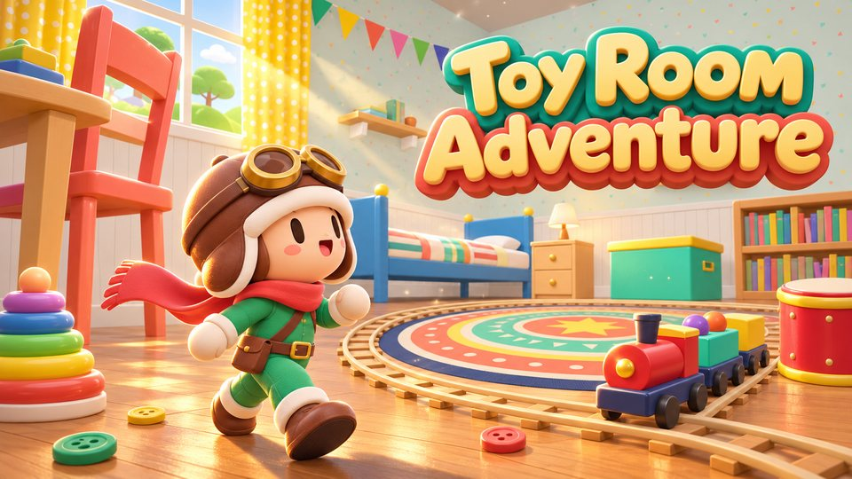</a> | **[Toy Room Adventure](#toy-room-adventure)** | [Sotiris Kaniras](https://x.com/itssotsot) | Claude Fable 5.2 | video only | [X](https://x.com/itssotsot/status/2119909017216491720) | 5 | ✓ | 8/10 |
| <a href="#tokyo-night-gp">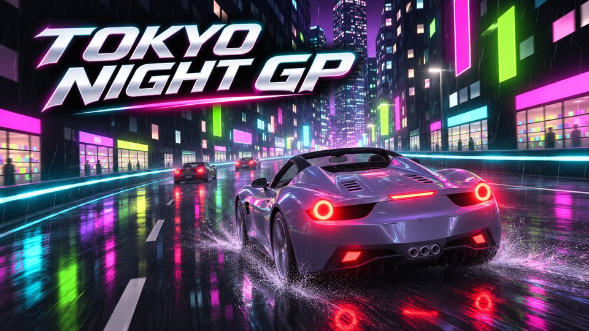</a> | **[Tokyo Night GP](#tokyo-night-gp)** | [@nikodemszymansk](https://x.com/nikodemszymansk) | Claude Fable 5.2 | video only | [X](https://x.com/nikodemszymansk/status/2119880518875435022) | 4 |  | 8/10 |
| <a href="#samurai-duel">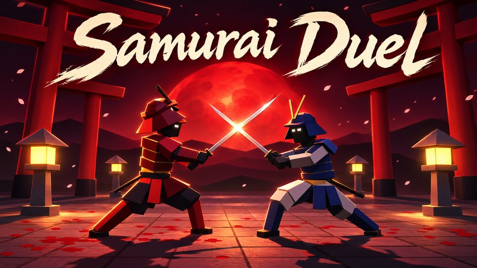</a> | **[Samurai Duel](#samurai-duel)** | [@tymarsha](https://x.com/tymarsha) | Claude Fable 5.2 | video only | [X](https://x.com/tymarsha/status/2119904015454810582) |  |  | 8/10 |
| <a href="#aidens-revenge">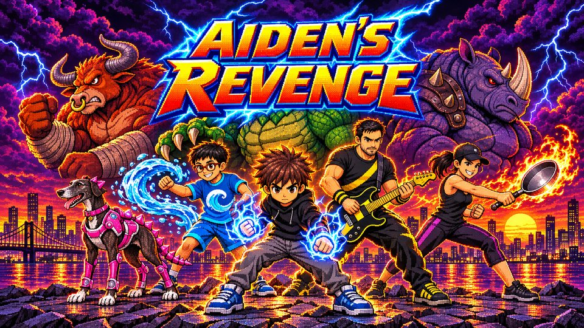</a> | **[Aiden's Revenge](#aidens-revenge)** | Lex Toumbourou | Claude Fable 5.2 | [▶ Play URL](https://aidens-revenge.pages.dev/) | [blog post](https://notesbylex.com/fable-5-2-one-shotted-my-nephews-dream-game) |  |  | 8/10 |
| <a href="#brasidas">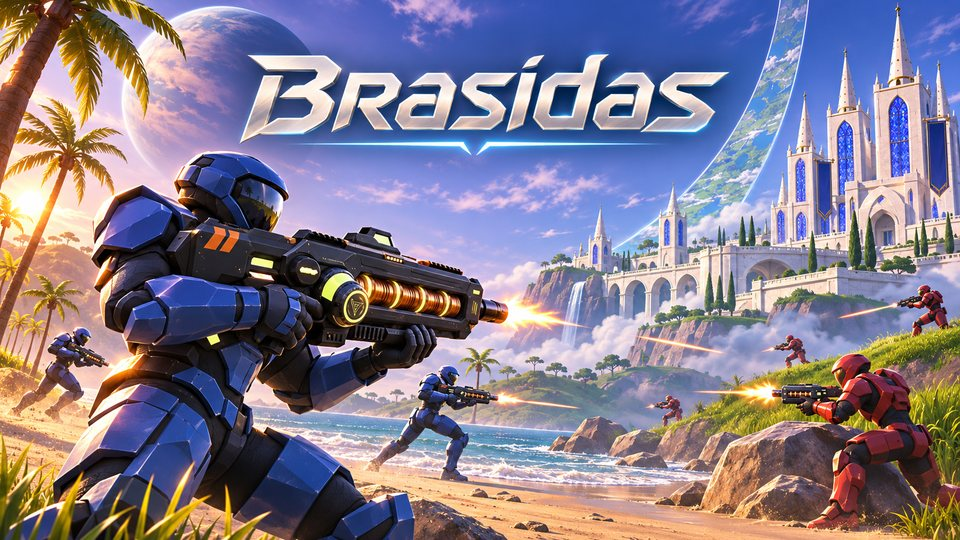</a> | **[Brasidas](#brasidas)** | [Mike Houser](https://x.com/M__Houser) | Tesana (model not stated) | [▶ Play URL](https://tesana.com/game/brasidas) | [X](https://x.com/TesanaAI/status/2115049380382437886) |  |  | 8/10 |
| <a href="#geminisland">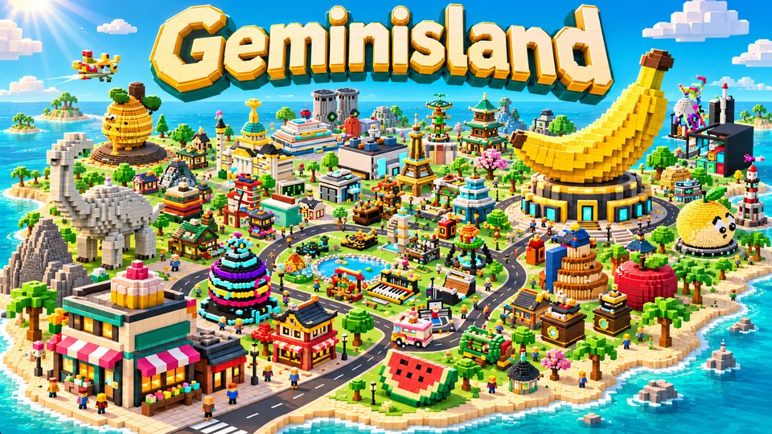</a> | **[Geminisland](#geminisland)** | [Google AI](https://x.com/GoogleAI) | Gemini 4 Hydrogen | [▶ Play URL](https://aistudio.google.com/apps/bundled/geminisland?showPreview=true&showAssistant=true&fullscreenApplet=true) | [X](https://x.com/GoogleAI/status/2120940684924403798) |  |  | 8/10 |
| <a href="#handful-island-god-game">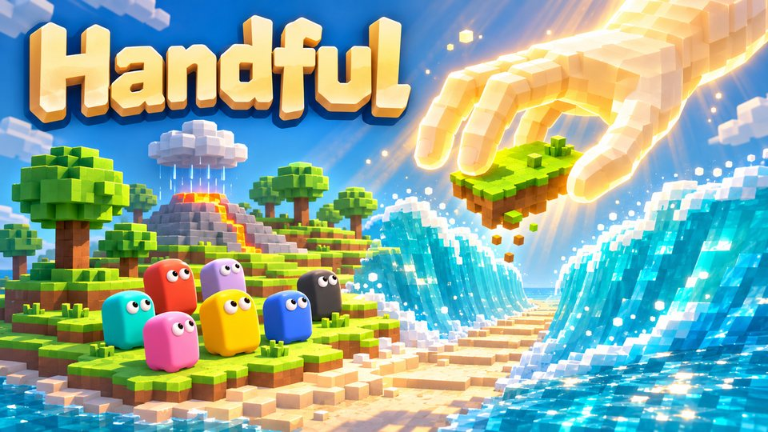</a> | **[Handful: Island God Game](#handful-island-god-game)** | [Nil Ni](https://x.com/_nilni) | Claude Fable 5.2 | [▶ Play URL](https://www.aigameshare.com/games/island-god-game) | [X](https://x.com/_nilni/status/2120639452146250153) | 11 |  | 7.8/10 |
| <a href="#body-cam">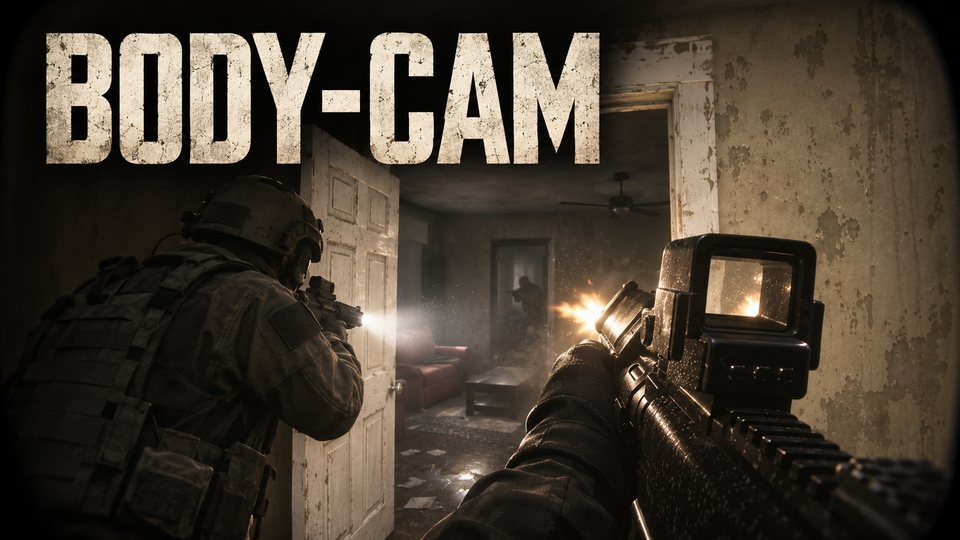</a> | **[BODY-CAM](#body-cam)** | Juicer | Tesana (model not stated) | [▶ Play URL](https://tesana.com/game/body-cam) | [X](https://x.com/TesanaAI/status/2112043090043449620) |  |  | 7.8/10 |
| <a href="#skyseed-pips-tempest-run">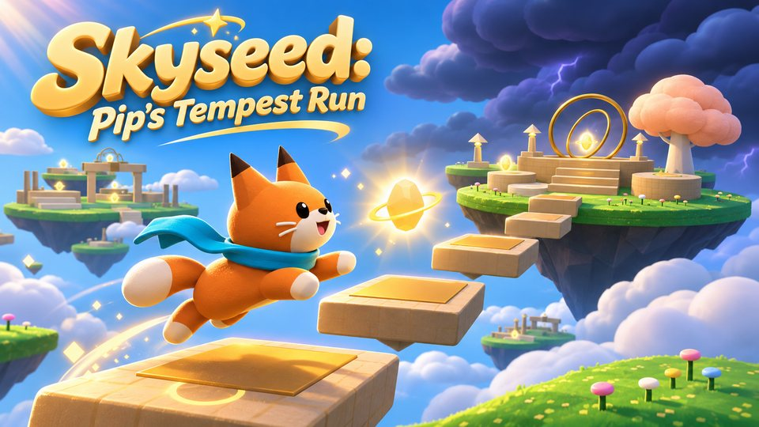</a> | **[Skyseed: Pip's Tempest Run](#skyseed-pips-tempest-run)** | [Sahil Panhotra](https://x.com/SahilPanhotra) | Gemini 4 Hydrogen | [▶ Play URL](https://01a1b677-97ba-7006-a384-e83b3e5793db.arena.site/) | [X](https://x.com/SahilPanhotra/status/2119102771173769262) | 60 |  | 7.5/10 |
| <a href="#hogwarts-royale">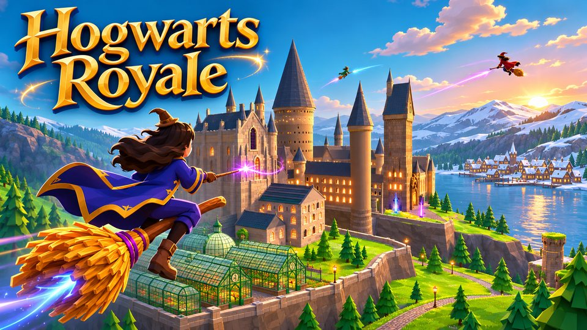</a> | **[Hogwarts Royale](#hogwarts-royale)** | [Matt Shumer](https://x.com/mattshumer_) | Claude Fable 5.2 | [▶ Play URL](https://www.spawn.co/@mattshumer/hogwarts-royale) | [X](https://x.com/mattshumer_/status/2119872098306810226) | 307 | ✓ | 7/10 |
| <a href="#the-clockmakers-mansion">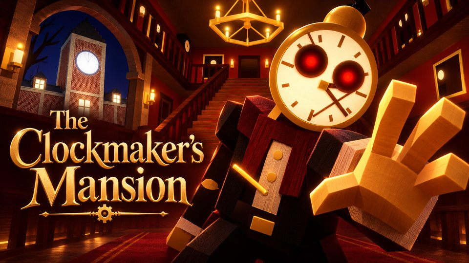</a> | **[The Clockmaker's Mansion](#the-clockmakers-mansion)** | [@mihawkxxxxx](https://x.com/mihawkxxxxx) | Claude Fable 5.2 | video only | [X](https://x.com/mihawkxxxxx/status/2119909865296699749) | 11 |  | 7/10 |
| <a href="#neon-coast">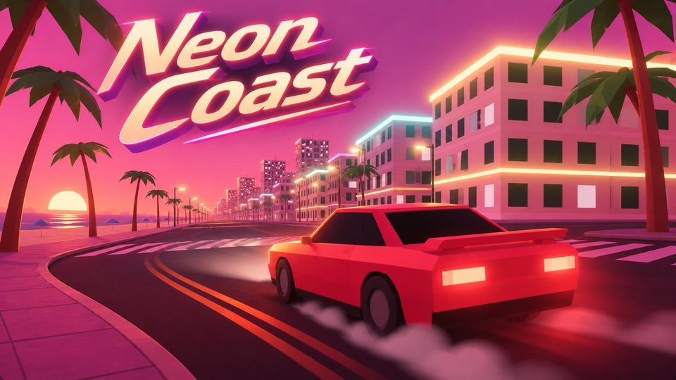</a> | **[Neon Coast](#neon-coast)** | [@ashwinntwt](https://x.com/ashwinntwt) | Claude Fable 5.2 | video only | [X](https://x.com/ashwinntwt/status/2119890312382603459) | 8 |  | 7/10 |

## Games

### Saltline
<a id="saltline"></a>

<a href="https://vibegamer.io/game/saltline?utm_source=github&utm_medium=readme&utm_campaign=awesome-claude-fable-games"></a>

A rain-soaked container-port FPS that Claude Fable 5.2 built in about eight hours, every model and sound included.

<p>  </p>

- **Made by:** Felix Rieseberg ([@felixrieseberg](https://x.com/felixrieseberg))
- **Model:** Claude Fable 5.2
- **Saltline game URL:** https://claude.ai/artifact/BGY1SztrAYcJQHSsnHHGmp
- **Original post:** https://x.com/felixrieseberg/status/2119925633564463609 (13.6K likes, 4.0M views, checked November 11, 2026)
- **Tags:** FPS, Shooter, 3D
- **Saltline on VibeGamer (trailer, screenshots, reviews):** [vibegamer.io/game/saltline](https://vibegamer.io/game/saltline?utm_source=github&utm_medium=readme&utm_campaign=awesome-claude-fable-games)

**Prompt** (verbatim from the maker; the opening of the prompt, from the maker's reply):

```text
You know, you should also build me a FPS. Insanely detailed quality pls, something that looks visually like it can keep up with AAA. Make it small in scope (like a tiny level) but …
```

<sub>Our score: 10/10 for visuals and polish.</sub>

### What the Water Keeps
<a id="what-the-water-keeps"></a>

<a href="https://vibegamer.io/game/what-the-water-keeps?utm_source=github&utm_medium=readme&utm_campaign=awesome-claude-fable-games"></a>

A slow, lantern-lit boat ride through eight dreamlike worlds, made with Claude Fable 5.2 and Three.js.

<p>  </p>

- **Made by:** Kevin Ngo ([@kevin_t_ngo](https://x.com/kevin_t_ngo))
- **Model:** Claude Fable 5.2
- **What the Water Keeps game URL:** https://what-the-water-keeps.vercel.app/
- **Original post:** https://x.com/kevin_t_ngo/status/2119868968307695818 (4.1K likes, 465K views, checked November 11, 2026)
- **Tags:** Adventure, 3D, Cosy
- **What the Water Keeps on VibeGamer (trailer, screenshots, reviews):** [vibegamer.io/game/what-the-water-keeps](https://vibegamer.io/game/what-the-water-keeps?utm_source=github&utm_medium=readme&utm_campaign=awesome-claude-fable-games)

<sub>Our score: 9/10 for visuals and polish.</sub>

### Oil Paint
<a id="oil-paint"></a>

<a href="https://vibegamer.io/game/oil-paint?utm_source=github&utm_medium=readme&utm_campaign=awesome-claude-fable-games"></a>

Walk through an autumn forest that looks hand-painted: about 1.5 million brush strokes a frame, at 200 fps in a browser tab.

<p>  </p>

- **Made by:** Blendi ([@BlendiByl](https://x.com/BlendiByl))
- **Model:** Claude Fable 5.2
- **Oil Paint game URL:** https://patch.gg/blendi/oil-paint
- **Original post:** https://x.com/BlendiByl/status/2120341251178594532 (4K likes, 193.1K views, checked November 11, 2026)
- **Source:** open source, https://patch.gg/blendi/oil-paint
- **Tags:** 3D, Cosy, Sandbox
- **Oil Paint on VibeGamer (trailer, screenshots, reviews):** [vibegamer.io/game/oil-paint](https://vibegamer.io/game/oil-paint?utm_source=github&utm_medium=readme&utm_campaign=awesome-claude-fable-games)

<sub>Our score: 9/10 for visuals and polish.</sub>

### Starry Night Rider
<a id="starry-night-rider"></a>

<a href="https://vibegamer.io/game/starry-night-rider?utm_source=github&utm_medium=readme&utm_campaign=awesome-claude-fable-games"></a>

Ride a bicycle through the village of Van Gogh's The Starry Night, every street painted in swirling brushstrokes.

<p>  </p>

- **Made by:** Ebby Amir ([@ebbyamir](https://x.com/ebbyamir))
- **Model:** Claude Fable 5.2
- **Starry Night Rider game URL:** https://starrynightrider.com
- **Original post:** https://x.com/ebbyamir/status/2120284261089673376 (3K likes, 173.4K views, checked November 11, 2026)
- **Tags:** 3D, Cosy, Adventure
- **Starry Night Rider on VibeGamer (trailer, screenshots, reviews):** [vibegamer.io/game/starry-night-rider](https://vibegamer.io/game/starry-night-rider?utm_source=github&utm_medium=readme&utm_campaign=awesome-claude-fable-games)

<sub>Our score: 9/10 for visuals and polish.</sub>

### Age of Dragon
<a id="age-of-dragon"></a>

<a href="https://x.com/M__Houser/status/2120253236309569696"></a>

A huge open-world 3D fantasy RPG on a 12 × 12 km island, which its maker puts at about twice Skyrim's map: fly a dragon, ride horses and clear nine dungeons. He says he can't code and built it in a few days with Fable 5.2 and Opus 5.5; a free playable version is promised soon.

<p>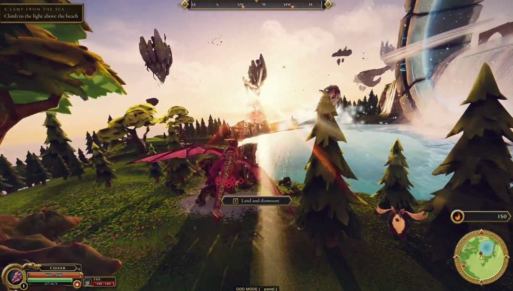 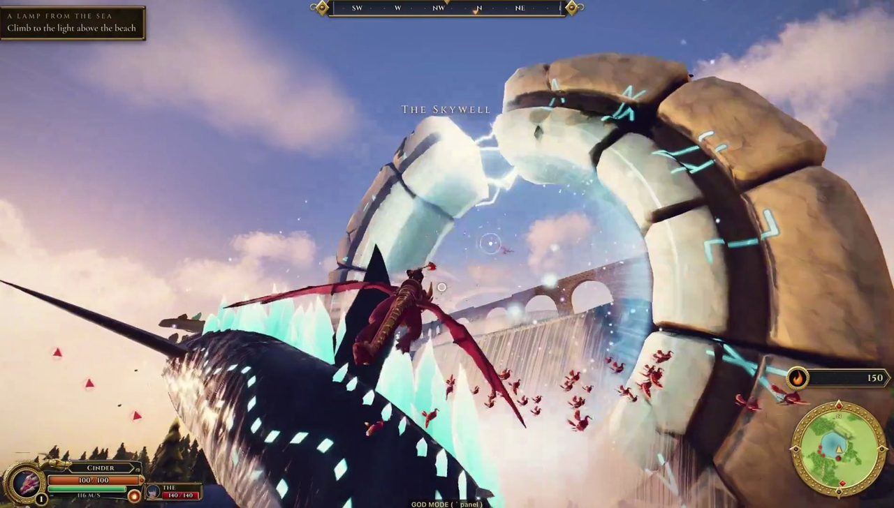 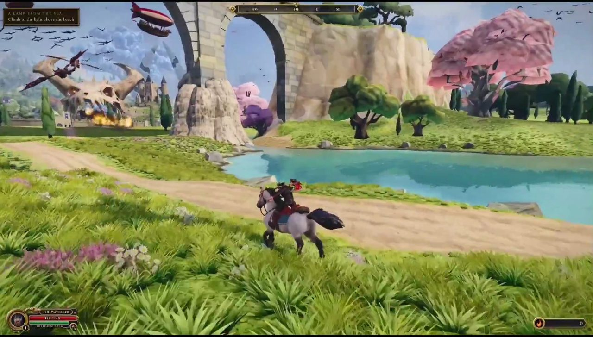</p>

- **Made by:** Mike Houser ([@M__Houser](https://x.com/M__Houser))
- **Model:** Claude Fable 5.2 and Claude Opus 5.5
- **Play:** no public build yet; watch the gameplay video in the post
- **Original post:** https://x.com/M__Houser/status/2120253236309569696 (2.5K likes, 350.5K views, checked November 13, 2026)
- **Tags:** Open world, RPG, 3D

<sub>Our score: 9/10 for visuals and polish.</sub>

### Mirror Earth
<a id="mirror-earth"></a>

<a href="https://vibegamer.io/game/mirror-earth?utm_source=github&utm_medium=readme&utm_campaign=awesome-claude-fable-games"></a>

The whole planet in voxels, in your browser: go anywhere, break anything, with weather that matches the real Earth live.

<p>  </p>

- **Made by:** Matt Shumer ([@mattshumer_](https://x.com/mattshumer_))
- **Model:** Claude Fable 5.2
- **Mirror Earth game URL:** https://www.spawn.co/@mattshumer/earth?room=local
- **Original post:** https://x.com/mattshumer_/status/2119877065701036047 (2.4K likes, 398.6K views, checked November 11, 2026)
- **Tags:** Open world, Sandbox, 3D
- **Mirror Earth on VibeGamer (trailer, screenshots, reviews):** [vibegamer.io/game/mirror-earth](https://vibegamer.io/game/mirror-earth?utm_source=github&utm_medium=readme&utm_campaign=awesome-claude-fable-games)

<sub>Our score: 9/10 for visuals and polish.</sub>

### Mist-Locked Gate (雾锁山门)
<a id="mist-locked-gate"></a>

<a href="https://vibegamer.io/game/mist-locked-gate?utm_source=github&utm_medium=readme&utm_campaign=awesome-claude-fable-games"></a>

A wuxia action game in a snowy, lantern-lit mountain shrine, built by Claude Fable 5.2 in one afternoon as a single HTML file.

<p>  </p>

- **Made by:** 歸藏 (Guizang) ([@op7418](https://x.com/op7418))
- **Model:** Claude Fable 5.2
- **Mist-Locked Gate (雾锁山门) game URL:** https://op7418.github.io/guizang-game-skill/
- **Original post:** https://x.com/op7418/status/2120694045299327187 (769 likes, 176.4K views, checked November 12, 2026)
- **Tags:** Action, Combat, 3D
- **Mist-Locked Gate (雾锁山门) on VibeGamer (trailer, screenshots, reviews):** [vibegamer.io/game/mist-locked-gate](https://vibegamer.io/game/mist-locked-gate?utm_source=github&utm_medium=readme&utm_campaign=awesome-claude-fable-games)

<sub>Our score: 9/10 for visuals and polish.</sub>

### I Would Have Gotten Away With It
<a id="i-would-have-gotten-away-with-it"></a>

<a href="https://vibegamer.io/game/i-would-have-gotten-away-with-it?utm_source=github&utm_medium=readme&utm_campaign=awesome-claude-fable-games"></a>

A reverse Scooby-Doo: you are the villain of Grimsby Manor, and your job is to scare off the meddling kids and their capybara.

<p>  </p>

- **Made by:** Ethan Mollick ([@emollick](https://x.com/emollick))
- **Model:** Claude Fable 5.2
- **I Would Have Gotten Away With It game URL:** https://i-would-have-gotten-away-with-it.netlify.app
- **Original post:** https://x.com/emollick/status/2119876449494540554 (503 likes, 31.8K views, checked November 11, 2026)
- **Tags:** Strategy, Story, 3D
- **I Would Have Gotten Away With It on VibeGamer (trailer, screenshots, reviews):** [vibegamer.io/game/i-would-have-gotten-away-with-it](https://vibegamer.io/game/i-would-have-gotten-away-with-it?utm_source=github&utm_medium=readme&utm_campaign=awesome-claude-fable-games)

<sub>Our score: 9/10 for visuals and polish.</sub>

### Gilt & Gutter
<a id="gilt-and-gutter"></a>

<a href="https://vibegamer.io/game/gilt-and-gutter?utm_source=github&utm_medium=readme&utm_campaign=awesome-claude-fable-games"></a>

A stylish 1v1 first-person shooter in a gilded arcade hall, where shots of your own colour charge your gun.

<p>  </p>

- **Made by:** Kevin Ngo ([@kevin_t_ngo](https://x.com/kevin_t_ngo))
- **Model:** Claude Fable 5.2
- **Gilt & Gutter game URL:** https://gilt-and-gutter.vercel.app
- **Original post:** https://x.com/kevin_t_ngo/status/2119900487688622171 (318 likes, 102.1K views, checked November 11, 2026)
- **Tags:** FPS, Shooter, 3D
- **Gilt & Gutter on VibeGamer (trailer, screenshots, reviews):** [vibegamer.io/game/gilt-and-gutter](https://vibegamer.io/game/gilt-and-gutter?utm_source=github&utm_medium=readme&utm_campaign=awesome-claude-fable-games)

<sub>Our score: 9/10 for visuals and polish.</sub>

### The Waking River
<a id="the-waking-river"></a>

<a href="https://vibegamer.io/game/the-waking-river?utm_source=github&utm_medium=readme&utm_campaign=awesome-claude-fable-games"></a>

Sail a golden boat through five sleeping worlds that wake as you pass, in a browser fantasy game made by Claude Fable 5.2.

<p>  </p>

- **Made by:** Florence ([@flxrnc](https://x.com/flxrnc))
- **Model:** Claude Fable 5.2
- **The Waking River game URL:** https://rivergame-kappa.vercel.app
- **Original post:** https://x.com/flxrnc/status/2120494277528580110 (86 likes, 4K views, checked November 12, 2026)
- **Prompt:** the maker shared the full prompt as a PDF, https://drive.google.com/file/d/1P-t5me9yKRK9JjiAZlEfCfpacSv6cjM6/view
- **Tags:** Adventure, Story, 3D
- **The Waking River on VibeGamer (trailer, screenshots, reviews):** [vibegamer.io/game/the-waking-river](https://vibegamer.io/game/the-waking-river?utm_source=github&utm_medium=readme&utm_campaign=awesome-claude-fable-games)

<sub>Our score: 9/10 for visuals and polish.</sub>

### Tidewright
<a id="tidewright"></a>

<a href="https://vibegamer.io/game/tidewright?utm_source=github&utm_medium=readme&utm_campaign=awesome-claude-fable-games"></a>

Sail a storm-tossed night sea and relight the lighthouses of the Thrumming Isles, built by Claude Fable 5.2.

<p> </p>

- **Made by:** Felix Rieseberg ([@felixrieseberg](https://x.com/felixrieseberg))
- **Model:** Claude Fable 5.2
- **Tidewright game URL:** https://claude.ai/artifact/JTgyEMn7sn1q2riWrMb7D4
- **Original post:** https://x.com/felixrieseberg/status/2119867839033352596
- **Tags:** Adventure, 3D
- **Tidewright on VibeGamer (trailer, screenshots, reviews):** [vibegamer.io/game/tidewright](https://vibegamer.io/game/tidewright?utm_source=github&utm_medium=readme&utm_campaign=awesome-claude-fable-games)

<sub>Our score: 9/10 for visuals and polish.</sub>

### Parallax
<a id="parallax"></a>

<a href="https://x.com/_sholtodouglas/status/2119935331499925557"></a>

An arena FPS where everyone carries a portal door: open one behind an enemy, shoot through it, or use it to board their platform, on white marble arenas under a ringed planet. Anthropic's Sholto Douglas made it with Claude Fable 5.2 and playtests it against colleagues at the office. No public build.

<p>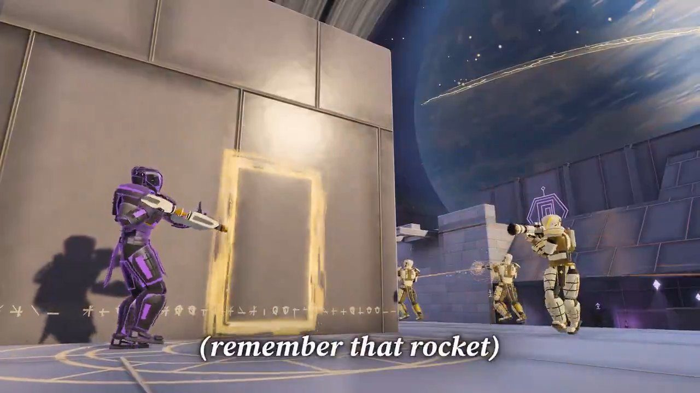 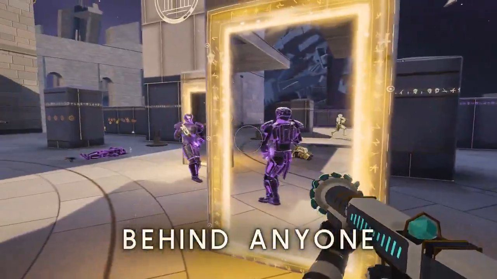 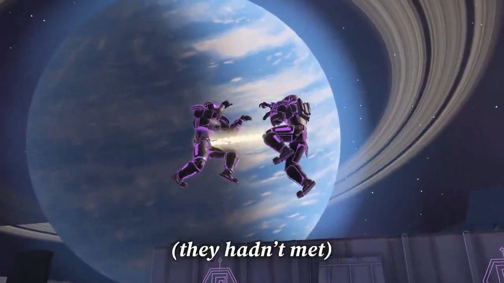</p>

- **Made by:** Sholto Douglas ([@_sholtodouglas](https://x.com/_sholtodouglas))
- **Model:** Claude Fable 5.2
- **Play:** no public build yet; watch the gameplay video in the post
- **Original post:** https://x.com/_sholtodouglas/status/2119935331499925557 (1.9K likes, checked November 13, 2026)
- **Tags:** FPS, Shooter, Multiplayer, 3D

<sub>Our score: 8.5/10 for visuals and polish.</sub>

### Dragon Rider
<a id="dragon-rider"></a>

<a href="https://x.com/ForwardEditor/status/2119867743965163994"></a>

A dragon riding sim made with early access to Claude Fable 5.2: leap off floating sky islands above a sea of clouds, dive, and breathe fire on the villages below. The maker says the jump off the island feels like a roller coaster in the stomach, and also ported it to Roblox. No public build yet.

<p>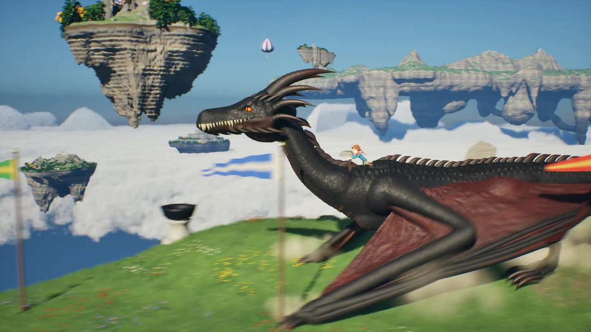 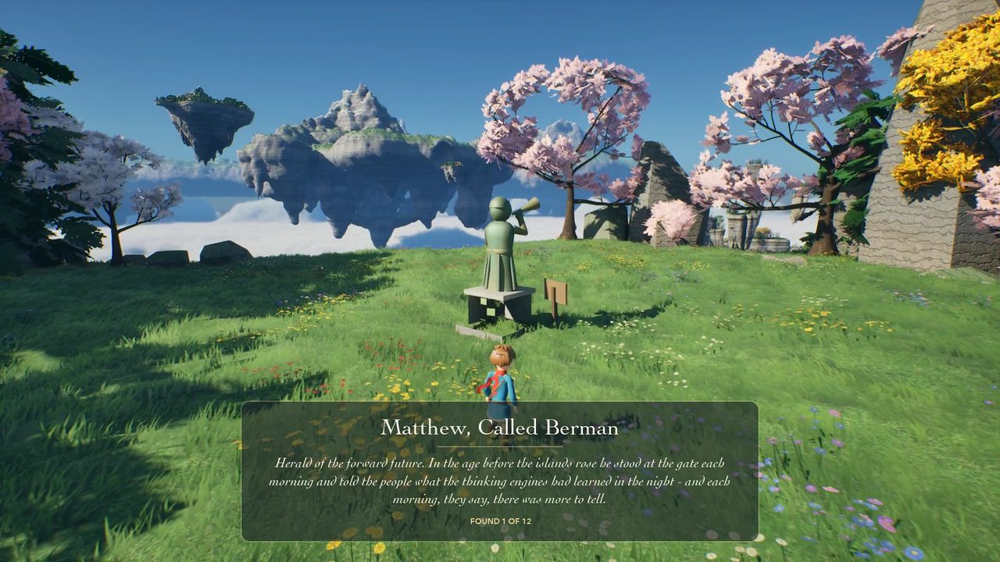 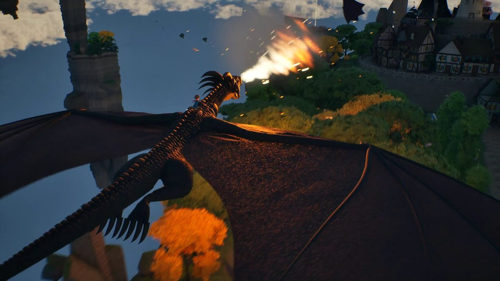</p>

- **Made by:** Future Brian ([@ForwardEditor](https://x.com/ForwardEditor))
- **Model:** Claude Fable 5.2
- **Play:** no public build yet; watch the gameplay video in the post
- **Original post:** https://x.com/ForwardEditor/status/2119867743965163994 (461 likes, checked November 13, 2026)
- **Tags:** Flight, Action, 3D

<sub>Our score: 8.5/10 for visuals and polish.</sub>

### Great Wave
<a id="great-wave"></a>

<a href="https://vibegamer.io/game/great-wave?utm_source=github&utm_medium=readme&utm_campaign=awesome-claude-fable-games"></a>

Surf Hokusai's Great Wave off Kanagawa: the woodblock print becomes a game where you row a little boat through the barrel, past the gods of wind and thunder, toward Mount Fuji. Made with Claude Fable 5.2.

<p>  </p>

- **Made by:** Nil Ni ([@_nilni](https://x.com/_nilni))
- **Model:** Claude Fable 5.2
- **Great Wave game URL:** https://www.aigameshare.com/games/great-wave-off-kanagawa
- **Original post:** https://x.com/_nilni/status/2120797996610994355 (7 likes, checked November 13, 2026)
- **Tags:** Arcade, Sports
- **Great Wave on VibeGamer (trailer, screenshots, reviews):** [vibegamer.io/game/great-wave](https://vibegamer.io/game/great-wave?utm_source=github&utm_medium=readme&utm_campaign=awesome-claude-fable-games)

<sub>Our score: 8.3/10 for visuals and polish.</sub>

### Skywake: Kite & Mo's Big Flight
<a id="skywake"></a>

<a href="https://vibegamer.io/game/skywake?utm_source=github&utm_medium=readme&utm_campaign=awesome-claude-fable-games"></a>

A storybook flying adventure: ride Mo, a big gliding sky creature, over a turquoise lagoon of rock spires, sing to giant masked Tallwalkers and dodge the lamps that throw nets. Made with Gemini 4 Argon, then refreshed with Claude Opus 5.5.

<p>  </p>

- **Made by:** Aniket J ([@aniketjart](https://x.com/aniketjart))
- **Model:** Gemini 4 Argon and Claude Opus 5.5
- **Skywake: Kite & Mo's Big Flight game URL:** https://app.usecrayon.ai/play/992c2130-43da-416b-a577-aed9514d3057
- **Original post:** https://x.com/aniketjart/status/2117508141076378029 (203 likes, checked November 13, 2026)
- **Tags:** Flight, Adventure, 3D, Cosy
- **Skywake: Kite & Mo's Big Flight on VibeGamer (trailer, screenshots, reviews):** [vibegamer.io/game/skywake](https://vibegamer.io/game/skywake?utm_source=github&utm_medium=readme&utm_campaign=awesome-claude-fable-games)

<sub>Our score: 8.2/10 for visuals and polish.</sub>

### Valley Ride
<a id="valley-ride"></a>

<a href="https://vibegamer.io/game/valley-ride?utm_source=github&utm_medium=readme&utm_campaign=awesome-claude-fable-games"></a>

A calm horse ride across a mountain valley to a campfire at sunset, in three.js and WebGPU. Built in two days with Claude Opus 5.5 and Fable 5.2, and open source.

<p>  </p>

- **Made by:** Prasenjit ([@prasenx](https://x.com/prasenx))
- **Model:** Claude Opus 5.5 and Claude Fable 5.2
- **Valley Ride game URL:** https://starknightt.github.io/valley-ride/
- **Original post:** https://x.com/prasenx/status/2120565971270459430 (162 likes, checked November 13, 2026)
- **Source:** open source, https://github.com/StarKnightt/valley-ride
- **Tags:** Cosy, Adventure, 3D
- **Valley Ride on VibeGamer (trailer, screenshots, reviews):** [vibegamer.io/game/valley-ride](https://vibegamer.io/game/valley-ride?utm_source=github&utm_medium=readme&utm_campaign=awesome-claude-fable-games)

<sub>Our score: 8.2/10 for visuals and polish.</sub>

### Danfo Run
<a id="danfo-run"></a>

<a href="https://vibegamer.io/game/danfo-run?utm_source=github&utm_medium=readme&utm_campaign=awesome-claude-fable-games"></a>

Drive a yellow danfo through Lagos traffic, load passengers and top the live leaderboard. The browser game that went viral in Nigeria as Lagos Run.

<p>  </p>

- **Made by:** Eureka ([@eureka_seamless](https://x.com/eureka_seamless))
- **Model:** Claude (version not stated)
- **Danfo Run game URL:** https://danforun.com
- **Original post:** https://x.com/eureka_seamless/status/2103938108668420286 (36.8K likes, 14.3M views, checked November 13, 2026)
- **Tags:** Driving, Runner, Arcade
- **Danfo Run on VibeGamer (trailer, screenshots, reviews):** [vibegamer.io/game/danfo-run](https://vibegamer.io/game/danfo-run?utm_source=github&utm_medium=readme&utm_campaign=awesome-claude-fable-games)

<sub>Our score: 8/10 for visuals and polish.</sub>

### The Clockmaker's Heart
<a id="the-clockmakers-heart"></a>

<a href="https://vibegamer.io/game/the-clockmakers-heart?utm_source=github&utm_medium=readme&utm_campaign=awesome-claude-fable-games"></a>

Wake a sleeping clockwork giant one gear puzzle at a time, a first draft by Claude Fable 5.2.

<p> </p>

- **Made by:** Felix Rieseberg ([@felixrieseberg](https://x.com/felixrieseberg))
- **Model:** Claude Fable 5.2
- **The Clockmaker's Heart game URL:** https://claude.ai/artifact/6MjtQjf4ee1ZZjEpafaEpa
- **Original post:** https://x.com/felixrieseberg/status/2119867839033352596 (283 likes, checked November 11, 2026)
- **Tags:** Puzzle, 3D
- **The Clockmaker's Heart on VibeGamer (trailer, screenshots, reviews):** [vibegamer.io/game/the-clockmakers-heart](https://vibegamer.io/game/the-clockmakers-heart?utm_source=github&utm_medium=readme&utm_campaign=awesome-claude-fable-games)

<sub>Our score: 8/10 for visuals and polish.</sub>

### Aestra: The Last Wish
<a id="aestra-the-last-wish"></a>

<a href="https://vibegamer.io/game/aestra-the-last-wish?utm_source=github&utm_medium=readme&utm_campaign=awesome-claude-fable-games"></a>

A permadeath pixel-art action RPG you play online with others: 9 classes, 100 levels, 3 raids and one life. Its maker quit his job, can't code, and built it with Opus 5.5 on the AI game maker Tesana; over 27,000 players so far.

<p>  </p>

- **Made by:** Mike Houser ([@M__Houser](https://x.com/M__Houser))
- **Model:** Claude Opus 5.5 (on Tesana)
- **Aestra: The Last Wish game URL:** https://tesana.com/game/aestra-the-last-wish
- **Original post:** https://x.com/M__Houser/status/2115438489995190285 (281 likes, 23.5K views, checked November 13, 2026)
- **Tags:** RPG, Action, Multiplayer, 2D
- **Aestra: The Last Wish on VibeGamer (trailer, screenshots, reviews):** [vibegamer.io/game/aestra-the-last-wish](https://vibegamer.io/game/aestra-the-last-wish?utm_source=github&utm_medium=readme&utm_campaign=awesome-claude-fable-games)

<sub>Our score: 8/10 for visuals and polish.</sub>

### Cayley
<a id="cayley"></a>

<a href="https://vibegamer.io/game/cayley?utm_source=github&utm_medium=readme&utm_campaign=awesome-claude-fable-games"></a>

A browser flight simulator with real wing physics, 9 real aircraft and the whole planet streamed in 3D, built overnight by Claude Fable 5.2.

<p>  </p>

- **Made by:** Lionel Mora ([@lionel_mora](https://x.com/lionel_mora))
- **Model:** Claude Fable 5.2
- **Cayley game URL:** https://lauramionel.github.io/cayley-flight-simulator/
- **Original post:** https://x.com/lionel_mora/status/2120554787812860294 (280 likes, 14.8K views, checked November 12, 2026)
- **Source:** open source, https://github.com/lauramionel/cayley-flight-simulator
- **Tags:** Flight, Simulation, 3D
- **Cayley on VibeGamer (trailer, screenshots, reviews):** [vibegamer.io/game/cayley](https://vibegamer.io/game/cayley?utm_source=github&utm_medium=readme&utm_campaign=awesome-claude-fable-games)

<sub>Our score: 8/10 for visuals and polish.</sub>

### MAAD MAXXING
<a id="maad-maxxing"></a>

<a href="https://vibegamer.io/game/maad-maxxing?utm_source=github&utm_medium=readme&utm_campaign=awesome-claude-fable-games"></a>

A Mad Max-style desert car-combat game in three.js and WebGPU, written by Claude Fable 5.2 in 100% code with no models or textures.

<p>  </p>

- **Made by:** Andrew Blumson ([@Andrew_Blumson](https://x.com/Andrew_Blumson))
- **Model:** Claude Fable 5.2
- **MAAD MAXXING game URL:** https://maad-maxxing.vercel.app
- **Original post:** https://x.com/Andrew_Blumson/status/2120599812512833557 (165 likes, 37.4K views, checked November 12, 2026)
- **Tags:** Driving, Action, 3D
- **MAAD MAXXING on VibeGamer (trailer, screenshots, reviews):** [vibegamer.io/game/maad-maxxing](https://vibegamer.io/game/maad-maxxing?utm_source=github&utm_medium=readme&utm_campaign=awesome-claude-fable-games)

<sub>Our score: 8/10 for visuals and polish.</sub>

### Turbo Tails
<a id="turbo-tails"></a>

<a href="https://vibegamer.io/game/turbo-tails?utm_source=github&utm_medium=readme&utm_campaign=awesome-claude-fable-games"></a>

A 3D kart racer with six animal drivers, drifting and items, playable free in the browser with friends.

<p>  </p>

- **Made by:** Peter Yang ([@petergyang](https://x.com/petergyang))
- **Model:** Claude Fable 5.2
- **Turbo Tails game URL:** https://turbo-tails.vercel.app
- **Original post:** https://x.com/petergyang/status/2119901658394358005 (137 likes, 31.7K views, checked November 11, 2026)
- **Tags:** Racing, Multiplayer, 3D
- **Turbo Tails on VibeGamer (trailer, screenshots, reviews):** [vibegamer.io/game/turbo-tails](https://vibegamer.io/game/turbo-tails?utm_source=github&utm_medium=readme&utm_campaign=awesome-claude-fable-games)

**Prompts** (verbatim from the maker; two of the three prompts, from the maker's replies):

```text
Let's make mobile work please
```
```text
Ok let's add multiplayer the simplest way
```

<sub>Our score: 8/10 for visuals and polish.</sub>

### Party Royale
<a id="party-royale"></a>

<a href="https://vibegamer.io/game/party-royale?utm_source=github&utm_medium=readme&utm_campaign=awesome-claude-fable-games"></a>

A Fall Guys-style party royale with dozens of jelly-bean players, fake doors and slime floors, made in one try.

<p>  </p>

- **Made by:** Matthew Berman ([@MatthewBerman](https://x.com/MatthewBerman))
- **Model:** Claude Fable 5.2
- **Play:** no public build yet; watch the gameplay video in the post
- **Original post:** https://x.com/MatthewBerman/status/2119868630989254665 (97 likes, 11.7K views, checked November 11, 2026)
- **Tags:** Party, Multiplayer, 3D
- **Party Royale on VibeGamer (trailer, screenshots, reviews):** [vibegamer.io/game/party-royale](https://vibegamer.io/game/party-royale?utm_source=github&utm_medium=readme&utm_campaign=awesome-claude-fable-games)

<sub>Our score: 8/10 for visuals and polish.</sub>

### Fablecraft
<a id="fablecraft"></a>

<a href="https://vibegamer.io/game/fablecraft?utm_source=github&utm_medium=readme&utm_campaign=awesome-claude-fable-games"></a>

An infinite voxel sandbox with HDR lighting in a single HTML file, made in two prompts.

<p>  </p>

- **Made by:** @RezAIT00 ([X](https://x.com/RezAIT00))
- **Model:** Claude Fable 5.2
- **Play:** no public build yet; watch the gameplay video in the post
- **Original post:** https://x.com/RezAIT00/status/2119902470205997344 (71 likes, 7.9K views, checked November 11, 2026)
- **Tags:** Sandbox, Open world, 3D
- **Fablecraft on VibeGamer (trailer, screenshots, reviews):** [vibegamer.io/game/fablecraft](https://vibegamer.io/game/fablecraft?utm_source=github&utm_medium=readme&utm_campaign=awesome-claude-fable-games)

**Prompts** (verbatim from the maker; both prompts, run on extra-high effort):

```text
make minecraft single file
```
```text
eh looks basic, make it hdr
```

<sub>Our score: 8/10 for visuals and polish.</sub>

### Lumenvale
<a id="lumenvale"></a>

<a href="https://vibegamer.io/game/lumenvale?utm_source=github&utm_medium=readme&utm_campaign=awesome-claude-fable-games"></a>

A gentle open-world fantasy: wake the seven sleeping shrines of a flower valley. Claude Fable 5.2 made the game, its music and its trailer.

<p>  </p>

- **Made by:** Sai ([@sai0xgen](https://x.com/sai0xgen))
- **Model:** Claude Fable 5.2
- **Lumenvale game URL:** https://claude.ai/artifact/9bekwKPUpCNDqEfgR8zwQa
- **Original post:** https://x.com/sai0xgen/status/2120758436581589369 (35 likes, 1.1K views, checked November 12, 2026)
- **Tags:** Open world, Adventure, Cosy
- **Lumenvale on VibeGamer (trailer, screenshots, reviews):** [vibegamer.io/game/lumenvale](https://vibegamer.io/game/lumenvale?utm_source=github&utm_medium=readme&utm_campaign=awesome-claude-fable-games)

<sub>Our score: 8/10 for visuals and polish.</sub>

### Rifts
<a id="rifts"></a>

<a href="https://vibegamer.io/game/rifts?utm_source=github&utm_medium=readme&utm_campaign=awesome-claude-fable-games"></a>

An Overwatch-style 3v3 hero brawler with 12 heroes, world-hopping rifts and boss fights, free in the browser.

<p>  </p>

- **Made by:** Abbi ([@Pumpnasterr](https://x.com/Pumpnasterr))
- **Model:** Claude Fable 5.2
- **Rifts game URL:** https://www.spawn.co/@abbidabbi/rifts
- **Original post:** https://x.com/Pumpnasterr/status/2119895877250609238 (31 likes, 1.8K views, checked November 11, 2026)
- **Tags:** Action, Multiplayer, 3D
- **Rifts on VibeGamer (trailer, screenshots, reviews):** [vibegamer.io/game/rifts](https://vibegamer.io/game/rifts?utm_source=github&utm_medium=readme&utm_campaign=awesome-claude-fable-games)

<sub>Our score: 8/10 for visuals and polish.</sub>

### Memory of Teresa: The Storm Spire
<a id="memory-of-teresa-the-storm-spire"></a>

<a href="https://vibegamer.io/game/memory-of-teresa-the-storm-spire?utm_source=github&utm_medium=readme&utm_campaign=awesome-claude-fable-games"></a>

A dark gothic boss fight on a storm-lashed cathedral spire, lightning against blade, one-shotted with Claude Fable 5.2.

<p>  </p>

- **Made by:** @OneHitKillDev ([X](https://x.com/OneHitKillDev))
- **Model:** Claude Fable 5.2
- **Memory of Teresa: The Storm Spire game URL:** https://www.spawn.co/@chocopuff/one-hit-kill
- **Original post:** https://x.com/OneHitKillDev/status/2119882801222709524 (31 likes, 1.5K views, checked November 11, 2026)
- **Tags:** Dark fantasy, Action, 3D
- **Memory of Teresa: The Storm Spire on VibeGamer (trailer, screenshots, reviews):** [vibegamer.io/game/memory-of-teresa-the-storm-spire](https://vibegamer.io/game/memory-of-teresa-the-storm-spire?utm_source=github&utm_medium=readme&utm_campaign=awesome-claude-fable-games)

<sub>Our score: 8/10 for visuals and polish.</sub>

### Street Brawler II
<a id="street-brawler-ii"></a>

<a href="https://vibegamer.io/game/street-brawler-ii?utm_source=github&utm_medium=readme&utm_campaign=awesome-claude-fable-games"></a>

A pixel-art arcade fighter with eight original fighters and eight stages, one-shotted by Claude Fable 5.2 in 35 minutes.

<p>  </p>

- **Made by:** @BertrandDiouly ([X](https://x.com/BertrandDiouly))
- **Model:** Claude Fable 5.2
- **Play:** no public build yet; watch the gameplay video in the post
- **Original post:** https://x.com/BertrandDiouly/status/2119886197648765001 (21 likes, 559 views, checked November 11, 2026)
- **Tags:** Retro, Combat, 2D
- **Street Brawler II on VibeGamer (trailer, screenshots, reviews):** [vibegamer.io/game/street-brawler-ii](https://vibegamer.io/game/street-brawler-ii?utm_source=github&utm_medium=readme&utm_campaign=awesome-claude-fable-games)

<sub>Our score: 8/10 for visuals and polish.</sub>

### Toy Room Adventure
<a id="toy-room-adventure"></a>

<a href="https://vibegamer.io/game/toy-room-adventure?utm_source=github&utm_medium=readme&utm_campaign=awesome-claude-fable-games"></a>

Shrink down to toy size and explore a sunlit kids' bedroom, built by Claude Fable 5.2 from one shared prompt.

<p>  </p>

- **Made by:** Sotiris Kaniras ([@itssotsot](https://x.com/itssotsot))
- **Model:** Claude Fable 5.2
- **Play:** no public build yet; watch the gameplay video in the post
- **Original post:** https://x.com/itssotsot/status/2119909017216491720 (5 likes, 343 views, checked November 11, 2026)
- **Tags:** 3D, Adventure, Cosy
- **Toy Room Adventure on VibeGamer (trailer, screenshots, reviews):** [vibegamer.io/game/toy-room-adventure](https://vibegamer.io/game/toy-room-adventure?utm_source=github&utm_medium=readme&utm_campaign=awesome-claude-fable-games)

**Prompt** (verbatim from the maker):

```text
I want you to create a three.js third-person game where I am Woody from Toy Story inside the house, and I can walk and jump through furniture and objects and find the other characters. Make sure to capture the aesthetic and style of the movie.
```

<sub>Our score: 8/10 for visuals and polish.</sub>

### Tokyo Night GP
<a id="tokyo-night-gp"></a>

<a href="https://vibegamer.io/game/tokyo-night-gp?utm_source=github&utm_medium=readme&utm_campaign=awesome-claude-fable-games"></a>

Race five rivals through neon Tokyo at night on wet, reflective asphalt: one prompt, 30 minutes, three.js.

<p>  </p>

- **Made by:** @nikodemszymansk ([X](https://x.com/nikodemszymansk))
- **Model:** Claude Fable 5.2
- **Play:** no public build yet; watch the gameplay video in the post
- **Original post:** https://x.com/nikodemszymansk/status/2119880518875435022 (4 likes, 1K views, checked November 11, 2026)
- **Tags:** Racing, Driving, 3D
- **Tokyo Night GP on VibeGamer (trailer, screenshots, reviews):** [vibegamer.io/game/tokyo-night-gp](https://vibegamer.io/game/tokyo-night-gp?utm_source=github&utm_medium=readme&utm_campaign=awesome-claude-fable-games)

<sub>Our score: 8/10 for visuals and polish.</sub>

### Samurai Duel
<a id="samurai-duel"></a>

<a href="https://vibegamer.io/game/samurai-duel?utm_source=github&utm_medium=readme&utm_campaign=awesome-claude-fable-games"></a>

Two samurai, one red moon: a one-prompt sword-fighting game from Claude Fable 5.2 on High.

<p>  </p>

- **Made by:** @tymarsha ([X](https://x.com/tymarsha))
- **Model:** Claude Fable 5.2
- **Play:** no public build yet; watch the gameplay video in the post
- **Original post:** https://x.com/tymarsha/status/2119904015454810582
- **Tags:** Combat, Action, 3D
- **Samurai Duel on VibeGamer (trailer, screenshots, reviews):** [vibegamer.io/game/samurai-duel](https://vibegamer.io/game/samurai-duel?utm_source=github&utm_medium=readme&utm_campaign=awesome-claude-fable-games)

<sub>Our score: 8/10 for visuals and polish.</sub>

### Aiden's Revenge
<a id="aidens-revenge"></a>

<a href="https://vibegamer.io/game/aidens-revenge?utm_source=github&utm_medium=readme&utm_campaign=awesome-claude-fable-games"></a>

A 1–4 player pixel-art beat 'em up dreamed up and drawn by a kid named Aiden, finished overnight with Claude Fable 5.2.

<p></p>

- **Made by:** Lex Toumbourou
- **Model:** Claude Fable 5.2
- **Aiden's Revenge game URL:** https://aidens-revenge.pages.dev/
- **Original post:** https://notesbylex.com/fable-5-2-one-shotted-my-nephews-dream-game
- **Tags:** Action, 2D, Co-op, Retro
- **Aiden's Revenge on VibeGamer (trailer, screenshots, reviews):** [vibegamer.io/game/aidens-revenge](https://vibegamer.io/game/aidens-revenge?utm_source=github&utm_medium=readme&utm_campaign=awesome-claude-fable-games)

<sub>Our score: 8/10 for visuals and polish.</sub>

### Brasidas
<a id="brasidas"></a>

<a href="https://vibegamer.io/game/brasidas?utm_source=github&utm_medium=readme&utm_campaign=awesome-claude-fable-games"></a>

A Halo-style 10v10 team shooter on a ring world: storm a tropical beach or fight across a marble sanctum above the clouds. Made in a few prompts on the AI game maker Tesana by Mike Houser, who also made Aestra.

<p>  </p>

- **Made by:** Mike Houser ([@M__Houser](https://x.com/M__Houser))
- **Model:** Tesana (model not stated)
- **Brasidas game URL:** https://tesana.com/game/brasidas
- **Original post:** https://x.com/TesanaAI/status/2115049380382437886
- **Tags:** FPS, Shooter, Multiplayer, 3D
- **Brasidas on VibeGamer (trailer, screenshots, reviews):** [vibegamer.io/game/brasidas](https://vibegamer.io/game/brasidas?utm_source=github&utm_medium=readme&utm_campaign=awesome-claude-fable-games)

<sub>Our score: 8/10 for visuals and polish.</sub>

### Geminisland
<a id="geminisland"></a>

<a href="https://vibegamer.io/game/geminisland?utm_source=github&utm_medium=readme&utm_campaign=awesome-claude-fable-games"></a>

Google's launch demo for Gemini 4 Hydrogen: a shared voxel island where one prompt, like "huge banana statue", becomes a building in seconds, then you walk the streets and step inside in first person. Opens in Google AI Studio (Google sign-in needed).

<p>  </p>

- **Made by:** Google AI ([@GoogleAI](https://x.com/GoogleAI))
- **Model:** Gemini 4 Hydrogen
- **Geminisland game URL:** https://aistudio.google.com/apps/bundled/geminisland?showPreview=true&showAssistant=true&fullscreenApplet=true
- **Original post:** https://x.com/GoogleAI/status/2120940684924403798
- **Tags:** Sandbox, 3D, Multiplayer
- **Geminisland on VibeGamer (trailer, screenshots, reviews):** [vibegamer.io/game/geminisland](https://vibegamer.io/game/geminisland?utm_source=github&utm_medium=readme&utm_campaign=awesome-claude-fable-games)

<sub>Our score: 8/10 for visuals and polish.</sub>

### Handful: Island God Game
<a id="handful-island-god-game"></a>

<a href="https://vibegamer.io/game/handful-island-god-game?utm_source=github&utm_medium=readme&utm_campaign=awesome-claude-fable-games"></a>

A 3D god game on an island of 8 million simulated voxels: with one giant hand and powers like parting the sea, rain and wind, lead a dozen little cube villagers to the light. Made with Claude Fable 5.2.

<p>  </p>

- **Made by:** Nil Ni ([@_nilni](https://x.com/_nilni))
- **Model:** Claude Fable 5.2
- **Handful: Island God Game game URL:** https://www.aigameshare.com/games/island-god-game
- **Original post:** https://x.com/_nilni/status/2120639452146250153 (11 likes, checked November 13, 2026)
- **Tags:** Sandbox, Puzzle, 3D, Cosy
- **Handful: Island God Game on VibeGamer (trailer, screenshots, reviews):** [vibegamer.io/game/handful-island-god-game](https://vibegamer.io/game/handful-island-god-game?utm_source=github&utm_medium=readme&utm_campaign=awesome-claude-fable-games)

<sub>Our score: 7.8/10 for visuals and polish.</sub>

### BODY-CAM
<a id="body-cam"></a>

<a href="https://vibegamer.io/game/body-cam?utm_source=github&utm_medium=readme&utm_campaign=awesome-claude-fable-games"></a>

A realistic body-camera police shooter: serve a warrant at 1147 Elm St. and clear a run-down house room by room with your squad, now with 5v5 multiplayer. Made by a creator called Juicer on the AI game maker Tesana; its most-played game this week.

<p>  </p>

- **Made by:** Juicer
- **Model:** Tesana (model not stated)
- **BODY-CAM game URL:** https://tesana.com/game/body-cam
- **Original post:** https://x.com/TesanaAI/status/2112043090043449620
- **Tags:** FPS, Shooter, 3D, Multiplayer
- **BODY-CAM on VibeGamer (trailer, screenshots, reviews):** [vibegamer.io/game/body-cam](https://vibegamer.io/game/body-cam?utm_source=github&utm_medium=readme&utm_campaign=awesome-claude-fable-games)

<sub>Our score: 7.8/10 for visuals and polish.</sub>

### Skyseed: Pip's Tempest Run
<a id="skyseed-pips-tempest-run"></a>

<a href="https://vibegamer.io/game/skyseed-pips-tempest-run?utm_source=github&utm_medium=readme&utm_campaign=awesome-claude-fable-games"></a>

A cute one-level 3D platformer from one prompt to Gemini 4 Hydrogen: guide Pip the sky-cat across three floating islands and grab all 12 sun-seeds before the storm hits in 90 seconds.

<p>  </p>

- **Made by:** Sahil Panhotra ([@SahilPanhotra](https://x.com/SahilPanhotra))
- **Model:** Gemini 4 Hydrogen
- **Skyseed: Pip's Tempest Run game URL:** https://01a1b677-97ba-7006-a384-e83b3e5793db.arena.site/
- **Original post:** https://x.com/SahilPanhotra/status/2119102771173769262 (60 likes, checked November 13, 2026)
- **Tags:** Platformer, 3D, Cosy
- **Skyseed: Pip's Tempest Run on VibeGamer (trailer, screenshots, reviews):** [vibegamer.io/game/skyseed-pips-tempest-run](https://vibegamer.io/game/skyseed-pips-tempest-run?utm_source=github&utm_medium=readme&utm_campaign=awesome-claude-fable-games)

<sub>Our score: 7.5/10 for visuals and polish.</sub>

### Hogwarts Royale
<a id="hogwarts-royale"></a>

<a href="https://vibegamer.io/game/hogwarts-royale?utm_source=github&utm_medium=readme&utm_campaign=awesome-claude-fable-games"></a>

A wizard-school battle royale on brooms, from a single prompt: "create a mashup of Harry Potter and Fortnite".

<p>  </p>

- **Made by:** Matt Shumer ([@mattshumer_](https://x.com/mattshumer_))
- **Model:** Claude Fable 5.2
- **Hogwarts Royale game URL:** https://www.spawn.co/@mattshumer/hogwarts-royale
- **Original post:** https://x.com/mattshumer_/status/2119872098306810226 (307 likes, 169.6K views, checked November 11, 2026)
- **Tags:** Battle royale, Fan game, 3D
- **Hogwarts Royale on VibeGamer (trailer, screenshots, reviews):** [vibegamer.io/game/hogwarts-royale](https://vibegamer.io/game/hogwarts-royale?utm_source=github&utm_medium=readme&utm_campaign=awesome-claude-fable-games)

**Prompt** (verbatim from the maker):

```text
Fable 5.2, create a mashup of Harry Potter and Fortnite
```

<sub>Our score: 7/10 for visuals and polish.</sub>

### The Clockmaker's Mansion
<a id="the-clockmakers-mansion"></a>

<a href="https://vibegamer.io/game/the-clockmakers-mansion?utm_source=github&utm_medium=readme&utm_campaign=awesome-claude-fable-games"></a>

A Roblox horror game where a clock-faced owner hunts you through his mansion, built and trailered by Claude Fable 5.2 over MCP.

<p>  </p>

- **Made by:** @mihawkxxxxx ([X](https://x.com/mihawkxxxxx))
- **Model:** Claude Fable 5.2
- **Play:** no public build yet; watch the gameplay video in the post
- **Original post:** https://x.com/mihawkxxxxx/status/2119909865296699749 (11 likes, 1.2K views, checked November 11, 2026)
- **Tags:** Horror, 3D, Adventure
- **The Clockmaker's Mansion on VibeGamer (trailer, screenshots, reviews):** [vibegamer.io/game/the-clockmakers-mansion](https://vibegamer.io/game/the-clockmakers-mansion?utm_source=github&utm_medium=readme&utm_campaign=awesome-claude-fable-games)

<sub>Our score: 7/10 for visuals and polish.</sub>

### Neon Coast
<a id="neon-coast"></a>

<a href="https://vibegamer.io/game/neon-coast?utm_source=github&utm_medium=readme&utm_campaign=awesome-claude-fable-games"></a>

Fast cars, hot nights, bad ideas: a GTA-style driving game in a pink-lit Miami beach city, from a single prompt.

<p>  </p>

- **Made by:** @ashwinntwt ([X](https://x.com/ashwinntwt))
- **Model:** Claude Fable 5.2
- **Play:** no public build yet; watch the gameplay video in the post
- **Original post:** https://x.com/ashwinntwt/status/2119890312382603459 (8 likes, 1.1K views, checked November 11, 2026)
- **Tags:** Driving, Open world, 3D
- **Neon Coast on VibeGamer (trailer, screenshots, reviews):** [vibegamer.io/game/neon-coast](https://vibegamer.io/game/neon-coast?utm_source=github&utm_medium=readme&utm_campaign=awesome-claude-fable-games)

<sub>Our score: 7/10 for visuals and polish.</sub>

## How we pick and score

- Any model is welcome if the game is great. Each game names the model the maker says they used, or says the maker didn't name it.
- It looks good: we skip rough prototypes. The score (out of 10) is ours, for visuals, polish and ambition.
- We open every post and its replies by hand to find the play link, the tools used and any prompt the maker shared.
- Likes and views are what the original post showed on the day we checked it, given with each game.
- Machine-readable list: [`data/games.json`](data/games.json).

## Add a game

Made a great game with Claude Fable 5.2 or another model, or found one? Open an issue or a pull request with the post link, the play link if there is one, the model used, and the prompt if it's public. You can also submit it on [vibegamer.io/submit](https://vibegamer.io/submit?utm_source=github&utm_medium=readme&utm_campaign=awesome-claude-fable-games).

## Credits and removal

Every game, video and prompt belongs to its maker; this list only links to them and credits them. Cover art was generated for this list from each game's own screenshots. If you made one of these games and want it changed or removed, open an issue and we'll do it the same day.

The list text and data in this repository are under the [MIT License](LICENSE). Maintained by the team behind [vibegamer.io](https://vibegamer.io?utm_source=github&utm_medium=readme&utm_campaign=awesome-claude-fable-games). Not affiliated with Anthropic.
